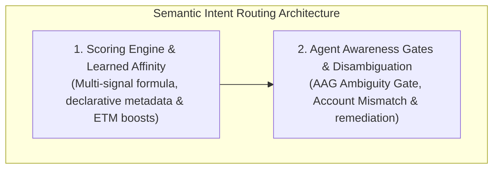

# Semantic Intent Routing & Agent Interaction Hub

When autonomous AI agents operate in complex multi-account environments, they frequently need to execute tasks against specific web identities: sending a customer notification from an administrative console, testing a checkout flow in a staging sandbox, or reading personal documentation.

If an agent hardcodes profile indices or navigates blindly, it risks catastrophic cross-account contamination: posting internal corporate data to personal feeds, or operating in unauthorized environments.

Nova AI Workspace provides **Semantic Intent Routing** backed by declarative metadata, multi-signal scoring formulas, learned domain affinities from Episodic Task Memory (ETM), and preemptive Agent Awareness Gates (AAG).

---

## Architectural Subsystems

Explore the dedicated architecture guides within this domain:

### 1. [Scoring Engine & Learned Affinity](scoring-engine-and-affinity/README.md)
* **Declarative Metadata:** Annotating sandboxes with `Purpose`, `Aliases`, `AccountLabel`, `DetectedAccountName`, `PreferredFor`, `StartUrl`, and `IsPaused`.
* **The Multi-Signal Scoring Formula:** Calculating normalized scores based on preferred intents, purpose classifications, service URL heuristics, alias matches, and runtime readiness.
* **Episodic Task Memory (ETM) Affinity:** How successfully executed workflows dynamically reinforce sandbox-domain associations using cryptographic persistent GUIDs.
* **Deterministic Tie-Breaking:** Resolving close scores and preventing ambiguous executions.

### 2. [Agent Awareness Gates & Disambiguation](agent-awareness-gates-and-disambiguation/README.md)
* **Preemptive Intervention:** Intercepting ambiguous or conflicting sandbox operations before tool dispatch.
* **The Four Safety Gates:** Low Confidence Gate ($S < 0.30$), Multi-Match Ambiguity Gate ($\Delta < 0.10$), Account Mismatch Gate, and Not-Ready / Paused Profile Gate.
* **Structured Remediation Envelopes:** Delivering structured `nextActions` and candidate rankings back to the agent for deterministic recovery.

---

## Related Documentation

* [Multi-Sandbox Session Isolation Master Hub](../README.md)
* [Profile Storage, Disk Anchors & Recovery](../profile-storage-and-disk-anchors/README.md)
* [WinUI 3 User Management & GUI Controls](../user-management/README.md)
* [MCP Governance & Security Boundaries](../mcp-governance/README.md)
* [Resolve Sandbox Tool Reference](../../../mcp-reference/tools/site-data-and-identity/nova-resolve-sandbox.md)
