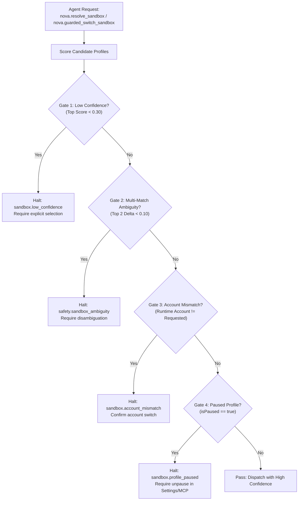

# Sandbox Agent Awareness Gates & Account Disambiguation

In multi-identity browser automation, executing actions against the wrong profile is a critical failure mode: corporate documents can be saved into personal drives, sensitive emails can be dispatched from wrong addresses, or test transactions can be submitted to production databases.

To prevent unguided models from guessing or defaulting to arbitrary sandboxes, Nova AI Workspace integrates four preemptive **Agent Awareness Gates (AAG)** directly into the sandbox resolution and tool dispatch pipeline.



---

## 1. The Four Sandbox Awareness Gates

### 1. Low Confidence Gate (`sandbox.low_confidence`)
* **Trigger Condition:** The highest scoring candidate profile achieves a score $S_{\text{top}} < 0.30$.
* **Failure Risk:** The agent is attempting to automate a service that has never been mapped to any sandbox, risking arbitrary default assignment.
* **System Action:** Rejects automatic resolution. Returns status `low_confidence` and prompts the agent to either supply an explicit `sandboxId` or configure new metadata.

### 2. Multi-Match Ambiguity Gate (`safety.sandbox_ambiguity`)
* **Trigger Condition:** Two or more candidate profiles achieve scores with a difference $\Delta < 0.10$ (e.g., Candidate A scores `0.72` and Candidate B scores `0.68`).
* **Failure Risk:** The agent has provided ambiguous hints that match both a personal and a corporate account (e.g., both named "Google Mail").
* **System Action:** Halts automatic routing. Emits structured diagnostic remediation listing the tied candidates and requiring explicit disambiguation.

### 3. Account Mismatch Gate (`sandbox.account_mismatch`)
* **Trigger Condition:** The agent specifies an explicit `accountHint` (e.g., `work`), but the candidate profile's active `DetectedAccountName` or verified cookie identity indicates an opposing identity (e.g., `personal@gmail.com`).
* **Failure Risk:** Operating in a contaminated session where the user switched accounts manually.
* **System Action:** Blocks the action until the agent or operator confirms that switching to this profile is intentional.

### 4. Paused Profile Gate (`sandbox.profile_paused`)
* **Trigger Condition:** The resolved sandbox is currently soft-hidden (`IsPaused = true`).
* **Failure Risk:** Interacting with a profile that the operator deliberately tucked away to reduce noise or avoid accidental modifications.
* **System Action:** Blocks navigation or activation until the profile is unpaused via [`nova.sandbox_update`](../../../../mcp-reference/tools/site-data-and-identity/nova-sandbox-update.md) or the WinUI SettingsView.

---

## 2. Structured Remediation Envelope

When an awareness gate halts an ambiguous resolution, Nova delivers structured guidance in the MCP response:

```json
{
  "status": "ambiguous",
  "reason": "safety.sandbox_ambiguity",
  "message": "Multiple sandboxes matched the intent 'email.compose' with near-identical confidence. Explicit selection required to prevent account bleed.",
  "candidates": [
    {
      "sandboxId": "A",
      "name": "Work Mail",
      "accountLabel": "Work",
      "score": 0.74,
      "detectedAccount": "admin@enterprise.corp"
    },
    {
      "sandboxId": "B",
      "name": "Personal Mail",
      "accountLabel": "Personal",
      "score": 0.71,
      "detectedAccount": "user@gmail.com"
    }
  ],
  "nextActions": [
    "Specify sandboxId='A' or sandboxId='B' explicitly in your next call",
    "Pass accountHint='Work' or accountHint='Personal' to disambiguate"
  ]
}
```

* **Zero Hallucination:** The agent receives exact candidates, their Short Letter IDs, and their detected accounts, eliminating the need to guess.
* **Safety Invariant:** Under no condition does Nova fall back to a random sandbox when an ambiguity gate is tripped.

---

## 3. Related Documentation

* [Semantic Intent Routing Overview](../README.md)
* [Scoring Engine & Learned Affinity](../scoring-engine-and-affinity/README.md)
* [Agent Awareness Gates (AAG) Subsystem](../../../agent-awareness-gates-aag/README.md)
* [Guarded Switch Sandbox Tool Reference](../../../../mcp-reference/tools/guarded-actions/nova-guarded-switch-sandbox.md)
