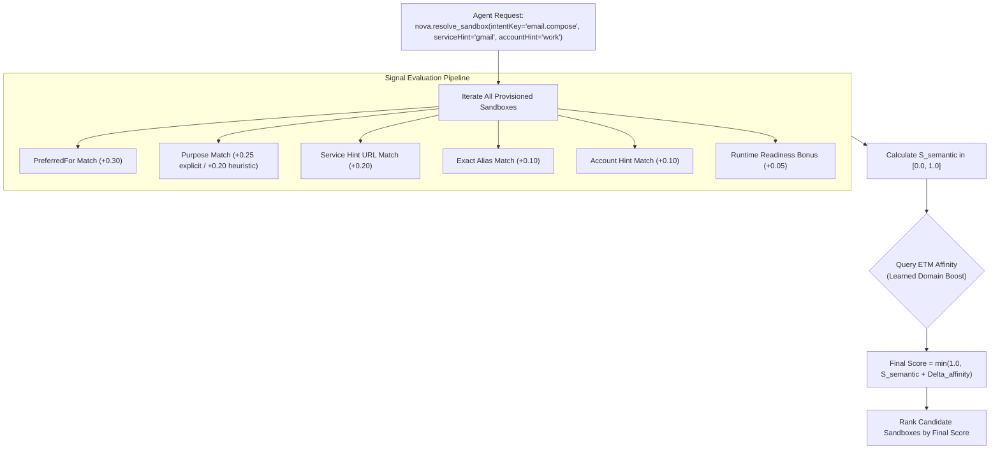
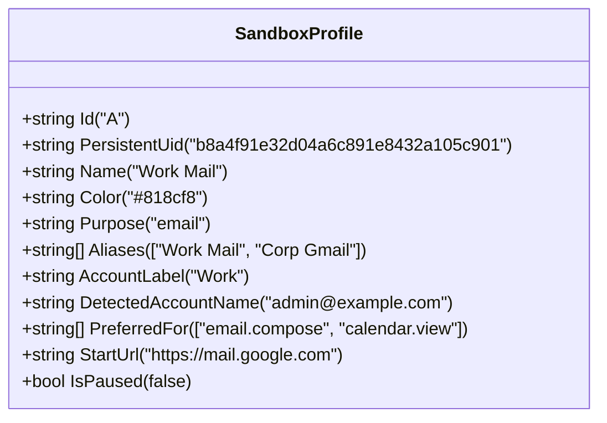

# Multi-Signal Intent Scoring & Learned Domain Affinity

Autonomous AI agents frequently interact with web platforms without knowing the precise internal identifier of the profile they need. Instead, agents express intent in natural language or high-level goals:
* *"Check the invoice inbox on our corporate Google Workspace."*
* *"Create a test user account in the staging environment."*
* *"Update repository permissions in the client GitHub organization."*

Nova AI Workspace provides a **Multi-Signal Intent Scoring Engine** ([`nova.resolve_sandbox`](../../../../mcp-reference/tools/site-data-and-identity/nova-resolve-sandbox.md)) that evaluates candidate profiles across seven semantic and behavioral signals, reinforced by learned domain affinities from [Episodic Task Memory (ETM)](../../../learning/episodic-task-memory-etm/README.md).



---

## 1. Declarative Sandbox Metadata

Operators and agents configure semantic descriptors on sandboxes to guide intent resolution:



### Metadata Attribute Specifications

| Attribute | Type | Role in Resolution | Example |
| :--- | :--- | :--- | :--- |
| **`Purpose`** | string | Primary functional domain category. | `"email"`, `"crm"`, `"code"`, `"chat"`, `"docs"` |
| **`Aliases`** | string array | Colloquial names, project nicknames, or brand identifiers. | `["Work Mail", "Corp Gmail", "Primary Inbox"]` |
| **`AccountLabel`** | string | Organizational boundary or user persona. | `"Work"`, `"Personal"`, `"Staging QA"`, `"Admin"` |
| **`DetectedAccountName`** | string | Runtime identity detected from active cookies or DOM elements. | `"john.doe@company.com"`, `"ops-admin"` |
| **`PreferredFor`** | string array | Explicit task intent keys permanently mapped to this profile. | `["email.compose", "email.read", "calendar.schedule"]` |
| **`StartUrl`** | string | Default navigation URL; evaluated against `serviceHint`. | `"https://mail.google.com"` |
| **`IsPaused`** | boolean | Soft-hidden status; paused profiles are demoted or gated. | `false` (active) / `true` (paused) |

---

## 2. The Multi-Signal Scoring Formula

Nova computes a normalized match score $S \in [0.0, 1.0]$ for each candidate profile:

$$S_{\text{semantic}} = w_{\text{preferred}} + w_{\text{purpose}} + w_{\text{service}} + w_{\text{alias}} + w_{\text{account}} + \text{Bonus}_{\text{readiness}}$$

$$S_{\text{final}} = \min\left(1.0, S_{\text{semantic}} + \Delta_{\text{affinity}}\right)$$

### Signal Weights and Criteria

1. **Preferred Intent Match ($w_{\text{preferred}} = 0.30$):**
   Awarded when the requested `intentKey` exactly matches an entry in the sandbox's `PreferredFor` array.
2. **Purpose Match ($w_{\text{purpose}} \in \{0.20, 0.25\}$):**
   * $+0.25$ if the sandbox's declared `Purpose` matches the primary category extracted from `intentKey`.
   * $+0.20$ if inferred from heuristic name matching.
3. **Service Hint Match ($w_{\text{service}} = 0.20$):**
   Awarded when the hostname in `StartUrl` contains the provided `serviceHint` (e.g., `serviceHint: "gmail"` matches `https://mail.google.com`).
4. **Alias Match ($w_{\text{alias}} = 0.10$):**
   Awarded when any entry in `Aliases` matches the service or account hint.
5. **Account Label Match ($w_{\text{account}} = 0.10$):**
   Awarded when `AccountLabel` or `DetectedAccountName` matches `accountHint`.
6. **Readiness Bonus ($\text{Bonus}_{\text{readiness}} \le 0.05$):**
   * $+0.03$ if the sandbox already has an active tab open to the relevant origin.
   * $+0.02$ if the WebView2 controller is fully initialized in memory.

---

## 3. Learned Domain Affinity via Episodic Task Memory (ETM)

When an agent successfully completes a task on a domain within a specific sandbox, Nova's [Episodic Task Memory (ETM)](../../../learning/episodic-task-memory-etm/README.md) records the correlation.

$$\Delta_{\text{affinity}} = \min\left(0.15, \frac{\text{SuccessfulCompletions}}{10}\right)$$

* **Persistent GUID Anchoring:** Affinities are anchored strictly to the sandbox's immutable `PersistentUid`, ensuring that recycling Short Letter IDs (`A`, `B`) does not inherit stale learned weights.
* **Failure Decay:** If an agent encounters authentication failures or errors on that domain within the sandbox, the affinity score is demoted automatically.

---

## 4. MCP Invocation Example

An agent calls [`nova.resolve_sandbox`](../../../../mcp-reference/tools/site-data-and-identity/nova-resolve-sandbox.md):

```json
{
  "name": "nova.resolve_sandbox",
  "arguments": {
    "intentKey": "email.compose",
    "serviceHint": "gmail",
    "accountHint": "work",
    "requireConfirmation": false
  }
}
```

### Result Schema

```json
{
  "status": "resolved",
  "sandboxId": "A",
  "name": "Work Mail",
  "confidence": 0.88,
  "matchReason": "PreferredFor matched 'email.compose'; StartUrl matched serviceHint 'gmail'; AccountLabel matched 'work'",
  "candidates": [
    {
      "sandboxId": "A",
      "name": "Work Mail",
      "score": 0.88,
      "isPaused": false
    },
    {
      "sandboxId": "B",
      "name": "Personal",
      "score": 0.23,
      "isPaused": false
    }
  ]
}
```

---

## 5. Related Documentation

* [Semantic Intent Routing Overview](../README.md)
* [Agent Awareness Gates & Disambiguation](../agent-awareness-gates-and-disambiguation/README.md)
* [Episodic Task Memory (ETM)](../../../learning/episodic-task-memory-etm/README.md)
* [Resolve Sandbox Tool Reference](../../../../mcp-reference/tools/site-data-and-identity/nova-resolve-sandbox.md)
