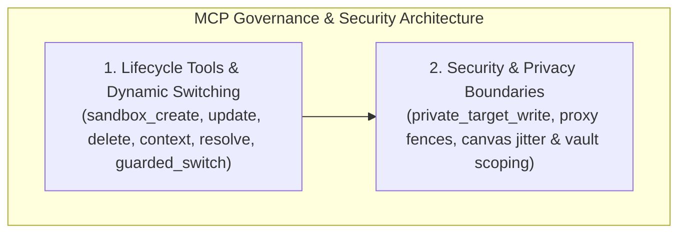

# Agent MCP Governance & Security Boundaries Hub

Autonomous AI agents interact with browser sandboxes through structured Model Context Protocol (MCP) tools. Because agents execute programmatic workflows without human micro-supervision, every sandbox operation must be bounded by strict security policies, privacy fences, and protocol-level invariants.

Nova AI Workspace provides a comprehensive MCP tool suite for profile provisioning, context inspection, and guarded switching, integrated with host-level privacy shielding and credential vault boundaries.

---

## Architectural Subsystems

Explore the dedicated architecture guides within this domain:

### 1. [Lifecycle Tools & Dynamic Switching](lifecycle-tools-and-switching/README.md)
* **Complete Tool Contracts:** Detailed parameter schemas, execution preconditions, and return structures for `nova.sandbox_create`, `nova.sandbox_update`, `nova.sandbox_delete`, `nova.sandbox_context`, `nova.resolve_sandbox`, and `nova.guarded_switch_sandbox`.
* **Dynamic Sandbox Switching:** How agents transition tab contexts across sandboxes without reloading or dropping network connections.
* **Context Probing:** Inspecting active cookies, storage size, and tab occupancy for a specific profile via `nova.sandbox_context`.

### 2. [Security & Privacy Boundaries](security-and-privacy-boundaries/README.md)
* **The `private_target_write` Barrier:** Unconditional rejection of persistent storage writes originating from InPrivate or temporary profiles.
* **Per-Sandbox Network Proxy Fencing:** Independent proxy disconnection toggles isolating specific profiles from global upstream SOCKS5/HTTP routing.
* **Canvas Jitter & Hardware Privacy:** Profile-scoped WebGL/Canvas noise injection and user-agent architecture protection.
* **Credential Vault Scoping:** Windows DPAPI-encrypted credential injection locked strictly to the requesting sandbox profile.

---

## Related Documentation

* [Multi-Sandbox Session Isolation Master Hub](../README.md)
* [Profile Storage, Disk Anchors & Recovery](../profile-storage-and-disk-anchors/README.md)
* [Semantic Intent Routing](../intent-routing/README.md)
* [WinUI 3 User Management & GUI Controls](../user-management/README.md)
* [Agent Awareness Gates (AAG)](../../agent-awareness-gates-aag/README.md)
