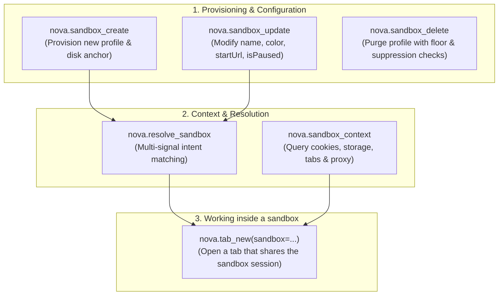
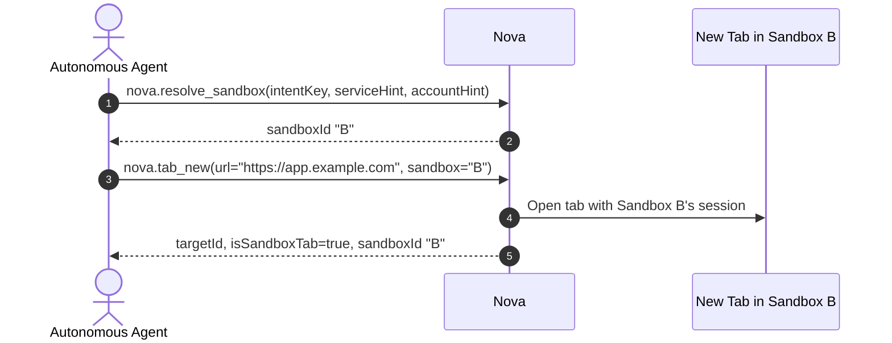

# Sandbox Lifecycle Tools & Dynamic Context Switching

Autonomous agents manage browser identities programmatically through the `sandboxes` and `guarded_actions` capability bundles. These tools enable agents to provision temporary or persistent profiles, update metadata, inspect a sandbox, and open tabs inside the sandbox a task belongs to.

The core MCP tools for sandbox lifecycles:



---

## 1. Tool Specifications

### 1. `nova.sandbox_create`
Provisions a new sandbox profile with an indestructible disk anchor:

```json
{
  "name": "nova.sandbox_create",
  "arguments": {
    "name": "Client Billing QA",
    "color": "#10b981",
    "startUrl": "https://billing.client.example.com",
    "purpose": "crm",
    "accountLabel": "Staging QA"
  }
}
```

* **Capacity Enforcement:** Fails with an error if the total sandbox count reaches `MaxSandboxes = 100`.
* **Short Letter ID Assignment:** Automatically assigns the next available Short Letter ID (`A` through `Z`, or `S1` through `S100`).
* **Cryptographic UID:** Mints a fresh 32-character hexadecimal GUID and stages `.sandbox-meta.json` atomically.

### 2. `nova.sandbox_update`
Updates view-state, metadata, or paused status of an existing sandbox:

```json
{
  "name": "nova.sandbox_update",
  "arguments": {
    "sandboxId": "B",
    "name": "Staging Admin (Updated)",
    "isPaused": false,
    "purpose": "admin"
  }
}
```

### 3. `nova.sandbox_delete`
Permanently purges a sandbox profile and its physical storage directory:

```json
{
  "name": "nova.sandbox_delete",
  "arguments": {
    "sandboxId": "B",
    "confirm": true
  }
}
```

* **Mandatory Confirmation:** Requires `confirm: true` to prevent accidental deletion.
* **Floor Invariant Check:** Refuses to delete the final remaining sandbox profile.
* **No resurrection:** A deleted sandbox is not restored by Nova's automatic sandbox recovery.

### 4. `nova.sandbox_context`
Returns the runtime status, open tab counts, proxy states, and storage footprint of a sandbox:

```json
{
  "name": "nova.sandbox_context",
  "arguments": {
    "sandboxId": "A"
  }
}
```

**Diagnostic Response:**
```json
{
  "sandboxId": "A",
  "persistentUid": "b8a4f91e32d04a6c891e8432a105c901",
  "name": "Work Mail",
  "color": "#818cf8",
  "startUrl": "https://mail.google.com",
  "isPaused": false,
  "proxy": {
    "isDisconnected": false,
    "effectiveProxy": "socks5://127.0.0.1:1080"
  },
  "openTabs": 3,
  "claimedTabCount": 1,
  "storageUsageBytes": 42105820
}
```

---

## 2. Moving Work into Another Sandbox

Nova has no tool that moves a running tab from one sandbox to another: a sandbox's cookies and sessions stay with its own tabs. To continue a task in another sandbox, pick the sandbox and open a tab there:



`nova.guarded_switch_sandbox` is something else: it clicks a workspace or account switcher **inside a web application** and verifies that the page's workspace changed. It does not change Nova's sandboxes. See [`nova.guarded_switch_sandbox`](../../../../mcp-reference/tools/guarded-actions/nova-guarded-switch-sandbox.md).

---

## 3. Related Documentation

* [MCP Governance Overview](../README.md)
* [Security & Privacy Boundaries](../security-and-privacy-boundaries/README.md)
* [Intent Scoring & Learned Affinity](../../intent-routing/scoring-engine-and-affinity/README.md)
* [Sandbox Tool Catalog Reference](../../../../mcp-reference/tools/site-data-and-identity/README.md)
