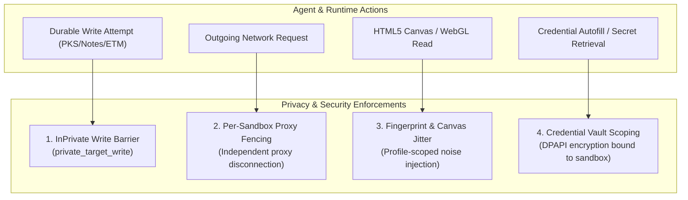
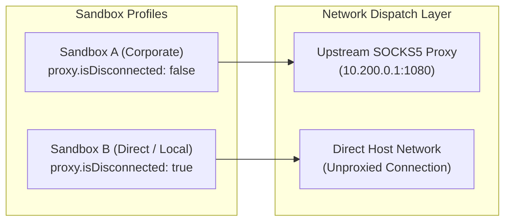

# Sandbox Security, Privacy & Isolation Boundaries

Multi-sandbox browsing must guarantee that privacy and security boundaries are enforced not merely at the user interface, but at the deep protocol, network, and storage layers. An autonomous agent or malicious script in one sandbox must never be able to exfiltrate cookies, read saved credentials, leak network routes, or cross-contaminate knowledge stores.

Nova AI Workspace enforces four immutable security and privacy boundaries across all sandbox profiles:

---

## 1. The `private_target_write` Barrier

Nova guarantees that temporary or InPrivate sessions never commit durable data to disk:

* **Unconditional Enforcement:** 22+ persistent storage tools—including PKS knowledge storage (`nova.pks_upsert`), Domain Notes (`nova.domain_note`), Operator Notes (`nova.operator_notes_store`), and Episodic Task Memory—reject any write originating from an InPrivate tab.
* **Fail-Closed Architecture:** If an agent attempts to persist learned selectors, operational notes, or task histories from a private browsing session, the call is rejected immediately with error `private_target_write`.
* **Zero Disk Leakage:** Ephemeral session artifacts are completely destroyed when the tab is closed.

---

## 2. Per-Sandbox Proxy Fencing

While global upstream proxy configuration (SOCKS5/HTTP) is maintained host-wide, Nova provides per-sandbox network isolation:

* **Selective Bypass:** Operators can disconnect individual sandboxes from the corporate proxy for local testing or high-bandwidth streaming without exposing other profiles to direct traffic.
* **DNS Leak Shielding:** Centralized host socket binding ensures that DNS requests honor proxy configurations without leaking queries across local network interfaces.

---

## 3. Fingerprint & Canvas Jitter Protection

Modern tracking vendors employ browser fingerprinting techniques (measuring micro-differences in HTML5 Canvas 2D rendering, WebGL shader execution, and AudioContext frequencies) to correlate user identities across different browser profiles.

Nova injects subtle, profile-scoped mathematical noise (canvas jitter) into graphic rendering APIs:

$$\text{PixelValue}_{\text{jittered}} = \text{PixelValue} + \mathcal{N}\left(0, \sigma^2_{\text{sandbox}}\right)$$

* **Profile-Bound Seed:** The pseudo-random noise generator is seeded strictly from the sandbox's immutable `PersistentUid`.
* **Cross-Profile Incoherence:** Running identical canvas fingerprinting scripts in Sandbox A and Sandbox B yields mathematically distinct fingerprint hashes, preventing tracking networks from linking the two identities.

---

## 4. Credential Vault Scoping

Nova integrates with the Windows Data Protection API (DPAPI) to encrypt and manage stored credentials:

* **Scoped Vault Partitions:** Saved usernames, passwords, and API bearer tokens are encrypted on disk and mapped strictly to specific sandbox profiles.
* **Zero Cross-Profile Autofill:** When [`nova.vault_get`](../../../../mcp-reference/tools/vault-and-security/nova-vault-get.md) or [`nova.vault_prepare_fill`](../../../../mcp-reference/tools/vault-and-security/nova-vault-prepare-fill.md) is invoked, Nova verifies that the requested credential belongs to the active sandbox context. Sandbox B is strictly blocked from requesting or injecting passwords saved in Sandbox A.

---

## 5. Related Documentation

* [MCP Governance Overview](../README.md)
* [Lifecycle Tools & Dynamic Switching](../lifecycle-tools-and-switching/README.md)
* [Agent Awareness Gates (AAG)](../../../agent-awareness-gates-aag/README.md)
* [Privacy & Fingerprint Protection Architecture](../../../privacy/README.md)
* [Password Vault & DPAPI Credentials](../../../privacy/vault-and-secrets/README.md)
