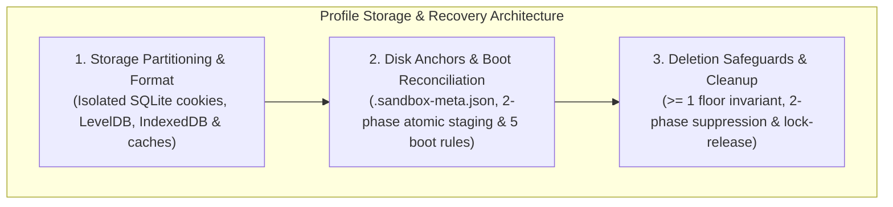

# Profile Storage, Disk Anchors & Recovery Hub

In multi-identity browser automation, storage loss is identity loss. When human operators and autonomous agents manage corporate accounts, personal workspaces, and staging environments simultaneously, browser sessions represent active authentication trust, cryptographic keys, and uncommitted drafts.

Nova AI Workspace guarantees that sessions survive configuration corruption, process crashes, and unexpected power outages through an **Indestructible Disk Anchor** architecture backed by partitioned Microsoft Edge WebView2 profile hierarchies.

---

## Architectural Subsystems

Explore the dedicated architecture guides within this domain:

### 1. [Storage Partitioning & WebView2 Hierarchy](storage-partitioning-and-format/README.md)
* **Physical Directory Layout:** Structure of `%LOCALAPPDATA%\nova-cognitive\Nova\UserData\Shared\EBWebView\WV2Profile_<persistentUid>\`.
* **State Store Isolation:** Per-profile SQLite cookie databases (`Network\Cookies`), LevelDB key-value stores (`Local Storage\leveldb`), origin-partitioned IndexedDB directories, HTTP network disk caches, and V8 compiled bytecode caches (`Code Cache\js\`).
* **Isolated vs. Shared Stack:** What is partitioned per sandbox (cookies, storage, cache, service workers, file handles) versus what is shared across the browser process tree (GPU process, network utility process, socket bindings, global User-Agent).

### 2. [Indestructible Disk Anchors & Boot Reconciliation](disk-anchors-and-reconciliation/README.md)
* **Dual-Truth Persistence:** Disk anchors own immutable identity (`Id`, `PersistentUid`, `CreatedAtUtc`), while `settings.json` owns mutable view-state (`Name`, `Color`, `StartUrl`, `IsPaused`).
* **Anchor Schema & Atomic Staging:** The `.sandbox-meta.json` Schema v1, two-phase atomic file staging (`.tmp` write $\rightarrow$ buffer flush $\rightarrow$ atomic rename), and power-loss crash safety.
* **The Five Boot Reconciliation Rules:** Rule 1 (Identity-Merge), Rule 2 (Catastrophic Empty Restore), Rule 3 (Auto-Reattach), Rule 4 (Orphan Routing), and Rule 5 (Anchor Backfill).
* **Interactive Recovery Dialog:** Modal resolution of disk-only profiles and Short Letter ID collisions.

### 3. [Deletion Safeguards & Cleanup Choreography](deletion-safeguards-and-cleanup/README.md)
* **Minimum Floor Invariant:** Enforcing $\ge 1$ active sandbox at all times; hard-blocking accidental or automated deletion of the final remaining profile.
* **Two-Phase Suppression Lists:** Protecting the crash-window gap between `settings.json` mutation and physical disk purging via `SuppressedRecoveryAnchorUids`.
* **Delayed Lock Release & Background Purge:** WebView2 process disposal (`DeactivateSandboxTargetAsync`), OS file handle unlocking, and non-blocking background folder removal.

---

## Related Documentation

* [Multi-Sandbox Session Isolation Master Hub](../README.md)
* [Semantic Intent Routing](../intent-routing/README.md)
* [WinUI 3 User Management & GUI Controls](../user-management/README.md)
* [MCP Governance & Security Boundaries](../mcp-governance/README.md)
