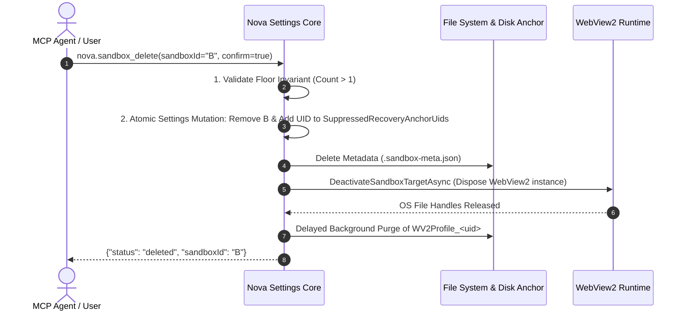
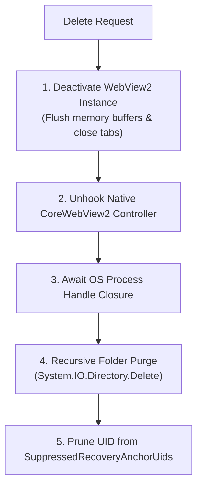

# Sandbox Deletion Safeguards & Cleanup Choreography

Deleting a sandbox profile is an irreversible, destructive operation. In an autonomous browser environment where AI agents and human operators interact concurrently, profile deletion must be protected against race conditions, accidental self-termination, operating system file locks, and crash windows.

Nova AI Workspace enforces a rigorous three-stage deletion choreography backed by atomic settings mutations and delayed directory purging.



---

## 1. The Minimum Floor Invariant ($\ge 1$ Sandbox)

Nova strictly mandates that the browser must always contain at least one valid sandbox profile at all times:

$$\text{ActiveSandboxCount} \ge 1$$

* **Pre-Flight Validation:** If an agent or human operator attempts to delete the last active sandbox, Nova rejects the operation immediately with an error before initiating any mutations.
* **Concurrency Lock Guard:** The minimum count check is evaluated again inside the exclusive settings mutation lock, preventing race conditions where two concurrent requests might attempt to delete the final two sandboxes simultaneously.
* **UI Defense:** In the WinUI 3 interface, the "Delete Sandbox" context option is disabled whenever only one sandbox exists.

---

## 2. Two-Phase Suppression List (`SuppressedRecoveryAnchorUids`)

In real-world environments, operating system crashes, power cuts, or process terminations can occur at any millisecond during profile deletion.

### The Crash-Window Vulnerability
1. An agent requests profile deletion.
2. Nova removes the sandbox from `settings.json`.
3. Before the physical multi-gigabyte profile folder (`WV2Profile_<uid>`) can be purged from disk, power is lost.
4. On the next startup, the [Boot Reconciliation Engine](../disk-anchors-and-reconciliation/README.md) scans the disk, encounters the unreferenced profile folder, and assumes it was orphaned by accident—prompting the user with a confusing recovery dialog.

### The Nova Shield
Nova eliminates this vulnerability by registering the sandbox's `PersistentUid` in `SuppressedRecoveryAnchorUids` within `settings.json` *during the same atomic write transaction* that removes the profile from the active list:

```json
{
  "sandboxes": [
    { "id": "A", "persistentUid": "b8a4f91e32d04a6c891e8432a105c901", "name": "Primary" }
  ],
  "suppressedRecoveryAnchorUids": [
    "7c12e0fa98234bb5a3411e779a55dc09"
  ]
}
```

* When the boot reconciliation engine scans `EBWebView` during subsequent startups, any profile whose UID is present in `SuppressedRecoveryAnchorUids` is recognized as an intentionally deleted sandbox.
* The folder is purged silently in the background without triggering false-alarm recovery prompts.

---

## 3. Delayed Lock Release & Background Purge

Chromium and Microsoft Edge WebView2 hold open file locks on SQLite databases (`Network\Cookies`), LevelDB journals, and disk cache blocks while the browser process is running.

Attempting to delete the profile directory synchronously while WebView2 holds active handles results in an operating system file sharing violation (`ERROR_SHARING_VIOLATION` / Win32 error code `0x20`):



1. **Deactivation (`DeactivateSandboxTargetAsync`):** Nova instructs WebView2 to flush in-memory storage buffers, unhook navigation listeners, and close all active tab targets bound to that profile.
2. **Handle Release Awaiting:** The runtime yields execution, allowing the underlying Chromium utility processes to terminate their database connections and release file handles.
3. **Recursive Directory Purge:** The directory `WV2Profile_<persistentUid>` is deleted recursively in a background task, preventing UI thread freezes on large cache stores.
4. **Suppression List Pruning:** Once the folder is confirmed removed from disk, the UID can be safely pruned from `SuppressedRecoveryAnchorUids`.

---

## 4. Related Documentation

* [Profile Storage, Disk Anchors & Recovery Overview](../README.md)
* [Storage Partitioning & Format](../storage-partitioning-and-format/README.md)
* [Indestructible Disk Anchors & Boot Reconciliation](../disk-anchors-and-reconciliation/README.md)
* [Sandbox Delete Tool Reference](../../../../mcp-reference/tools/site-data-and-identity/nova-sandbox-delete.md)
