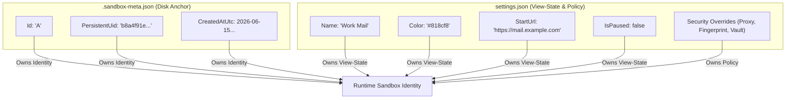
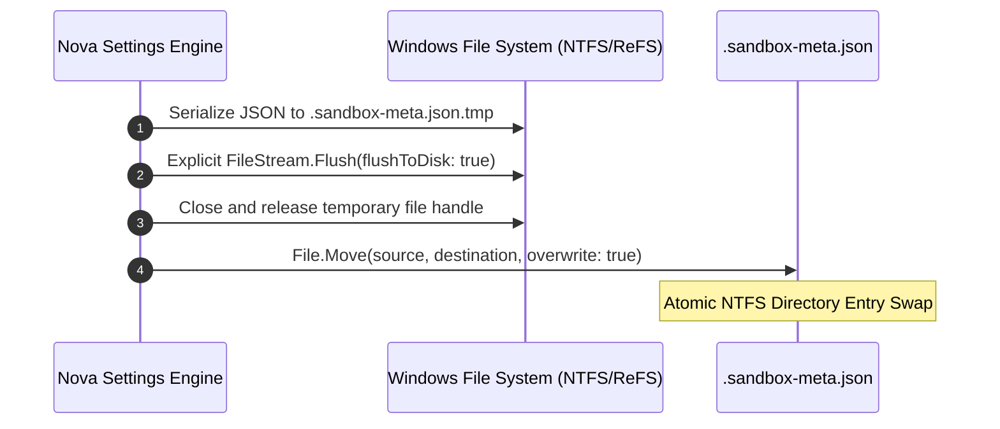
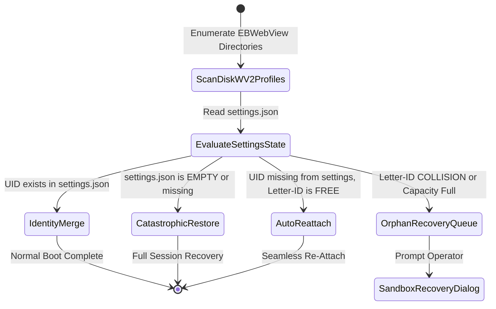

# Indestructible Disk Anchors & Boot-Time Reconciliation

Traditional web automation frameworks and browser wrappers treat a single configuration file (`settings.json`) as the sole source of truth. If that file is corrupted during an OS crash, deleted by an aggressive cleanup tool, or modified incorrectly by an external script, all profile directories on disk are orphaned. The user's active accounts, authentication tokens, and tab histories become inaccessible.

Nova AI Workspace solves this with **Self-Describing Disk Anchors** (`.sandbox-meta.json`), **Two-Phase Atomic Staging**, and **Automated Boot Reconciliation**.



---

## 1. Disk Anchor Schema (Version 1)

Every sandbox profile directory contains a `.sandbox-meta.json` file located at its root:

```json
{
  "schemaVersion": 1,
  "id": "A",
  "persistentUid": "b8a4f91e32d04a6c891e8432a105c901",
  "name": "Work Mail",
  "color": "#818cf8",
  "startUrl": "https://mail.example.com",
  "createdAtUtc": "2026-06-15T08:30:00.0000000Z"
}
```

### Field Definitions

* **`schemaVersion` (integer):** Metadata format version (currently `1`). Incremented additively for future extensions. Unknown fields are safely ignored by Nova's JSON parser.
* **`id` (string):** The assigned Short Letter ID at creation time (`A` through `Z`, or `S1` through `S100`).
* **`persistentUid` (string):** The immutable 32-character hexadecimal GUID.
* **`name` (string):** Descriptive display name assigned at creation.
* **`color` (string):** Accent hex color code assigned at creation (e.g., `#818cf8`).
* **`startUrl` (string, optional):** Default entry point URL.
* **`createdAtUtc` (string, ISO 8601):** Exact UTC timestamp when the sandbox was provisioned.

---

## 2. Two-Phase Atomic Staging Algorithm

To eliminate partial-file corruption during unexpected power outages or operating system crashes, Nova writes disk anchors using a two-phase atomic file staging pattern:



1. **Stage to Temporary File:** Metadata is serialized to `.sandbox-meta.json.tmp` in the target profile directory.
2. **Buffer Flush:** The underlying `FileStream` is explicitly flushed (`flushToDisk: true`) and closed to ensure all bytes are committed to the filesystem journal.
3. **Atomic Replace:** Nova calls `File.Move(source, destination, overwrite: true)`.
4. **Crash Safety Guarantee:** Because filesystem directory entries are swapped atomically by the Windows kernel, any reading process will observe either the complete previous anchor or the complete new anchor. A partially written or corrupt file is physically impossible.

---

## 3. Boot-Time Identity Reconciliation (`SandboxDiskRehydration`)

During application startup, Nova executes an automated reconciliation sweep across disk profiles before initializing the main UI:



### The Five Boot Reconciliation Rules

Discovered disk anchors are evaluated chronologically by `CreatedAtUtc`, then ordinally by `Id`:

1. **Rule 1: Identity-Merge (Normal Boot):**
   * For every sandbox in `settings.json` whose `PersistentUid` matches an on-disk anchor, Nova merges the records.
   * The disk anchor owns `Id` and `CreatedAtUtc` (guaranteeing that identity never drifts).
   * `settings.json` owns `Name`, `Color`, `StartUrl`, and `IsPaused` (preserving user customization).
2. **Rule 2: Catastrophic Empty Restore:**
   * If `settings.json` was deleted, corrupted, or contains an empty sandbox list, Nova automatically scans `EBWebView` for all surviving `.sandbox-meta.json` anchors.
   * All valid anchors (up to `MaxSandboxes = 100`) are re-attached to the active configuration.
   * UIDs registered in `SuppressedRecoveryAnchorUids` (intentionally deleted profiles) are skipped silently.
   * Active accounts, cookies, and tabs return immediately without data loss.
3. **Rule 3: Auto-Reattach (Seamless Recovery):**
   * If an on-disk anchor's `PersistentUid` is absent from `settings.json` (e.g., due to an interrupted file write or manual configuration edits), AND:
     * The profile was not deleted (UID is not in suppression lists), AND
     * The anchor's original Short Letter ID is currently **free** in `settings.json`, AND
     * The system is below the 100-sandbox limit:
   * Nova re-attaches the sandbox to the active UI automatically. Active logins and cookies remain seamlessly accessible.
4. **Rule 4: Orphan Anchor Routing:**
   * If an unlisted disk anchor's Short Letter ID is already occupied by a different sandbox, or if the maximum sandbox limit is reached:
   * Nova does **not** silently overwrite the occupying sandbox.
   * Instead, the unattached profile is classified as a *Disk-Only Profile* and routed to the **Sandbox Recovery Dialog** for operator confirmation.
5. **Rule 5: Anchor Backfill:**
   * If `settings.json` lists a valid sandbox that lacks a `.sandbox-meta.json` file on disk (e.g., after manual profile directory copying), Nova automatically writes the missing anchor during boot to ensure future recovery resilience.

---

## 4. The Interactive Sandbox Recovery Dialog

When unattached disk-only profiles with conflicting IDs or leftover data are detected, Nova presents a non-blocking modal dialog on startup (`SandboxRecoveryDialog`):

```
┌─────────────────────────────────────────────────────────────────┐
│  Recover sandbox profiles                                       │
│  These sandbox profiles exist on disk but are not active.       │
│  Pick an action for each entry.                                 │
├─────────────────────────────────────────────────────────────────┤
│  [A] Work Mail (WV2Profile_b8a4f91e...)                         │
│      Created: 2026-06-15 · Cookies and logins present           │
│      Action: [ Restore (Assign next free ID: C)             ▼ ] │
│                                                                 │
│  [B] Deprecated QA Test (WV2Profile_7c12e0fa...)                │
│      Created: 2026-04-10 · Storage: 45 MB                       │
│      Action: [ Delete Permanently                           ▼ ] │
├─────────────────────────────────────────────────────────────────┤
│                                 [ Apply Decisions ] [ Leave ]   │
└─────────────────────────────────────────────────────────────────┘
```

### Operator Decision Matrix

| Action | Technical Operation | Impact on Data |
| :--- | :--- | :--- |
| **Restore This** | Re-registers the profile in `settings.json` and assigns the next available Short Letter ID (`NextSandboxId`). | All existing cookies, saved logins, and web storage are immediately re-mounted and available in the browser chrome. |
| **Delete Permanently** | Adds the UID to `SuppressedRecoveryAnchorUids` and securely purges the profile directory from disk. | Profile directory and all authentication tokens are permanently removed from the system. |
| **Leave For Now** | Leaves the profile files untouched on disk without modifying `settings.json`. Suppresses recovery prompts for the active session. | No files are altered. The profile can be restored or purged during a future application session. |

---

## 5. Related Documentation

* [Profile Storage, Disk Anchors & Recovery Overview](../README.md)
* [Storage Partitioning & Format](../storage-partitioning-and-format/README.md)
* [Deletion Safeguards & Cleanup Choreography](../deletion-safeguards-and-cleanup/README.md)
* [Native Dialogs & UI Prompts](../../../native-dialogs-and-prompts/README.md)
