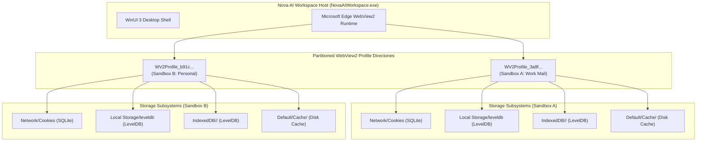
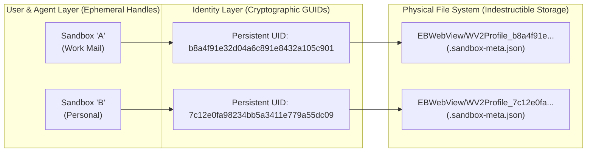
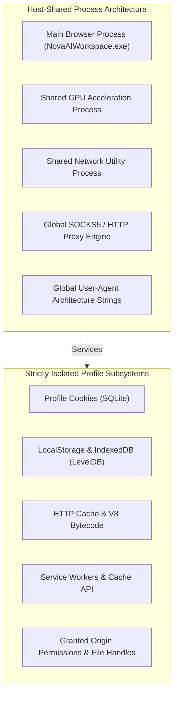

# WebView2 Storage Partitioning & Physical Directory Layout

Modern web applications store authentication tokens, session identifiers, and user state across multiple distinct storage engines provided by the Chromium web platform. In multi-account enterprise browsing, accidental leakage across accounts can lead to privilege escalation, session contamination, or leaked credentials.

Nova AI Workspace guarantees strict state partitioning by isolating Microsoft Edge WebView2 browser profiles under dedicated physical disk hierarchies.



---

## 1. Physical Directory Hierarchy

All sandbox profiles live within the operator's local application data directory:

```
%LOCALAPPDATA%\nova-cognitive\Nova\
  ├── settings.json                                 # View-state, preferences, overrides & suppression lists
  └── UserData\
        └── Shared\
              └── EBWebView\
                    ├── Crashpad\                   # Shared crash reporting and mini-dumps
                    ├── WV2Profile_<persistentUid-A>\  # Dedicated profile directory for Sandbox A
                    │     ├── .sandbox-meta.json        # Indestructible disk anchor
                    │     ├── Network\
                    │     │     └── Cookies            # Isolated SQLite cookie jar
                    │     ├── Local Storage\
                    │     │     └── leveldb\           # LevelDB key-value store (localStorage)
                    │     ├── Session Storage\         # Ephemeral tab session storage
                    │     ├── IndexedDB\               # Origin-partitioned application databases
                    │     │     └── https_mail.example.com_0.indexeddb.leveldb\
                    │     └── Default\
                    │           ├── Cache\             # HTTP network disk cache
                    │           └── Code Cache\js\     # V8 compiled bytecode cache
                    └── WV2Profile_<persistentUid-B>\  # Dedicated profile directory for Sandbox B
                          ├── .sandbox-meta.json        # Indestructible disk anchor
                          └── ...
```

> [!NOTE]
> Installations upgraded from preview releases may retain `%LOCALAPPDATA%\NovaBrowser\` as their profile root. Nova's path resolver automatically detects legacy directory layouts and preserves full backward compatibility.

---

## 2. Ephemeral Short Letters vs. Immutable Persistent UIDs

Nova decouples user-facing UI handles from physical filesystem directories:



### Identification Contracts
1. **Short Letter ID (`A` through `Z`, then `S1` through `S100`):**
   * Ephemeral UI and command handles used in tabs, window title bar pills, and MCP tool parameters (`sandboxId="A"`).
   * **Recyclable:** When Sandbox B is deleted, its Short Letter ID is returned to the pool and can be assigned to the next created profile.
2. **Persistent UID (`32-character hexadecimal GUID`):**
   * Globally unique, cryptographically random identifier minted exactly once when the profile is created (e.g., `b8a4f91e32d04a6c891e8432a105c901`).
   * Physical filesystem directories are named `WV2Profile_<persistentUid>`.
   * **Never Recycled:** Even after profile deletion, the UID is permanently retired.
3. **Knowledge Store Binding:**
   * Auxiliary intelligence engines—including Domain Notes, Operator Notes, and Episodic Task Memory (ETM)—anchor their data records strictly to `PersistentUid`.
   * Binding notes to the persistent UID guarantees that recycling Short Letter IDs never causes historical notes, cookies, or learned task affinities to bleed between unrelated accounts.

---

## 3. Storage Partitioning Matrix

Nova enforces strict physical and logical boundaries across every browser storage mechanism:

| Storage Engine | Storage Format | On-Disk Path | Partitioning Policy |
| :--- | :--- | :--- | :--- |
| **HTTP Cookies** | SQLite Database | `Network\Cookies` | **Strictly Isolated.** SQLite file locked to profile. Tables (`cookies`) store encrypted tokens. Zero leakage across profiles. |
| **Local Storage** | LevelDB Key-Value | `Local Storage\leveldb\` | **Strictly Isolated.** Origins partitioned per directory. Writes in Sandbox A cannot be observed or modified by Sandbox B. |
| **Session Storage** | Chromium Memory/Disk | `Session Storage\` | **Strictly Isolated.** Scoped to individual tab contexts within the sandbox profile. |
| **IndexedDB** | LevelDB Databases | `IndexedDB\<origin>.indexeddb.leveldb\` | **Strictly Isolated.** Offline databases, blobs, and object stores strictly partitioned by origin within the profile. |
| **Service Workers & Cache API** | LevelDB & Storage Keys | `Service Worker\` | **Strictly Isolated.** Service worker scripts, background push registrations, and Cache API stores are isolated. |
| **HTTP Network Cache** | Block-based Disk Cache | `Default\Cache\` | **Strictly Isolated.** Cached resources, images, scripts, and bytecode caches (`Code Cache\js\`) are profile-scoped. |
| **File System Access API** | Origin Handle Permissions | Chromium State Store | **Strictly Isolated.** Granted directory and file permissions are scoped strictly to the profile. |

---

## 4. Isolated Profile vs. Shared Process Stack

To optimize host memory and CPU utilization, Nova shares the underlying Chromium process tree while maintaining strict data isolation:



* **Shared Process Infrastructure:** A single GPU process and network utility process serve all active profiles. This reduces RAM overhead from ~400 MB per window (typical of multi-process architectures) down to **~80–120 MB per active profile**.
* **Shared Network Stack with Scoped Overrides:** The global upstream proxy configuration and DNS leak prevention are centrally managed. Individual sandboxes can opt out via local disconnect toggles without reconfiguring the host network.
* **Isolated Data Plane:** JavaScript running in Sandbox A cannot access cookies, storage, or cache entries in Sandbox B under any condition.

---

## 5. Related Documentation

* [Profile Storage, Disk Anchors & Recovery Overview](../README.md)
* [Indestructible Disk Anchors & Boot Reconciliation](../disk-anchors-and-reconciliation/README.md)
* [Deletion Safeguards & Cleanup Choreography](../deletion-safeguards-and-cleanup/README.md)
* [Site Data Management](../../../site-data-management/README.md)
