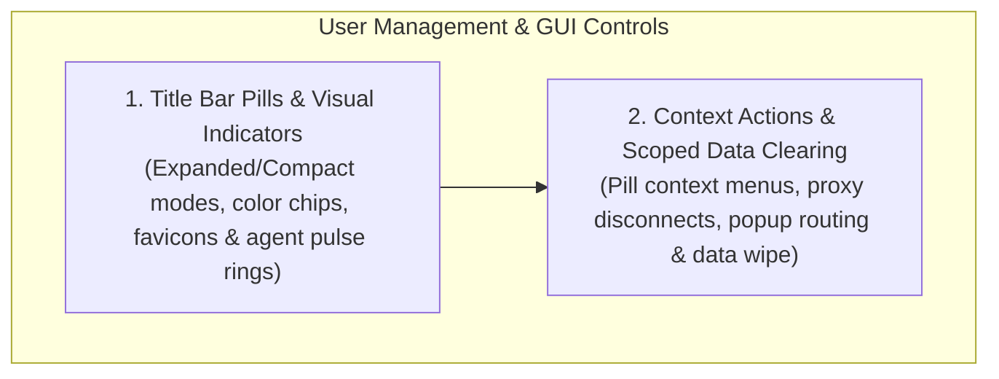

# WinUI 3 User Management & GUI Controls Hub

Power without visibility is chaos: human operators must always know at a glance which account is active, who is recording, and where agents are working.

Nova AI Workspace provides a rich WinUI 3 desktop experience engineered for transparent multi-identity browsing. Operators can seamlessly switch profiles, customize visual identity markers, monitor real-time hardware recording indicators, manage per-sandbox proxy overrides, and execute targeted storage clearing without affecting other sessions.

---

## Architectural Subsystems

Explore the dedicated architecture guides within this domain:

### 1. [Title Bar Pills & Visual Indicator System](title-bar-pills-and-indicators/README.md)
* **Title Bar Pill Strip:** Seamless integration of active sandboxes directly into the Windows title bar and tab strip.
* **Responsive Layout Engine:** Dynamic transitions between **Expanded Mode** (full labels, badges, indicators) and **Compact Mode** (Short Letter IDs, space-saving footprints) based on title bar width.
* **Marker Badges:** Circular accent color chips, dynamic high-resolution site favicons, and the animated **Agent Activity Pulse Ring** indicating active MCP tab claims.
* **Hardware Recording Indicators:** Automatic SVG camera and microphone badges alerting operators whenever an active tab utilizes media capture devices.
* **The Sandbox Overview Flyout:** High-density grid overview handling overflow scenarios when many sandboxes are active concurrently.

### 2. [Context Actions & Scoped Data Clearing](context-actions-and-data-clearing/README.md)
* **Right-Click Context Flyout:** On-demand operations: Release Agent (`nova.tab_release`), Proxy Disconnect toggles, Marker customization, and Popup Tab routing.
* **Soft-Hiding Profiles:** Toggling `IsPaused` to hide inactive sandboxes from the active toolbar without purging storage.
* **Granular Scoped Data Clearing:** The `SandboxDataClearDialog` enabling operators to clear cookies, local storage, indexeddb, or cache stores for a single sandbox while leaving all other profiles completely untouched.
* **Detour Host Whitelisting:** Routing external OAuth and SSO authentication popups back to the originating sandbox.

---

## Related Documentation

* [Multi-Sandbox Session Isolation Master Hub](../README.md)
* [Profile Storage, Disk Anchors & Recovery](../profile-storage-and-disk-anchors/README.md)
* [Semantic Intent Routing](../intent-routing/README.md)
* [MCP Governance & Security Boundaries](../mcp-governance/README.md)
* [Site Data Management](../../site-data-management/README.md)
