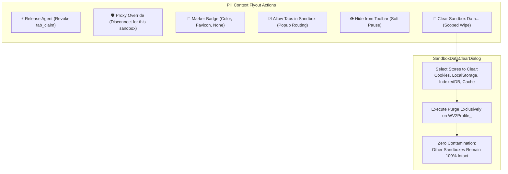
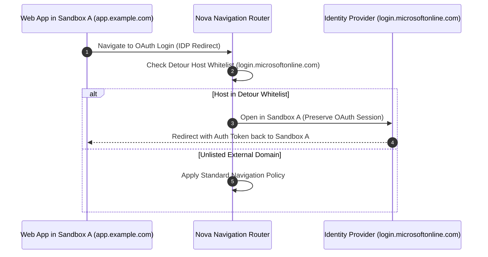

# Sandbox Context Actions, Data Clearing & Detour Whitelisting

Managing multiple identities requires granular operational control. Operators must be able to revoke runaway agent leases, override network proxies per sandbox, toggle visual markers, and purge stale login cookies without disturbing authentication sessions in other profiles.

Nova AI Workspace provides right-click context menus, selective storage clearing dialogs (`SandboxDataClearDialog`), and Detour Host whitelisting.



---

## 1. Sandbox Pill Context Menu Flyout

Right-clicking any sandbox pill in the title bar opens a dedicated context management flyout:

```
┌────────────────────────────────────────────────────────┐
│  Sandbox A (Work Mail)                                 │
├────────────────────────────────────────────────────────┤
│  ⚡ Release agent                                       │
│  🛡️ Proxy                                             ▶│
│     ├── Disconnect proxy for this sandbox (direct)     │
│     └── Open proxy settings...                         │
│  🎨 Mark                                              ▶│
│     ├── ( ) None                                       │
│     ├── (•) Colour                                     │
│     └── ( ) Site icon (favicon)                        │
│  ☑ Allow tabs in this sandbox                          │
│  👁️ Hide from toolbar                                  │
├────────────────────────────────────────────────────────┤
│  🧹 Clear sandbox data...                              │
└────────────────────────────────────────────────────────┘
```

### Context Actions Breakdown

* **⚡ Release Agent:** Appears whenever an autonomous agent holds an active tab claim (`nova.tab_claim`). Clicking immediately revokes the lease, returning control to the human operator.
* **🛡️ Proxy Submenu:** Allows the operator to toggle **Disconnect proxy for this sandbox**. Forces direct, unproxied connections specifically for that profile while leaving the global upstream SOCKS5/HTTP proxy active for all other profiles.
* **🎨 Mark Submenu:** Configures the visual marker badge:
  * *None:* Clears the marker.
  * *Colour:* Displays a circular accent color dot.
  * *Site icon (favicon):* Preloads and displays the active website's favicon inside the pill badge.
* **☑ Allow Tabs in This Sandbox (Popup Routing):**
  * *Enabled (Default):* New popup tabs (`window.open()` or `target="_blank"`) open within the same sandbox profile, preserving session credentials.
  * *Disabled:* Popup requests route to the global default profile.
* **👁️ Hide from Toolbar (Soft-Pause):** Soft-hides the profile by setting `IsPaused = true`. The profile directory, cookies, and saved logins remain completely intact on disk. The sandbox can be unpaused at any time in Settings.

---

## 2. Granular Scoped Data Clearing (`SandboxDataClearDialog`)

Clearing cookies or cache in traditional browsers frequently logs the user out of all open accounts across the entire application.

Nova's `SandboxDataClearDialog` enables precise, per-sandbox storage sanitization:

```
┌─────────────────────────────────────────────────────────────────┐
│  Clear data for Sandbox A (Work Mail)                           │
│  Select the data types you want to permanently delete.          │
│  Other sandboxes will NOT be affected.                          │
├─────────────────────────────────────────────────────────────────┤
│  ☑ Cookies and active login sessions (SQLite)                   │
│  ☑ Local storage and offline data (LevelDB)                     │
│  ☐ IndexedDB databases                                          │
│  ☑ HTTP network cache and temporary files                       │
├─────────────────────────────────────────────────────────────────┤
│  Time Range: [ All Time                                     ▼ ] │
├─────────────────────────────────────────────────────────────────┤
│                                   [ Clear Selected ] [ Cancel ] │
└─────────────────────────────────────────────────────────────────┘
```

### Scoped Invariants
1. **Physical Path Confinement:** The deletion command operates strictly within `WV2Profile_<persistentUid>`. It is impossible for file-system deletion routines to access neighboring profile folders.
2. **Selective Store Deletion:** An operator can purge temporary HTTP network caches while preserving authentication cookies, or wipe session tokens while keeping offline IndexedDB documents.

---

## 3. Detour Host Whitelisting

Modern single-sign-on (SSO) systems frequently redirect authentication flows through external identity providers (e.g., `login.microsoftonline.com`, `accounts.google.com`, `auth0.com`).



* **Preserving Authentication Context:** Detour Host Whitelisting ensures that third-party SSO redirect endpoints remain bound to the originating sandbox.
* **Preventing Account Bleed:** The token returned by the identity provider is stored strictly in Sandbox A's SQLite cookie jar, preventing accidental cross-contamination with the operator's personal identity.

---

## 4. Related Documentation

* [WinUI 3 User Management Overview](../README.md)
* [Title Bar Pills & Visual Indicators](../title-bar-pills-and-indicators/README.md)
* [Site Data Management](../../../site-data-management/README.md)
* [Proxy Routing Architecture](../../../network/README.md)
