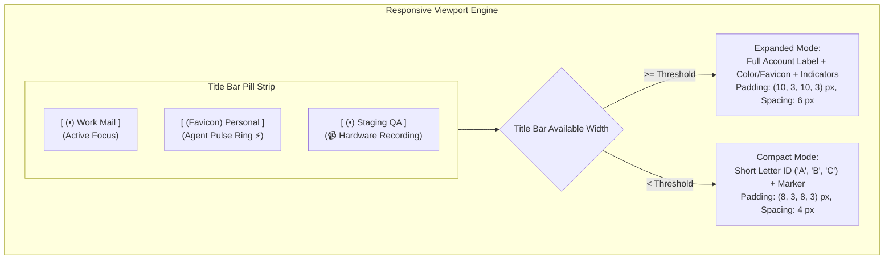

# Title Bar Pills & Real-Time Visual Indicators

In a multi-sandbox browser, clear visual feedback is essential for human operators. When an operator switches between work, personal, and administrative tasks, or supervises autonomous AI agents, the interface must communicate which account is active, which sites are open, and where agents are executing actions.

Nova AI Workspace integrates interactive sandbox pills directly into the WinUI 3 title bar and tab strip, complete with responsive geometry adjustments, dynamic site favicons, agent activity indicators, and hardware recording alerts.



---

## 1. Visual Anatomy of a Sandbox Pill

Every sandbox pill in the title bar combines three modular elements:

```
┌───────────────────────────────────────────────┐
│  ( Favicon )  Work Mail  [ 📹 ]  [ ⚡ Pulse ] │
└───────────────────────────────────────────────┘
     ▲              ▲          ▲         ▲
  Marker Badge    Label     Hardware   Agent Lease
```

### 1. Identity Marker Badge
* **Color Dot:** A circular badge rendered in the sandbox's assigned accent color (selected from Nova's curated 10-color palette).
* **Site Icon (Favicon):** Automatically captures, caches, and renders the high-resolution favicon of the active website inside the pill badge, allowing operators to see at a glance what site is loaded in background sandboxes.
* **Agent Activity Pulse Ring:** An animated accent glow ring surrounding the marker badge whenever an autonomous MCP agent holds an active tab claim (`_mcpServer.IsTabClaimed`) on that profile.

### 2. Hardware Recording Indicator
* An SVG camera warning badge (`camera_16_filled_site-warning.svg`) appears automatically whenever any tab within the sandbox accesses media capture APIs (webcam, microphone, or desktop screen capture).
* **Tooltip:** *"This sandbox is using camera, microphone, or screen sharing."*
* Alerts the user even if the recording tab is currently in the background or obscured.

### 3. Identity Label
* Displays the operator-defined name (e.g., `Work Mail`) or the automatically detected identity (e.g., `john.doe@enterprise.corp`).

---

## 2. Responsive Layout Engine (Expanded vs. Compact Mode)

When multiple sandboxes are active or when the user resizes the browser window to a narrower width, Nova's title bar layout engine dynamically transitions between two rendering modes:

| Layout Mode | Geometry & Padding | Visual Content | Space Efficiency |
| :--- | :--- | :--- | :--- |
| **Expanded Mode** | Padding: `(10, 3, 10, 3)` px<br>Spacing: `6` px | Full custom name or detected account label (`Work Mail`) | Complete human-readable context; ideal for wide screens and 1–4 sandboxes. |
| **Compact Mode** | Padding: `(8, 3, 8, 3)` px<br>Spacing: `4` px | Short Letter ID (`A`, `B`, `S1`) + marker badge | Ultra-compact footprint. Full name remains instantly accessible via hover tooltip and accessibility automation tree. |

---

## 3. The Sandbox Overview Flyout (`SandboxOverviewFlyout`)

When the total number of provisioned sandboxes exceeds available title bar space, Nova displays an overflow affordance icon (`⋯`):

```
┌────────────────────────────────────────────────────────┐
│  All Sandboxes (6 Active)                              │
├────────────────────────────────────────────────────────┤
│  [A] Work Mail           3 tabs   ⚡ Agent Claimed     │
│  [B] Personal Account    1 tab    🛡️ Direct (No Proxy) │
│  [C] Staging QA          2 tabs   📹 Recording Active  │
│  [D] AWS Admin           4 tabs   Normal               │
│  [E] Client Portal       1 tab    Normal               │
│  [F] Scratchpad          0 tabs   Normal               │
├────────────────────────────────────────────────────────┤
│  [ + Create New Sandbox ]        [ Manage in Settings ]│
└────────────────────────────────────────────────────────┘
```

* Clicking opens a high-density grid flyout listing all sandboxes, their open tab counts, proxy states, and agent lease statuses.
* Allows instantaneous one-click switching to any profile without scrolling through the tab strip.

---

## 4. Related Documentation

* [WinUI 3 User Management Overview](../README.md)
* [Context Actions & Scoped Data Clearing](../context-actions-and-data-clearing/README.md)
* [Profile Storage & Format](../../profile-storage-and-disk-anchors/storage-partitioning-and-format/README.md)
* [Native Dialogs & UI Prompts](../../../native-dialogs-and-prompts/README.md)
