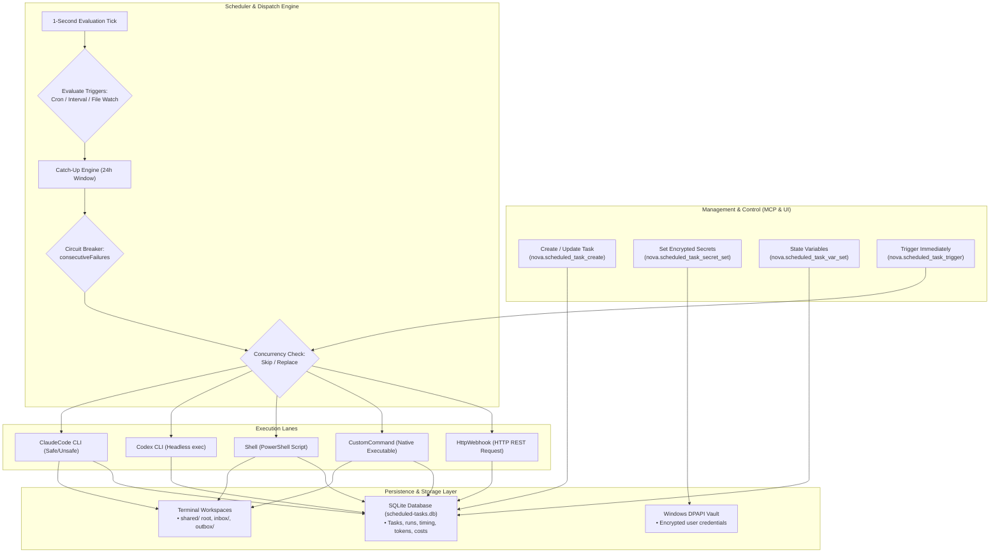

# Scheduled Tasks & Background Automation Engine

Autonomous web intelligence, recurring monitoring, and automated maintenance workflows require reliable execution beyond interactive user sessions. Running periodic tasks using naive terminal loops (`sleep`) is fragile: loops break when windows close, have no persistent run history, fail to handle system sleep states, and risk leaking plain-text credentials into scripts.

Nova AI Workspace provides an enterprise-grade background automation engine backed by SQLite (`scheduled-tasks.db`). It enables autonomous AI coding agents (Claude Code, Codex CLI), PowerShell scripts, system binaries, and HTTP webhooks to execute on human-readable cron schedules, fixed intervals, or filesystem directory changes—complete with Windows DPAPI credential encryption, terminal workspaces, and conditional multi-task pipeline chaining.

---

## 1. High-Level Engine Architecture

The Scheduled Tasks engine integrates scheduling, execution, credential vaults, and terminal workspaces into a unified control plane:



---

## 2. Documentation Suite Index

Explore the complete modular documentation suite across the three scheduled tasks domains:

### Domain 1: Schedules, Triggers & Concurrency
* **[Schedules, Triggers & Concurrency Hub](scheduling-and-triggers/README.md)**: Temporal dispatch loop, trigger modalities, and resilience gates.
  * **[Cron Syntax & Temporal Dispatch](scheduling-and-triggers/cron-syntax-and-temporal-dispatch/README.md)**: Human-readable cron patterns (`daily HH:MM`, `weekdays`, `weekly`, `hourly`, `every Nh`), standard 5-field UNIX cron fallback, IANA and Windows time zone resolution, daylight saving time (DST) leap reconciliation, fixed interval loops (minimum 60s), and 1-second scheduler ticks.
  * **[Filesystem Watch & Resilience Gates](scheduling-and-triggers/filesystem-watch-and-resilience-gates/README.md)**: Real-time filesystem directory monitoring (`watchPath`), 2-second trailing write debounce, 24-hour downtime catch-up recovery (`catchUpMissed`), concurrency governance (`Skip` vs `Replace`), and automated circuit breakers (`maxConsecutiveFailures`).

### Domain 2: Task Executors & Autonomy Modes
* **[Task Executors & Autonomy Modes Hub](executors-and-autonomy/README.md)**: Runner lanes, privilege policies, and financial limits.
  * **[Execution Lanes & Agent Harnesses](executors-and-autonomy/execution-lanes-and-agent-harnesses/README.md)**: The five execution lanes (`ClaudeCode`, `CodexCli`, `Shell`, `CustomCommand`, `HttpWebhook`), Nova MCP access via `--allowedTools "mcp__nova__*"`, environment variable secret injection, shell blocking security invariants, and real-time output capture into SQLite.
  * **[Autonomy Modes & Budget Governance](executors-and-autonomy/autonomy-modes-and-budget-governance/README.md)**: Privilege separation (`Safe` vs `Unsafe`), the administrative `allowWorkflowFanout` gate, per-run financial budget limits (`maxBudgetUsd`), cumulative lifetime spending caps (`maxCumulativeCostUsd`), `--max-turns` limits, and the run lifecycle state machine.

### Domain 3: Workspaces, Secrets & Chaining
* **[Workspaces, Secrets & Chaining Hub](workspaces-secrets-and-chaining/README.md)**: Data plane, encrypted secrets, state variables, and multi-task pipelines.
  * **[Workspace Storage & File Boundaries](workspaces-secrets-and-chaining/workspace-storage-and-file-boundaries/README.md)**: Dedicated terminal workspace binding (`workspaceId`), directory structure (`shared/`, `inbox/`, `outbox/`), 1 MiB UTF-8 file reading and writing ceiling, binary file suppression, and automated 14-day soft-cap mailbox retention.
  * **[Encrypted Secrets, Variables & Chaining](workspaces-secrets-and-chaining/encrypted-secrets-variables-and-chaining/README.md)**: Windows DPAPI task credential encryption, in-memory `{SECRET:key}` substitution, persistent 64 KB SQLite state variables (`{VAR:key}`), conditional downstream task triggering (`triggerNextTaskId`, `triggerOnStatus`), cycle detection, and max depth limit of 5.

---

## 3. The Four Core Control Planes

Nova structures scheduled operations across four distinct architectural pillars:

```
+-----------------------------------------------------------------------------------+
| CONTROL PLANE               | RESPONSIBILITIES & OPERATIONAL MECHANISMS           |
+-----------------------------------------------------------------------------------+
| 1. Scheduling & Triggers    | Time-based schedules (cron, interval), event-driven |
|                             | folder monitoring (watchPath), and downtime recovery|
|                             | (catchUpMissed within 24 hours).                    |
+-----------------------------+-----------------------------------------------------+
| 2. Execution & Autonomy     | Headless AI agents (Claude Code, Codex), PowerShell |
|                             | scripts, native binaries, and HTTP webhooks with    |
|                             | strict Safe/Unsafe autonomy mode enforcement.       |
+-----------------------------+-----------------------------------------------------+
| 3. Workspaces & Secrets     | Local file isolation in shared/, Windows DPAPI-     |
|                             | encrypted secrets, 64 KB persistent variables, and  |
|                             | a 1 MiB UTF-8 file boundary ceiling.                |
+-----------------------------+-----------------------------------------------------+
| 4. Pipeline Chaining        | Multi-stage task execution with status filters,     |
|                             | JSON output assertions, and max depth 5 bounds.     |
+-----------------------------------------------------------------------------------+
```

---

## 4. MCP Tool Capability Matrix

Agents configure and monitor background automation through the `scheduled_tasks` tool bundle:

| Tool Name | Subsystem | Primary Function |
| :--- | :--- | :--- |
| [`nova.scheduled_task_create`](../../mcp-reference/tools/scheduled-tasks/nova-scheduled-task-create.md) | Definition | Creates a new scheduled task (schedule, prompt, executor, limits, workspace). |
| [`nova.scheduled_task_update`](../../mcp-reference/tools/scheduled-tasks/nova-scheduled-task-update.md) | Definition | Modifies properties, schedules, prompts, or limits of an existing task. |
| [`nova.scheduled_task_delete`](../../mcp-reference/tools/scheduled-tasks/nova-scheduled-task-delete.md) | Definition | Permanently deletes a task definition, its run history, and bound variables. |
| [`nova.scheduled_task_get`](../../mcp-reference/tools/scheduled-tasks/nova-scheduled-task-get.md) | Definition | Returns full task configuration, schedule state, next fire time, and usage metrics. |
| [`nova.scheduled_task_list`](../../mcp-reference/tools/scheduled-tasks/nova-scheduled-task-list.md) | Definition | Lists all configured tasks with execution status, next run times, and costs. |
| [`nova.scheduled_task_enable`](../../mcp-reference/tools/scheduled-tasks/nova-scheduled-task-enable.md) | Lifecycle | Resumes a paused task and resets any tripped circuit breaker failure counter. |
| [`nova.scheduled_task_disable`](../../mcp-reference/tools/scheduled-tasks/nova-scheduled-task-disable.md) | Lifecycle | Pauses a task, suppressing automated scheduled executions. |
| [`nova.scheduled_task_trigger`](../../mcp-reference/tools/scheduled-tasks/nova-scheduled-task-trigger.md) | Execution | Immediately dispatches a run outside of the normal schedule. |
| [`nova.scheduled_task_active_runs`](../../mcp-reference/tools/scheduled-tasks/nova-scheduled-task-active-runs.md) | Execution | Lists all currently active, in-flight task executions. |
| [`nova.scheduled_task_run_cancel`](../../mcp-reference/tools/scheduled-tasks/nova-scheduled-task-run-cancel.md) | Execution | Delivers a graceful cancellation signal to an active task execution. |
| [`nova.scheduled_task_runs`](../../mcp-reference/tools/scheduled-tasks/nova-scheduled-task-runs.md) | History | Queries historical execution runs, statuses, durations, and costs. |
| [`nova.scheduled_task_run_output`](../../mcp-reference/tools/scheduled-tasks/nova-scheduled-task-run-output.md) | History | Retrieves stdout, stderr tail, and structured JSON results for a specific run. |
| [`nova.scheduled_task_workspace`](../../mcp-reference/tools/scheduled-tasks/nova-scheduled-task-workspace.md) | Workspace | Returns disk location and status of the task's bound terminal workspace. |
| [`nova.scheduled_task_workspace_list`](../../mcp-reference/tools/scheduled-tasks/nova-scheduled-task-workspace-list.md) | Workspace | Lists files and directories residing in the task's workspace. |
| [`nova.scheduled_task_workspace_read`](../../mcp-reference/tools/scheduled-tasks/nova-scheduled-task-workspace-read.md) | Workspace | Reads a UTF-8 text file from the workspace (capped at 1 MiB). |
| [`nova.scheduled_task_workspace_write`](../../mcp-reference/tools/scheduled-tasks/nova-scheduled-task-workspace-write.md) | Workspace | Writes or updates a file in the workspace (capped at 1 MiB). |
| [`nova.scheduled_task_secret_set`](../../mcp-reference/tools/scheduled-tasks/nova-scheduled-task-secret-set.md) | Secrets | Encrypts and binds a named secret to a task definition via Windows DPAPI. |
| [`nova.scheduled_task_secret_list`](../../mcp-reference/tools/scheduled-tasks/nova-scheduled-task-secret-list.md) | Secrets | Lists names of all secrets bound to a task (omits secret values). |
| [`nova.scheduled_task_var_set`](../../mcp-reference/tools/scheduled-tasks/nova-scheduled-task-var-set.md) | Variables | Sets a persistent key-value state variable for a task (up to 64 KB). |
| [`nova.scheduled_task_var_get`](../../mcp-reference/tools/scheduled-tasks/nova-scheduled-task-var-get.md) | Variables | Reads the current value of a persistent state variable. |
| [`nova.scheduled_task_var_list`](../../mcp-reference/tools/scheduled-tasks/nova-scheduled-task-var-list.md) | Variables | Lists all persistent variables and values associated with a task. |
| [`nova.scheduled_task_var_delete`](../../mcp-reference/tools/scheduled-tasks/nova-scheduled-task-var-delete.md) | Variables | Deletes a persistent variable from a task. |
| [`nova.scheduled_task_templates`](../../mcp-reference/tools/scheduled-tasks/nova-scheduled-task-templates.md) | Templates | Returns built-in task templates for common automation scenarios. |
| [`nova.scheduled_task_export`](../../mcp-reference/tools/scheduled-tasks/nova-scheduled-task-export.md) | Portability | Exports complete task definitions to a portable JSON bundle. |
| [`nova.scheduled_task_import`](../../mcp-reference/tools/scheduled-tasks/nova-scheduled-task-import.md) | Portability | Imports and registers a task bundle from a JSON definition. |

---

## 5. Security, Budget & Safety Invariants

1. **The Circuit Breaker:** Tasks that fail consecutively $N$ times (default: 3) trip an automated circuit breaker, transitioning to `disabled_circuit_breaker` to prevent runaway spending on broken scripts.
2. **Financial Hard Stop:** When `--max-budget-usd` is reached on a Claude Code run, Nova terminates the run immediately. Tasks exceeding cumulative lifetime caps are disabled.
3. **Privilege Separation:** Shell interpreters (`powershell.exe`, `cmd.exe`) are blocked in `CustomCommand`. Scripts must use the administrative policy-guarded `Shell` lane.
4. **Memory Decoupling:** Decrypted secrets exist in memory only during the active process launch phase, never stored unencrypted in SQLite or transcript files.

---

## 6. Related Architecture Guides

* [Terminal Workspaces Architecture](../terminal-workspaces/README.md): Interactive ConPTY terminal dock integration and command execution.
* [Privacy & Vault Architecture](../privacy/README.md): DPAPI storage backing system credentials.
* [Session Recording Architecture](../session-recording/README.md): Recording background browser runs for time-travel forensics.
* [Create Task Reference](../../mcp-reference/tools/scheduled-tasks/nova-scheduled-task-create.md) · [Templates Reference](../../mcp-reference/tools/scheduled-tasks/nova-scheduled-task-templates.md)

---

[All core features](../README.md)
