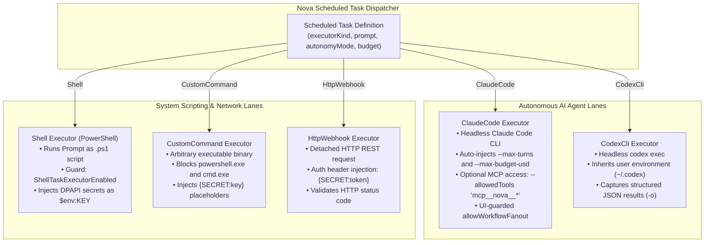

# Task Executors, Autonomy Modes & Budget Governance

Scheduled background automation requires robust, secure execution environments. Tasks cannot rely on human prompts during unattended runs; they must execute within defined privilege boundaries, adhere to strict compute and financial budget limits, and fail safely when errors occur.

Nova AI Workspace provides five specialized execution lanes—spanning autonomous AI coding agents, PowerShell scripts, custom binaries, and HTTP webhooks—governed by fine-grained autonomy policies, per-run spending caps, and cumulative lifetime budget guards.

---

## 1. Domain Architecture & Subguides

The Task Executors & Autonomy Modes subsystem is divided into two specialized technical guides:

```
+-----------------------------------------------------------------------------------+
|                     TASK EXECUTORS & AUTONOMY MODES DOMAIN                        |
+-----------------------------------------------------------------------------------+
| 1. Execution Lanes & Agent Harnesses    | ClaudeCode, CodexCli, Shell,            |
|                                         | CustomCommand, HttpWebhook execution.   |
+-----------------------------------------+-----------------------------------------+
| 2. Autonomy Modes & Budget Governance   | Safe vs Unsafe, allowWorkflowFanout,    |
|                                         | per-run/lifetime budgets, state machine.|
+-----------------------------------------------------------------------------------+
```

| Guide | Focus Area | Core Architectural Concepts |
| :--- | :--- | :--- |
| **[Execution Lanes & Agent Harnesses](execution-lanes-and-agent-harnesses/README.md)** | Runner Engines & Environment | The five execution lanes (`ClaudeCode`, `CodexCli`, `Shell`, `CustomCommand`, `HttpWebhook`), Nova MCP access via `--allowedTools "mcp__nova__*"`, environment variable secret injection, shell blocking security invariants, and real-time output capture into SQLite. |
| **[Autonomy Modes & Budget Governance](autonomy-modes-and-budget-governance/README.md)** | Safety Policies & Financial Caps | Privilege separation (`Safe` vs `Unsafe`), the administrative `allowWorkflowFanout` gate, per-run financial budget limits (`maxBudgetUsd`), cumulative lifetime spending caps (`maxCumulativeCostUsd`), `--max-turns` limits, and the run lifecycle state machine. |

---

## 2. The Five Execution Lanes Overview

Nova partitions background workloads across five dedicated runner engines:



---

## 3. Core Operational Guarantees

1. **Anti-Escalation Gate:** Autonomous agents cannot grant their own scheduled tasks workflow fan-out privileges over the MCP API. `allowWorkflowFanout` is configurable strictly through the Nova desktop UI Settings.
2. **Deterministic Financial Caps:** If a Claude Code run reaches its `maxBudgetUsd` limit during reasoning or tool invocation, Nova terminates the run immediately to prevent runaway billing.
3. **Shell Isolation:** To enforce clean privilege boundaries, `powershell.exe` and `cmd.exe` are strictly barred from the `CustomCommand` runner; scripts must execute through the policy-guarded `Shell` lane.

---

## 4. Related Architecture Guides

* [Execution Lanes & Agent Harnesses](execution-lanes-and-agent-harnesses/README.md): Detailed specifications for all 5 runner engines.
* [Autonomy Modes & Budget Governance](autonomy-modes-and-budget-governance/README.md): Safe/Unsafe modes, spending caps, and state audits.
* [Scheduled Tasks Engine Hub](../README.md): Master hub, architecture control planes, and complete MCP tool matrix.
* [Schedules, Triggers & Concurrency](../scheduling-and-triggers/README.md): Temporal cron schedules and filesystem directory watching.
* [Workspaces, Secrets & Chaining](../workspaces-secrets-and-chaining/README.md): Data plane, encrypted secrets, and pipeline chaining.
* [Run Output Reference](../../../mcp-reference/tools/scheduled-tasks/nova-scheduled-task-run-output.md) · [Cancel Run Reference](../../../mcp-reference/tools/scheduled-tasks/nova-scheduled-task-run-cancel.md)
