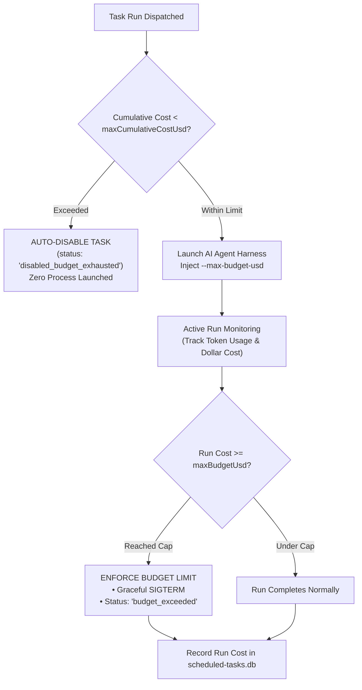
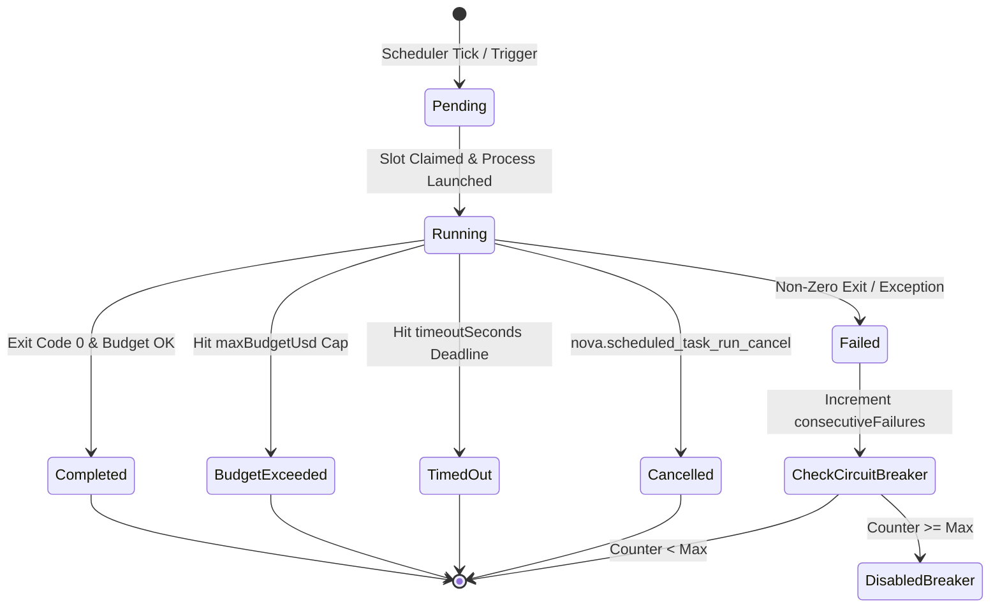

# Autonomy Modes, Budget Governance & Lifecycle States

Autonomous background tasks run unattended without real-time human supervision. Without strict guardrails, an autonomous agent caught in an unexpected error loop could repeatedly invoke expensive frontier LLM APIs, consume hundreds of dollars in cloud tokens, or perform destructive file operations.

Nova AI Workspace enforces enterprise-grade safety governance over scheduled tasks through **Autonomy Modes** (`Safe` vs `Unsafe`), **Financial Spending Limits** (per-run and cumulative lifetime budget caps), **Turn Limits**, and an audited **Run Lifecycle State Machine**.

---

## 1. Autonomy Modes: `Safe` vs `Unsafe`

Nova enforces explicit autonomy policies on every scheduled task definition:

```
+-----------------------------------------------------------------------------------+
| AUTONOMY MODE | RUNNER CONSTRAINTS & BEHAVIORAL PRIVILEGES                        |
+---------------+-------------------------------------------------------------------+
| Safe          | Restricts tool execution to safe read-only operations, DOM        |
| (Default)     | inspection, and non-destructive analysis. Disallows raw shell     |
|               | execution, file deletions, and unauthorized sub-agent fan-out.   |
+---------------+-------------------------------------------------------------------+
| Unsafe        | Unattended execution with full write permissions. Allows the AI   |
|               | agent to create, edit, or delete files within its bound terminal  |
|               | workspace, compile code, and run approved CLI commands.           |
+-----------------------------------------------------------------------------------+
```

### The `allowWorkflowFanout` Security Gate
* **Multi-Agent Fan-Out:** When Claude Code runs in an orchestration capacity, it can attempt to invoke the Claude harness Workflow tool to spawn sub-agents.
* **Administrative UI Gate:** The `allowWorkflowFanout` setting is intentionally **configurable only via the Nova UI Settings**.
* **Anti-Escalation Rule:** MCP tools (`nova.scheduled_task_create`, `nova.scheduled_task_update`) are cryptographically and logically blocked from setting `allowWorkflowFanout: true`. An AI agent cannot unilaterally grant its own future scheduled tasks the power to spawn unmanaged sub-agent swarms.

---

## 2. Financial Budget Governance

Nova protects operators against runaway API consumption through two independent financial spending boundaries:



### 1. Per-Run Budget Cap (`maxBudgetUsd`)
* **Default Cap:** $1.00 USD per run when unspecified.
* **CLI Enforcement:** Passed directly to the Claude Code harness via `--max-budget-usd <value>`.
* **Immediate Termination:** If the agent's token consumption reaches this dollar amount during reasoning or tool execution, the runner terminates the run immediately with status `budget_exceeded`.

### 2. Cumulative Lifetime Budget Cap (`maxCumulativeCostUsd`)
* **Aggregate Tracking:** Nova computes the sum of all historical run costs for the task in SQLite:
  $$\text{TotalCost} = \sum \text{costUsd}_{\text{run}}$$
* **Automatic Disabling:** If a task's cumulative cost reaches `maxCumulativeCostUsd`, the scheduler automatically flips the task status to `disabled_budget_exhausted`, permanently halting future scheduled triggers until manually reset by an operator.

---

## 3. Compute Bounds & Execution Limits

In addition to financial constraints, Nova enforces strict compute bounds on background processes:

| Constraint Parameter | Default Value | Enforcement Mechanism |
| :--- | :--- | :--- |
| **`maxTurns`** | 50 turns | Passed via `--max-turns <N>`. Prevents agents from looping infinitely when attempting to resolve complex refactors. |
| **`timeoutSeconds`** | 900 seconds (15 min) | Hard process execution timeout. If a process hangs, Nova sends a graceful cancellation token, waits a 5-second grace period, then issues an OS-level SIGKILL. |
| **`maxConsecutiveFailures`** | 3 failures | Circuit breaker threshold. Trips task into disabled state upon repeated errors. |

---

## 4. The Run Lifecycle State Machine

Every task execution progresses through a deterministic, audited state machine:



### Lifecycle State Definitions
* **`pending`:** The task was triggered and is awaiting an available concurrency slot.
* **`running`:** The process is currently executing in its execution lane.
* **`completed`:** Execution finished cleanly with exit code 0 and within budget.
* **`failed`:** Process exited with a non-zero code or threw an unhandled exception.
* **`budget_exceeded`:** Run was forcibly cancelled because spending reached `maxBudgetUsd`.
* **`timed_out`:** Process exceeded `timeoutSeconds` and was terminated by the watchdog.
* **`cancelled`:** An operator or agent invoked [`nova.scheduled_task_run_cancel`](../../../../mcp-reference/tools/scheduled-tasks/nova-scheduled-task-run-cancel.md).

---

## 5. Related Documentation

* [Execution Lanes & Agent Harnesses](../execution-lanes-and-agent-harnesses/README.md): ClaudeCode, CodexCli, Shell, CustomCommand, and Webhook engines.
* [Task Executors & Autonomy Modes Hub](../README.md): Overview of execution architecture.
* [Workspaces, Secrets & Chaining](../../workspaces-secrets-and-chaining/README.md): Data plane, encrypted secrets, and pipeline chaining.
* [Cancel Run Reference](../../../../mcp-reference/tools/scheduled-tasks/nova-scheduled-task-run-cancel.md) · [Active Runs Reference](../../../../mcp-reference/tools/scheduled-tasks/nova-scheduled-task-active-runs.md)
