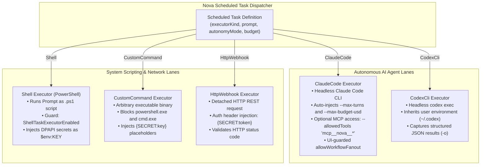

# Execution Lanes, Agent Harnesses & System Runners

Scheduled background automation requires diverse execution environments: from autonomous AI coding agents capable of reasoning and multi-step browser navigation to deterministic PowerShell scripts, compiled binaries, and cloud HTTP webhooks. Running these disparate workloads reliably requires a unified execution plane that enforces privilege boundaries, manages environment variables, and streams output into an audited database.

Nova AI Workspace provides five specialized **Execution Lanes** (`executorKind`) tailored for autonomous AI agents and systems automation.

---

## 1. The Five Execution Lanes Architecture

Nova partitions background workloads across five dedicated runner engines:



---

## 2. Autonomous AI Agent Lanes

### 1. `ClaudeCode` (Autonomous Claude Agent)
The primary agentic execution lane, running headless task workflows through the installed Claude Code CLI:

* **Prompt Delivery:** Hands the task's `Prompt` directly to the Claude Code CLI runner.
* **Turn & Budget Guards:** Automatically appends `--max-turns` (default: 50) and `--max-budget-usd` (default: $1.00 USD per run when unspecified) to prevent infinite reasoning loops.
* **Nova MCP Access (`mcpAccess`):**
  * When set to `true`, Nova configures Claude Code to connect to Nova's active MCP server, granting the agent full access to browser navigation, DOM inspection, and session tools via:
    ```bash
    --allowedTools "mcp__nova__*"
    ```
* **Workflow Fan-Out Gate (`allowWorkflowFanout`):**
  * Governs whether a Safe-mode Claude Code run is allowed to invoke the Claude harness Workflow tool (for multi-agent subtask fan-out).
  * **Crucial Security Invariant:** Configurable **only via Nova UI Settings**, never over the MCP API. An autonomous agent is strictly blocked from elevating its own scheduled task to grant fan-out privileges.

### 2. `CodexCli` (Autonomous Codex Agent)
The second first-class AI agent lane, executing headlessly through the user's local Codex CLI:

* **Execution Mechanism:** Invokes `codex exec` with prompt and argument templates, capturing structured machine-readable JSON results via `-o`.
* **Environment & Authentication:** Inherits the active user profile's Codex environment configuration (`~/.codex`).
* **Runtime Verification:** Automatically detected and verified at startup via Nova's agent runtime scanner.

---

## 3. System Scripting & Network Lanes

### 3. `Shell` (PowerShell Script Execution)
Executes the task's `Prompt` as a native Windows PowerShell script:

* **Script Synthesis:** Saves the prompt to a temporary `.ps1` script file inside the task's bound workspace.
* **Environment Secret Delivery:** Injects Windows DPAPI-encrypted secrets directly into the process environment block as `$env:KEY`, preventing plaintexts from appearing in script bodies.
* **Security Gate (`ShellTaskExecutorEnabled`):**
  * Deliberately guarded by an administrative setting in `AppSettings`.
  * If disabled, attempts to execute shell tasks fail immediately with a policy rejection error.

### 4. `CustomCommand` (Native Executable Binary)
Executes arbitrary local executable binaries (e.g., `git.exe`, `ffmpeg.exe`, `python.exe`):

* **Shell Blocking Invariant:** To prevent command injection and ensure clear privilege separation, Nova **strictly blocks `powershell.exe` and `cmd.exe`** from being specified as the binary in `CustomCommand`. Scripts must use the dedicated `Shell` executor.
* **Argument Substitution:** Replaces `{SECRET:key}` placeholders in command-line arguments with in-memory decrypted values immediately prior to process creation.

### 5. `HttpWebhook` (HTTP REST Webhook)
Dispatches an asynchronous, detached HTTP request against an external endpoint:

* **Supported Methods:** `GET`, `POST`, `PUT`, `DELETE`, `PATCH`.
* **Payload Delivery:** Passes the task's `Prompt` as the HTTP request body (e.g., JSON payload).
* **Header Authorization:** Supports template placeholders in headers (`Authorization: Bearer {SECRET:api_token}`).
* **Outcome Assertion:** Evaluates HTTP response status codes ($200 \le \text{status} \le 299$ = Success; $\ge 400$ = Failure).

---

## 4. Execution Parameter Matrix

| Executor | Primary Configuration Keys | Standard Output Handling | Default Timeout |
| :--- | :--- | :--- | :--- |
| **`ClaudeCode`** | `prompt`, `maxTurns`, `maxBudgetUsd`, `mcpAccess` | Streams agent thoughts, tool calls, and final summary to SQLite. | 15 minutes |
| **`CodexCli`** | `prompt`, `arguments` | Captures structured JSON output object and execution transcript. | 15 minutes |
| **`Shell`** | `prompt` (script content), `workingDirectory` | Captures standard stdout and stderr streams in SQLite. | 10 minutes |
| **`CustomCommand`**| `command` (executable path), `arguments` | Captures exit code, stdout, and stderr buffers. | 10 minutes |
| **`HttpWebhook`** | `url`, `method`, `headers`, `prompt` (body) | Captures HTTP status code, response headers, and response body tail. | 60 seconds |

---

## 5. Output Streaming & SQLite Run Logs

Regardless of the execution lane, Nova's background runner captures process output in real time and writes structured records into `scheduled-tasks.db`:

```json
{
  "runId": "run_20261018_105000_c4b1",
  "taskId": "task_daily_market_report",
  "executorKind": "ClaudeCode",
  "startedUtc": "2026-10-18T10:50:00.120Z",
  "completedUtc": "2026-10-18T10:52:14.880Z",
  "status": "completed",
  "exitCode": 0,
  "costUsd": 0.42,
  "turnsUsed": 12,
  "outputSummary": "Successfully scraped 14 ticker prices and committed report to shared/outbox/report.csv"
}
```

Agents inspect historical runs using [`nova.scheduled_task_runs`](../../../../mcp-reference/tools/scheduled-tasks/nova-scheduled-task-runs.md) and [`nova.scheduled_task_run_output`](../../../../mcp-reference/tools/scheduled-tasks/nova-scheduled-task-run-output.md).

---

## 6. Related Documentation

* [Autonomy Modes & Budget Governance](../autonomy-modes-and-budget-governance/README.md): Safe vs Unsafe modes, financial budget caps, and turn limits.
* [Task Executors & Autonomy Modes Hub](../README.md): High-level overview of execution engines.
* [Workspaces, Secrets & Chaining](../../workspaces-secrets-and-chaining/README.md): Terminal workspace isolation and DPAPI secret injection.
* [Run Output Tool Reference](../../../../mcp-reference/tools/scheduled-tasks/nova-scheduled-task-run-output.md) · [Runs Tool Reference](../../../../mcp-reference/tools/scheduled-tasks/nova-scheduled-task-runs.md)
