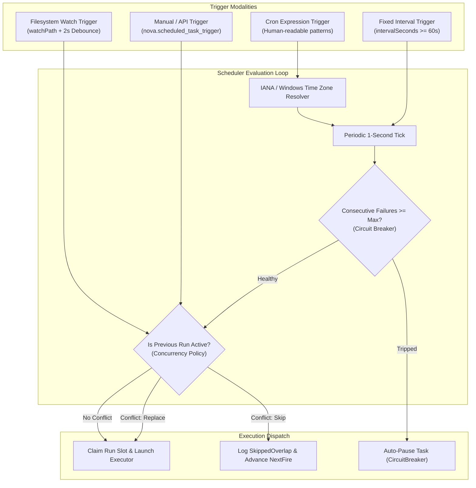

# Schedules, Triggers, Time Zones & Concurrency Governance

Recurring background automation requires precise, predictable scheduling that can accommodate real-world operating conditions: desktop restarts, system sleep states, time zone shifts, and filesystem events. Naive scheduling scripts relying on `sleep` loops fail because they lack persistence, lose state during application restarts, and provide no safeguards against overlapping executions.

Nova AI Workspace provides a persistent, event-driven scheduling engine backed by SQLite (`scheduled-tasks.db`). It supports human-readable cron syntax, fixed interval loops, real-time filesystem directory monitoring, robust downtime catch-up policies, and concurrency controls to prevent runaway processes.

---

## 1. Domain Architecture & Subguides

The Schedules, Triggers & Concurrency subsystem is divided into two specialized technical guides:

```
+-----------------------------------------------------------------------------------+
|                     SCHEDULES, TRIGGERS & CONCURRENCY DOMAIN                      |
+-----------------------------------------------------------------------------------+
| 1. Cron Syntax & Temporal Dispatch      | Human-readable cron, UNIX cron,         |
|                                         | IANA time zones, DST shifts, intervals. |
+-----------------------------------------+-----------------------------------------+
| 2. Filesystem Watch & Resilience Gates  | Directory watching, 2-second debounce,  |
|                                         | catch-up recovery, circuit breakers.    |
+-----------------------------------------------------------------------------------+
```

| Guide | Focus Area | Core Architectural Concepts |
| :--- | :--- | :--- |
| **[Cron Syntax & Temporal Dispatch](cron-syntax-and-temporal-dispatch/README.md)** | Temporal Scheduling & Math | Human-readable cron patterns (`daily HH:MM`, `weekdays`, `weekly`, `hourly`, `every Nh`), standard 5-field UNIX cron fallback, IANA and Windows time zone resolution, daylight saving time (DST) leap reconciliation, fixed interval loops (minimum 60s), and 1-second scheduler ticks. |
| **[Filesystem Watch & Resilience Gates](filesystem-watch-and-resilience-gates/README.md)** | Reactive Events & Safety | Real-time filesystem directory monitoring (`watchPath`), 2-second trailing write debounce, 24-hour downtime catch-up recovery (`catchUpMissed`), concurrency governance (`Skip` vs `Replace`), and automated circuit breakers (`maxConsecutiveFailures`). |

---

## 2. Trigger Modalities & Evaluation Pipeline

Nova unifies temporal and reactive execution into an integrated dispatch pipeline:



---

## 3. Operational Guarantees Summary

1. **Deterministic Catch-Up:** A 24-hour lookback window ensures missed runs due to system sleep fire cleanly upon wake, without generating an unmanaged cascade of back-to-back runs.
2. **File Lock Safety:** Filesystem watch triggers enforce a mandatory 2-second quiet period, preventing partial file reads during large network or disk copies.
3. **Runaway Prevention:** Tasks that fail consecutively trip an automated circuit breaker, transitioning to `disabled_circuit_breaker` before exhausting API budgets.

---

## 4. Related Architecture Guides

* [Cron Syntax & Temporal Dispatch](cron-syntax-and-temporal-dispatch/README.md): Cron expressions, time zones, and fixed intervals.
* [Filesystem Watch & Resilience Gates](filesystem-watch-and-resilience-gates/README.md): Event-driven watching, debounce, and circuit breakers.
* [Scheduled Tasks Engine Hub](../README.md): Master hub, architecture control planes, and complete MCP tool matrix.
* [Task Executors & Autonomy Modes](../executors-and-autonomy/README.md): Execution lanes and budget limits.
* [Workspaces, Secrets & Chaining](../workspaces-secrets-and-chaining/README.md): Data plane, encrypted secrets, and pipeline chaining.
* [Trigger Tool Reference](../../../mcp-reference/tools/scheduled-tasks/nova-scheduled-task-trigger.md) · [Active Runs Tool Reference](../../../mcp-reference/tools/scheduled-tasks/nova-scheduled-task-active-runs.md)
