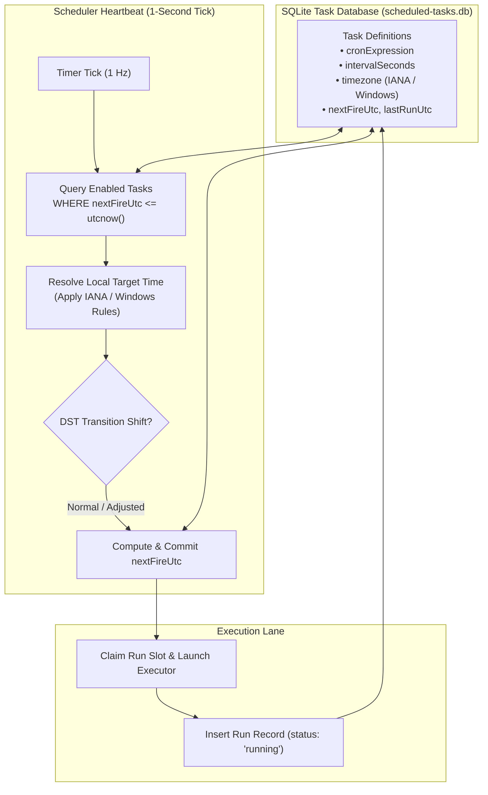
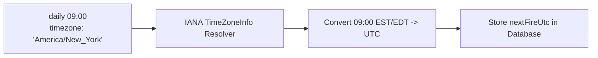

# Human-Readable Cron Syntax, Time Zones & Temporal Dispatch

Autonomous web intelligence, recurring compliance reporting, and continuous site verification require predictable, temporal scheduling that accurately handles real-world desktop conditions: time zone differences, daylight saving transitions, and machine sleep intervals. Naive script loops relying on `sleep` fail because they lose state on process exit, lack persistent database tracking, and cannot align with business calendar milestones.

Nova AI Workspace provides a persistent, event-driven temporal dispatch engine backed by SQLite (`scheduled-tasks.db`). It combines human-readable cron syntax with standard 5-field UNIX cron parsing, IANA/Windows time zone normalization, and sub-minute clock evaluation.

---

## 1. Temporal Dispatch & Evaluation Architecture

The scheduler evaluates registered task definitions on an internal 1-second evaluation tick:



---

## 2. Human-Readable Cron Expression Syntax

Rather than forcing operators and autonomous agents to construct brittle, error-prone 5-field UNIX cron syntax, Nova's scheduler natively parses human-readable expressions:

| Pattern Syntax | Operational Description | Next Fire Calculation |
| :--- | :--- | :--- |
| **`daily HH:MM`** | Fires once every day at the specified 24-hour time.<br/>*Example:* `daily 08:30` | Fires next day at 08:30 local time. |
| **`weekdays HH:MM`** | Fires Monday through Friday only.<br/>*Example:* `weekdays 09:00` | Fires next business day at 09:00. Skips Saturday and Sunday. |
| **`weekly <day> HH:MM`** | Fires once weekly on the specified day of week.<br/>*Example:* `weekly mon 10:00`, `weekly fri 17:00` | Fires on the next occurrence of that weekday. |
| **`hourly :MM`** | Fires once every hour at the specified minute offset.<br/>*Example:* `hourly :15` (fires at 01:15, 02:15, 03:15...) | Advances 60 minutes past the last hour mark. |
| **`every Nh`** | Step-interval firing every $N$ hours.<br/>*Example:* `every 2h`, `every 6h` | Advances $N$ hours from the initial task creation timestamp. |

### Standard 5-Field UNIX Cron Compatibility
For legacy automation compatibility, Nova's parser seamlessly falls back to standard 5-field UNIX cron format (`minute hour day-of-month month day-of-week`):
* `0 8 * * 1-5`: Monday to Friday at 08:00 UTC.
* `*/15 9-17 * * *`: Every 15 minutes between 09:00 and 17:59.
* `0 0 1 * *`: Midnight on the first day of every month.

---

## 3. Time Zone Resolution & Daylight Saving (DST) Handling

Tasks that execute business logic (such as scraping morning stock reports or pulling daily metrics at market open) must fire at the correct local hour, regardless of daylight saving transitions.

### IANA & Windows Time Zone Support
The `timezone` parameter accepts standard IANA time zone strings or Windows Time Zone IDs:
* IANA: `America/New_York`, `Europe/Berlin`, `Asia/Tokyo`, `UTC`
* Windows: `Eastern Standard Time`, `W. Europe Standard Time`, `Tokyo Standard Time`



### Daylight Saving Time Invariants
1. **Spring Forward (23-Hour Day):** When clocks skip forward (e.g., from 02:00 to 03:00), a task scheduled during the skipped hour fires immediately at the transition boundary (03:00) rather than failing or waiting 24 hours.
2. **Fall Back (25-Hour Day):** When clocks repeat an hour (e.g., from 02:00 back to 01:00), Nova's scheduler evaluates the task's `lastRunUtc` timestamp, preventing the task from firing twice on the same calendar day.

---

## 4. Fixed Interval Loops (`intervalSeconds`)

When tasks require high-frequency polling or recurring health checks decoupled from wall-clock time, operators configure fixed interval scheduling:

$$\text{intervalSeconds} \ge 60 \quad \text{seconds}$$

```json
{
  "name": "Production Endpoint Monitor",
  "intervalSeconds": 300,
  "executorKind": "HttpWebhook",
  "prompt": "https://api.example.com/health"
}
```

### Safety Invariants
* **Strict 60-Second Floor:** To prevent aggressive, accidental busy-waiting that consumes CPU and exhausts rate limits, Nova enforces a hard 60-second minimum for `intervalSeconds`.
* **Mutually Exclusive Triggers:** A task definition must specify either a temporal schedule (`cronExpression` or `intervalSeconds`) or an event-driven trigger (`watchPath`), never both.

---

## 5. Schedule State Introspection & Management API

Agents interrogate and manage task schedules using the `scheduled-tasks` MCP tool suite:

| MCP Tool | Purpose | Key Parameters |
| :--- | :--- | :--- |
| [`nova.scheduled_task_create`](../../../../mcp-reference/tools/scheduled-tasks/nova-scheduled-task-create.md) | Registers a new scheduled task definition. | `name`, `cronExpression`, `intervalSeconds`, `timezone`, `executorKind` |
| [`nova.scheduled_task_get`](../../../../mcp-reference/tools/scheduled-tasks/nova-scheduled-task-get.md) | Returns full schedule details, including `nextFireUtc` and `lastRunUtc`. | `taskId` |
| [`nova.scheduled_task_list`](../../../../mcp-reference/tools/scheduled-tasks/nova-scheduled-task-list.md) | Enumerates all configured tasks with execution states and fire times. | `includeDisabled?` |
| [`nova.scheduled_task_update`](../../../../mcp-reference/tools/scheduled-tasks/nova-scheduled-task-update.md) | Modifies schedule, time zone, or trigger configuration on existing task. | `taskId`, `cronExpression?`, `intervalSeconds?` |

---

## 6. Related Documentation

* [Filesystem Directory Watching & Resilience Gates](../filesystem-watch-and-resilience-gates/README.md): Event-driven file watching, downtime catch-up, and circuit breakers.
* [Schedules, Triggers & Concurrency Hub](../README.md): High-level overview of scheduling triggers.
* [Task Executors & Autonomy Modes](../../executors-and-autonomy/README.md): Execution lanes and budget limits.
* [Create Task Tool Reference](../../../../mcp-reference/tools/scheduled-tasks/nova-scheduled-task-create.md) · [Get Task Tool Reference](../../../../mcp-reference/tools/scheduled-tasks/nova-scheduled-task-get.md)
