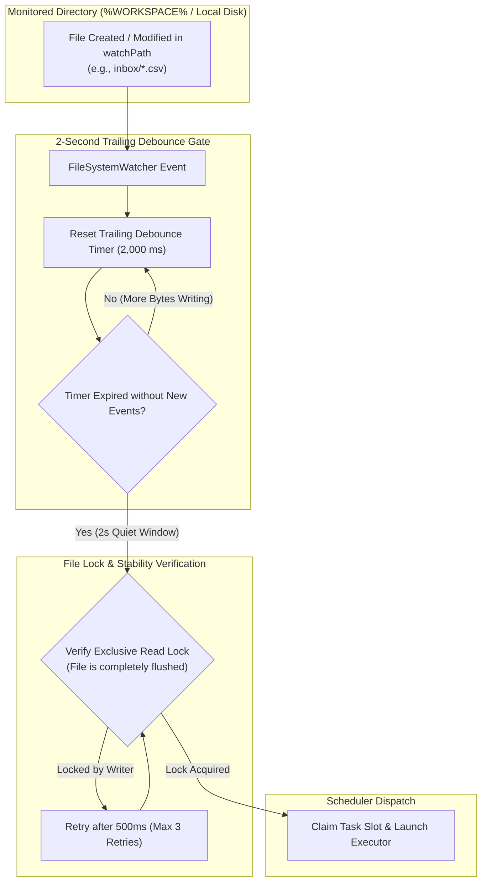
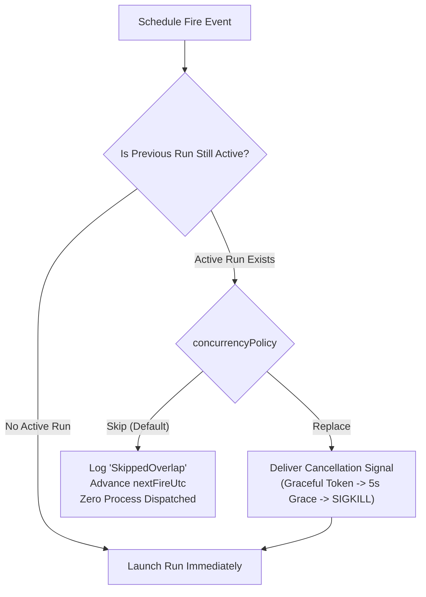
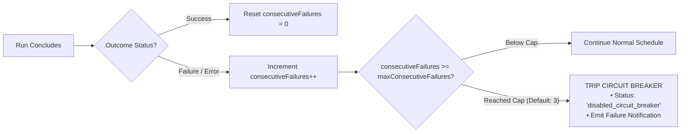

# Filesystem Directory Watching, Downtime Catch-Up & Resilience Gates

Unattended background automation must gracefully handle non-ideal operational environments: files copied in chunks over slow networks, laptop lids closing during scheduled hours, external API service outages, and overlapping execution runs. Without robust safeguards, a single failed network request can loop indefinitely, exhausting compute budgets, or partial file reads can corrupt database imports.

Nova AI Workspace incorporates event-driven filesystem monitoring alongside three core resilience gates: trailing write debounce, 24-hour downtime catch-up recovery, and automatic circuit breakers.

---

## 1. Event-Driven Filesystem Directory Watching (`watchPath`)

In addition to temporal cron schedules, Nova supports reactive, event-driven triggering based on filesystem changes:



### The 2-Second Trailing Debounce
When an external process writes a large file (such as a 50 MB database dump or CSV export), file creation events fire on the first byte, long before the file is finished writing. Attempting to read immediately causes `IOException: The process cannot access the file because it is being used by another process`.

Nova enforces a mandatory **2-second trailing debounce**:
1. When a filesystem change is detected in `watchPath`, a 2,000-millisecond timer starts.
2. Every subsequent byte write or modification resets the timer.
3. Only after the directory remains completely quiet for a full 2,000 ms does Nova attempt to verify file stability and trigger the task.

---

## 2. Downtime Recovery & Catch-Up Policies (`catchUpMissed`)

Laptops and developer workstations frequently enter sleep or hibernation states during scheduled execution windows (e.g., overnight). 

Nova evaluates downtime recovery using the `catchUpMissed` flag:

```
+-----------------------------------------------------------------------------------+
| PARAMETER STATE       | RECOVERY BEHAVIOR UPON SYSTEM BOOT / WAKE                 |
+-----------------------+-----------------------------------------------------------+
| catchUpMissed = true  | If the machine was offline during a scheduled fire, the   |
| (Default)             | task executes immediately upon wake if the missed time is |
|                       | within the 24-hour lookback window.                       |
+-----------------------+-----------------------------------------------------------+
| catchUpMissed = false | Missed fires are discarded; nextFireUtc advances to the   |
|                       | next future occurrence on the schedule.                   |
+-----------------------------------------------------------------------------------+
```

### Anti-Cascade Invariants (The 24-Hour Lookback Window)
If a computer was offline for an extended duration (e.g., a 2-week vacation):
* Nova limits the catch-up window to **24 hours**.
* If multiple scheduled intervals elapsed during the downtime, Nova executes **exactly one catch-up run** to bring state current, rather than launching an overwhelming burst of back-to-back runs.
* Subsequent runs resume their normal, predictable calendar schedule.

---

## 3. Concurrency Governance: `Skip` vs `Replace`

If a task's execution takes longer than its schedule interval (e.g., an hourly scraping run takes 75 minutes due to heavy network latency), unmanaged schedulers spawn overlapping concurrent processes that contend for shared workspace files and database locks.

Nova enforces explicit concurrency policies via `concurrencyPolicy`:



| Policy | Behavior | Best Use Case |
| :--- | :--- | :--- |
| **`Skip`** *(Default)* | Suppresses the new run. The existing run continues uninterrupted. Nova records a `skipped_overlap` entry in the database. | Data ingestion, report generation, and database imports where duplicate runs risk race conditions. |
| **`Replace`** | Delivers a cancellation signal to the active run, waits up to a 5-second graceful termination deadline, and launches the fresh run. | Live status dashboards, streaming monitors, or tasks where only the freshest output matters. |

---

## 4. Automated Circuit Breakers (`consecutiveFailures`)

Unattended background tasks that experience unhandled exceptions or connection errors must not run indefinitely, wasting API tokens and cloud budgets:



### Circuit Breaker Mechanics
1. **Consecutive Failure Tracking:** Nova tracks consecutive run failures in SQLite. Any successful run immediately resets the counter to 0.
2. **Trip Threshold:** Governed by `maxConsecutiveFailures` (default: 3).
3. **Automatic Disabling:** Once tripped, Nova automatically transitions the task state to `disabled_circuit_breaker`, preventing further automated executions.
4. **Operator Recovery:** Operators re-enable the task via [`nova.scheduled_task_enable`](../../../../mcp-reference/tools/scheduled-tasks/nova-scheduled-task-enable.md), which atomically clears the failure counter and reschedules the next fire timestamp.

---

## 5. Related Documentation

* [Human-Readable Cron Syntax & Temporal Dispatch](../cron-syntax-and-temporal-dispatch/README.md): Cron expressions, time zones, and fixed intervals.
* [Schedules, Triggers & Concurrency Hub](../README.md): High-level scheduling architecture.
* [Task Executors & Autonomy Modes](../../executors-and-autonomy/README.md): Runner engines, budget caps, and turn limits.
* [Enable Task Tool Reference](../../../../mcp-reference/tools/scheduled-tasks/nova-scheduled-task-enable.md) · [Disable Task Tool Reference](../../../../mcp-reference/tools/scheduled-tasks/nova-scheduled-task-disable.md)
