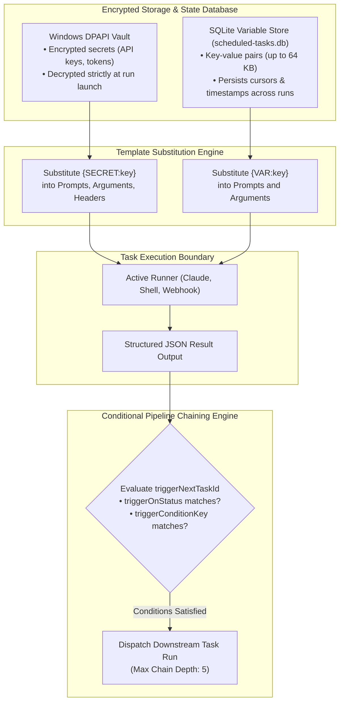

# Workspaces, Encrypted Secrets, Variables & Pipeline Chaining

Sophisticated background automation requires more than isolated command runs: tasks must store state across consecutive runs, manage input and output files safely, consume sensitive credentials without leaking them into logs, and hand off results to downstream tasks in multi-stage workflows.

Nova AI Workspace provides an integrated data plane for scheduled tasks, combining dedicated terminal workspaces, Windows DPAPI-encrypted secrets, persistent key-value variables, and conditional multi-task pipeline chaining.

---

## 1. Domain Architecture & Subguides

The Workspaces, Secrets & Chaining subsystem is divided into two specialized technical guides:

```
+-----------------------------------------------------------------------------------+
|                     WORKSPACES, SECRETS & CHAINING DOMAIN                         |
+-----------------------------------------------------------------------------------+
| 1. Workspace Storage & File Boundaries  | shared/ root, inbox/ and outbox/        |
|                                         | mailboxes, 1 MiB text limit, soft-caps. |
+-----------------------------------------+-----------------------------------------+
| 2. Encrypted Secrets & Chaining         | DPAPI task secrets, 64 KB variables,    |
|                                         | conditional chaining, cycle detection.  |
+-----------------------------------------------------------------------------------+
```

| Guide | Focus Area | Core Architectural Concepts |
| :--- | :--- | :--- |
| **[Workspace Storage & File Boundaries](workspace-storage-and-file-boundaries/README.md)** | Workspace File Management | Dedicated terminal workspace binding (`workspaceId`), directory structure (`shared/`, `inbox/`, `outbox/`), 1 MiB UTF-8 file reading and writing ceiling, binary file suppression, and automated 14-day soft-cap mailbox retention. |
| **[Encrypted Secrets, Variables & Chaining](encrypted-secrets-variables-and-chaining/README.md)** | State, Credentials & Pipelines | Windows DPAPI task credential encryption, in-memory `{SECRET:key}` substitution, persistent 64 KB SQLite state variables (`{VAR:key}`), conditional downstream task triggering (`triggerNextTaskId`, `triggerOnStatus`), cycle detection, and max depth limit of 5. |

---

## 2. Integrated Data Plane Topology

The data plane coordinates credential decryption, variable substitution, and downstream task dispatch during a scheduled run:



---

## 3. Data Plane Safety Contracts

1. **The 1 MiB File Ceiling:** All file reads and writes via MCP workspace tools strictly enforce a 1,048,576 byte ceiling, preventing multi-megabyte payloads from stalling agent context windows.
2. **Volatile Secret Injections:** Secrets are decrypted into short-lived in-memory buffers immediately prior to process creation and injected as environment variables or headers, leaving zero plaintext traces on disk.
3. **Pipeline Chaining Limits:** Multi-task pipelines enforce a hard limit of 5 sequential tasks with runtime cycle detection, eliminating infinite execution loops.

---

## 4. Related Architecture Guides

* [Workspace Storage & File Boundaries](workspace-storage-and-file-boundaries/README.md): Mailbox folders (`inbox/`, `outbox/`) and file size limits.
* [Encrypted Secrets, Variables & Chaining](encrypted-secrets-variables-and-chaining/README.md): DPAPI secrets, variables, and multi-task pipelines.
* [Scheduled Tasks Engine Hub](../README.md): Master hub, architecture control planes, and complete MCP tool matrix.
* [Schedules, Triggers & Concurrency](../scheduling-and-triggers/README.md): Temporal cron schedules and filesystem directory watching.
* [Task Executors & Autonomy Modes](../executors-and-autonomy/README.md): Execution lanes and budget limits.
* [Workspace Read Reference](../../../mcp-reference/tools/scheduled-tasks/nova-scheduled-task-workspace-read.md) · [Secret Set Reference](../../../mcp-reference/tools/scheduled-tasks/nova-scheduled-task-secret-set.md)
