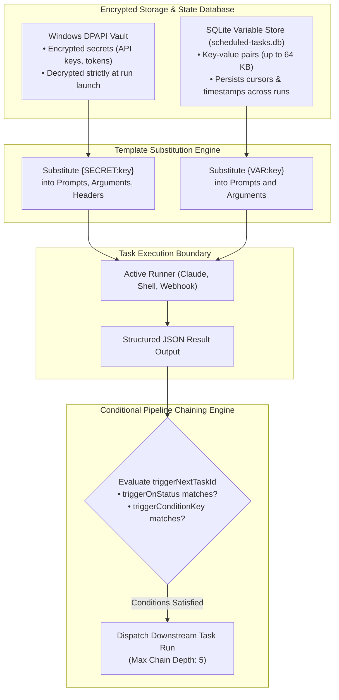
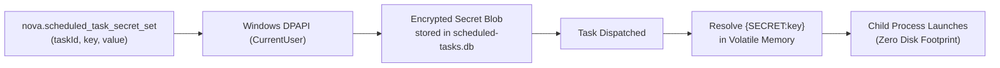
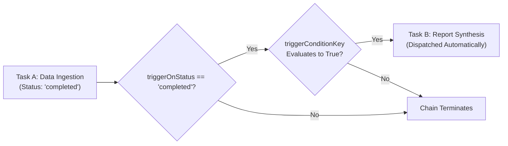

# Encrypted Task Secrets, Persistent Variables & Pipeline Chaining

Sophisticated background automation requires more than isolated, single-step scripts: tasks must store state across consecutive runs (e.g., tracking database pagination cursors or last-seen timestamps), consume sensitive credentials without exposing them in transcripts, and trigger downstream tasks in multi-stage workflows.

Nova AI Workspace provides an integrated data plane for scheduled tasks, combining Windows DPAPI-encrypted secrets, persistent 64 KB state variables, conditional multi-task pipeline chaining, and reusable task templates.

---

## 1. Integrated Data Plane Topology

The data plane coordinates credential decryption, variable substitution, and downstream task dispatch during a scheduled run:



---

## 2. Task-Scoped Encrypted Secrets

Scheduled tasks frequently require sensitive credentials (e.g., GitHub tokens, Slack webhook keys, database passwords). Hardcoding these credentials into task prompts exposes them in plain text across logs and database tables.

Nova binds secrets securely to individual tasks using Windows DPAPI:



### Substitution Syntax
In task prompts, command arguments, or webhook headers, reference the secret using standard placeholder syntax:
```
{SECRET:api_token}
```
* **Prompt Substitution:** Replaced with the decrypted secret in memory immediately before delivering the prompt to Claude Code or Codex CLI.
* **Webhook Headers:** Substituted into HTTP headers (e.g., `Authorization: Bearer {SECRET:stripe_key}`).
* **Zero Transcript Exposure:** Nova's capture redactor cross-references active secret hashes, replacing any accidentally printed tokens in stdout/stderr logs with `[redacted:secret]`.

---

## 3. Persistent State Variables (Up to 64 KB)

When a task executes periodically (e.g., scraping an RSS feed or monitoring an issue tracker), it needs to remember the state from its previous run (such as `last_seen_id: 4892` or `page_cursor: "cursor_b8a"`).

Nova provides dedicated task variables stored in SQLite:

```json
{
  "taskId": "task_github_issue_monitor",
  "key": "last_processed_issue_id",
  "value": "1042"
}
```

### Operational Invariants
* **64 KB Capacity:** Each variable can hold up to 65,536 bytes of text or serialized JSON state.
* **Template Substitution:** In prompts or arguments, reference variables using:
  ```
  Check for all issues created after ID {VAR:last_processed_issue_id}
  ```
* **Programmatic Updates:** Agents update variable state at the end of a run using [`nova.scheduled_task_var_set`](../../../../mcp-reference/tools/scheduled-tasks/nova-scheduled-task-var-set.md).

---

## 4. Multi-Task Pipeline Chaining

Complex workflows frequently require multi-stage pipelines: for example, **Task A** scrapes raw web data, then triggers **Task B** to synthesize a summary report, which triggers **Task C** to post a webhook alert.

Nova supports conditional task chaining via task definition parameters:

| Chaining Parameter | Type | Functional Meaning |
| :--- | :--- | :--- |
| **`triggerNextTaskId`** | string (UUID) | The ID of the downstream task to trigger upon run completion. |
| **`triggerOnStatus`** | string | Status condition required to trigger (`completed`, `failed`, or `any`). |
| **`triggerConditionKey`**| string | An optional JSON key path evaluated against the upstream run's output. |



### Chaining Invariants & Cycle Detection
1. **Max Chain Depth (5 Tasks):** To prevent infinite execution loops caused by cyclic dependencies, Nova strictly limits pipeline chaining to a maximum depth of **5 sequential tasks**.
2. **Cycle Detection:** The scheduler traces the directed graph of `triggerNextTaskId` pointers prior to dispatch; any detected cyclic loop aborts the chain immediately.
3. **Payload Forwarding:** Upstream run summary output is passed to downstream tasks as context in temporary workspace mailbox files (`shared/inbox/upstream_result.json`).

---

## 5. Task Templates & Portability (`export` / `import`)

To streamline workflow creation, Nova includes pre-packaged automation templates accessible via [`nova.scheduled_task_templates`](../../../../mcp-reference/tools/scheduled-tasks/nova-scheduled-task-templates.md):

* **Website Health Checker:** Periodic HTTP webhook verifying endpoint availability and status codes.
* **Autonomous Intelligence Scraper:** Claude Code agent with Nova MCP access executing recurring web audits.
* **Git Repository Cleaner:** Scheduled PowerShell maintenance script pruning stale local branches and caches.

### Export & Import
Operators can export complete task bundles (including schedules, prompts, budget caps, and variable schemas) using [`nova.scheduled_task_export`](../../../../mcp-reference/tools/scheduled-tasks/nova-scheduled-task-export.md) and restore them across environments using [`nova.scheduled_task_import`](../../../../mcp-reference/tools/scheduled-tasks/nova-scheduled-task-import.md). For security, plaintext secrets are omitted from exports and must be re-keyed via DPAPI.

---

## 6. Related Documentation

* [Workspace Storage & File Boundaries](../workspace-storage-and-file-boundaries/README.md): Mailbox folders (`inbox/`, `outbox/`) and 1 MiB text limits.
* [Workspaces, Secrets & Chaining Hub](../README.md): High-level data plane overview.
* [Password Vault & DPAPI Credentials](../../../privacy/vault-and-secrets/README.md): System-wide credential encryption.
* [Secret Set Reference](../../../../mcp-reference/tools/scheduled-tasks/nova-scheduled-task-secret-set.md) · [Var Set Reference](../../../../mcp-reference/tools/scheduled-tasks/nova-scheduled-task-var-set.md)
