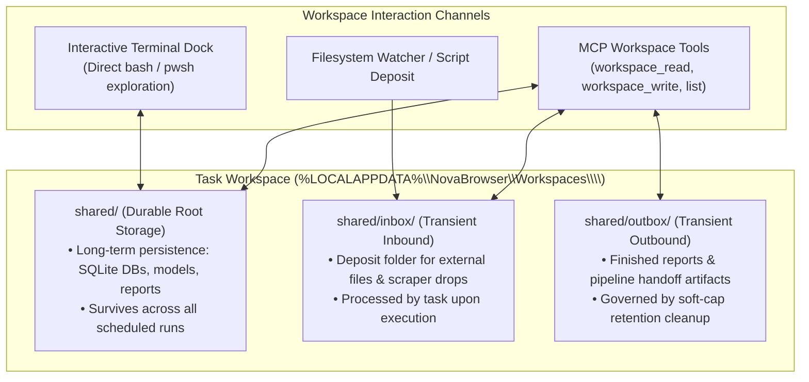
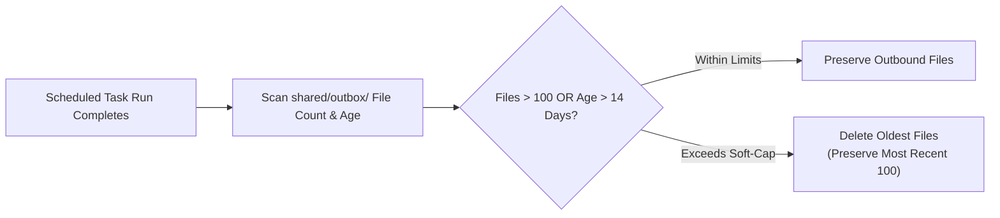

# Workspace Storage, File Boundaries & Retention Invariants

Autonomous background tasks frequently ingest input documents, generate intermediate analysis files, and produce final reports. Relying on arbitrary filesystem locations (such as system temp folders or user desktop directories) creates severe file contention, risks accidental data deletion, and complicates cross-task auditing.

Nova AI Workspace binds every scheduled task to an isolated **Terminal Workspace** backed by an explicit directory hierarchy, strict 1 MiB file size boundaries, and automated mailbox retention policies.

---

## 1. Physical Workspace Directory Hierarchy

Each scheduled task is allocated a dedicated root directory on disk under Nova's workspace storage tree:



### Directory Roles & Lifecycles
* **`shared/` (Durable Root):** Files residing directly in `shared/` persist indefinitely across task runs. This is the designated home for cumulative tracking databases, model weights, and durable configuration files.
* **`shared/inbox/` (Transient Inbound Mailbox):** A drop zone for new input data (e.g., raw CSVs dropped by an external crawler or user). Tasks ingest files from `inbox/`, process them, and archive or delete them.
* **`shared/outbox/` (Transient Outbound Mailbox):** A staging zone for processed deliverables (e.g., generated PDF summaries, exported JSON data) destined for downstream pipeline tasks or external SFTP/Mail connectors.

---

## 2. File Boundary Contracts & Safety Limits

To protect host memory and prevent agent context window exhaustion, Nova enforces strict file reading and writing guardrails:

```
+-----------------------------------------------------------------------------------+
| BOUNDARY DIMENSION    | ENFORCED VALUE | OPERATIONAL CONTRACT                     |
+-----------------------+----------------+------------------------------------------+
| Text Size Ceiling     | 1 MiB          | nova.scheduled_task_workspace_read and   |
|                       | (1,048,576 B)  | workspace_write strictly reject payloads |
|                       |                | exceeding 1 MiB.                         |
+-----------------------+----------------+------------------------------------------+
| Binary Suppression    | Metadata Only  | Reading binary files (.zip, .exe, .png)  |
|                       |                | returns size and SHA-256 hash without    |
|                       |                | dumping corrupt byte strings.            |
+-----------------------+----------------+------------------------------------------+
| Path Sandboxing       | Strict Jail    | File paths cannot escape the bound       |
|                       |                | workspace. '..' traversals are rejected. |
+-----------------------------------------------------------------------------------+
```

### Why the 1 MiB Boundary Is Mandatory
In AI-assisted background automation, reading a 100 MB log file into memory over JSON-RPC stalls the MCP transport and overflows the LLM's context token window. Enforcing a hard 1 MiB ceiling forces agents to use streaming tools, grep filters, or chunked processing rather than dumping entire datasets into context.

---

## 3. Soft-Cap Retention & Mailbox Garbage Collection

Transient mailboxes (`inbox/` and `outbox/`) can accumulate thousands of files if downstream processes fail to clean them up. Nova enforces automated soft-cap retention:



* **Soft-Cap Threshold:** Default 100 files or 14-day maximum age for transient mailboxes.
* **Graceful Pruning:** When the threshold is exceeded, Nova purges the oldest processed files from `outbox/`, keeping disk consumption predictable while preserving the most recent execution artifacts for operator inspection.

---

## 4. Workspace Management MCP Tools

Agents and operators inspect and manipulate workspace files programmatically without requiring raw shell commands:

| MCP Tool | Purpose | Key Parameters |
| :--- | :--- | :--- |
| [`nova.scheduled_task_workspace`](../../../../mcp-reference/tools/scheduled-tasks/nova-scheduled-task-workspace.md) | Returns root directory path and disk usage metrics for a task. | `taskId` |
| [`nova.scheduled_task_workspace_list`](../../../../mcp-reference/tools/scheduled-tasks/nova-scheduled-task-workspace-list.md) | Lists files and subdirectories with sizes and modification times. | `taskId`, `subPath?` |
| [`nova.scheduled_task_workspace_read`](../../../../mcp-reference/tools/scheduled-tasks/nova-scheduled-task-workspace-read.md) | Reads UTF-8 file content (enforcing the 1 MiB size cap). | `taskId`, `path` |
| [`nova.scheduled_task_workspace_write`](../../../../mcp-reference/tools/scheduled-tasks/nova-scheduled-task-workspace-write.md) | Writes or updates a file (enforcing the 1 MiB size cap). | `taskId`, `path`, `content` |

---

## 5. Related Documentation

* [Encrypted Secrets, Variables & Pipeline Chaining](../encrypted-secrets-variables-and-chaining/README.md): DPAPI secrets, 64 KB variables, and multi-task pipelines.
* [Workspaces, Secrets & Chaining Hub](../README.md): High-level data plane overview.
* [Terminal Workspaces Architecture](../../../terminal-workspaces/README.md): Interactive ConPTY terminal dock integration.
* [Workspace Read Tool Reference](../../../../mcp-reference/tools/scheduled-tasks/nova-scheduled-task-workspace-read.md) · [Workspace Write Reference](../../../../mcp-reference/tools/scheduled-tasks/nova-scheduled-task-workspace-write.md)
