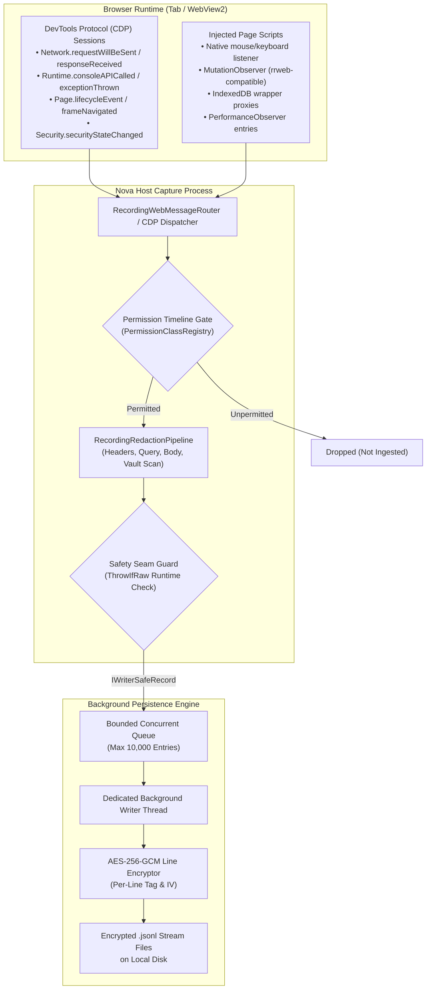

# Architecture & Capture Pipeline

Nova's Session Recording engine is built to capture dense, multi-stream web events without introducing noticeable latency, frame drops, or renderer pauses in the host browser. Capturing live network traffic, high-frequency DOM mutations, console output, and input interactions requires robust isolation between the browser's UI thread and the disk persistence layer.

This guide provides the architectural overview of the capture pipeline, bounded queue mechanics, safety seam guarantees, and on-disk artifact layout.

---

## 1. Domain Architecture & Subguides

The Architecture & Capture Pipeline subsystem is divided into two specialized technical guides:

```
+-----------------------------------------------------------------------------------+
|                     ARCHITECTURE & CAPTURE PIPELINE DOMAIN                        |
+-----------------------------------------------------------------------------------+
| 1. Ingestion Engine & Queue Management  | CDP protocol hooks, page observers,    |
|                                         | 10,000-entry bounded queue, gap markers.|
+-----------------------------------------+-----------------------------------------+
| 2. Safety Seams & DOM Snapshots         | IRawCapturePayload vs IWriterSafeRecord,|
|                                         | ThrowIfRaw guard, DOM snapshot quotas.  |
+-----------------------------------------------------------------------------------+
```

| Guide | Focus Area | Core Architectural Concepts |
| :--- | :--- | :--- |
| **[Ingestion Engine & Queue Management](ingestion-engine-and-queue-management/README.md)** | Event Ingestion & Backpressure | CDP domain sessions (`Network`, `Runtime`, `Page`, `Security`), page-side observers, `RecordingWebMessageRouter`, 10,000-entry bounded concurrent queue, worker thread coordination, and typed gap markers (`gap_start`, `stream_truncated`). |
| **[Safety Seams & DOM Snapshots](safety-seams-and-dom-snapshots/README.md)** | Defensive Boundaries & Context Capture | Compiler and runtime safety seam (`ThrowIfRaw` guard), `MetadataOnlyRecord` fallback primitives, automated interaction triggers (`DomSnapshotAutoTrigger`), 256 KB HTML serialization caps, and 10-second bridge execution timeouts. |

---

## 2. End-to-End Ingestion Flow

Event capture originates from two complementary sources within the recorded tab:



---

## 3. Core Architectural Guarantees

1. **Non-Blocking Execution:** All file I/O and encryption operations execute on a dedicated background worker thread pool. Bursts of page events cannot degrade tab responsiveness or drop UI frame rates.
2. **The 10,000-Entry Bounded Queue:** The writer queue is strictly capped at 10,000 events. Under catastrophic event flooding (e.g., an infinite logging loop), the queue safely drops the oldest unwritten events while logging typed gap markers.
3. **Safety Seam Contract:** Ingested payloads are partitioned at the compiler level. Payloads carrying raw, un-redacted bytes implement raw capture contracts; the writer queue accepts only verified, post-redaction records. Enqueuing un-redacted bytes triggers an immediate runtime exception at the boundary rather than leaking secrets to disk.
4. **Resilient DOM Snapshots:** DOM snapshots are captured automatically upon user/agent interactions, capped at ~256 KB, and isolated by a 10-second bridge execution timeout.

---

## 4. Physical Artifact Layout on Disk

Recordings are written to a dedicated folder in the Nova user profile:

```
%LOCALAPPDATA%\NovaBrowser\Recordings\<recording-id>\
```

Inside this directory, the recording is structured as follows:

```
<recording-id>/
├── manifest.json              # Plaintext manifest (zero secrets; ID, timestamps, classes)
├── dek.wrapped                # 256-bit AES DEK wrapped with Windows DPAPI (CurrentUser)
├── network.cdp.jsonl          # Encrypted CDP network requests, responses, and headers
├── console.jsonl              # Encrypted console.log/warn/error entries
├── errors.jsonl               # Encrypted unhandled JavaScript exceptions
├── lifecycle.jsonl            # Encrypted navigation events and in-stream gap markers
├── interactions.jsonl         # Encrypted agent and user click/key/input sequences
├── dom-snapshots.jsonl        # Encrypted DOM snapshot index and HTML payloads
├── security-violations.jsonl  # Encrypted CSP, mixed content, and TLS warnings
├── performance.jsonl          # Encrypted PerformanceObserver timing marks
├── workers.jsonl              # Encrypted Web Worker and Service Worker lifecycle events
├── indexeddb-ops.jsonl        # Encrypted IndexedDB transaction and query metadata
├── websocket-payloads.jsonl   # Encrypted WebSocket text frames (if granted)
├── indexeddb-values.jsonl     # Encrypted secret-bearing IDB records (if granted)
└── dom-mutations.jsonl        # Brotli-compressed, encrypted rrweb mutation stream
```

---

## 5. Related Architecture Guides

* [Ingestion Engine & Queue Management](ingestion-engine-and-queue-management/README.md): Detailed CDP hook mechanics, queue eviction, and gap markers.
* [Safety Seams & DOM Snapshots](safety-seams-and-dom-snapshots/README.md): Runtime safety guards, metadata fallbacks, and DOM snapshot serialization.
* [Session Recording Hub](../README.md): Master hub, operational limits, and complete MCP tool matrix.
* [Streams & Permission Classes](../streams-and-permission-classes/README.md): Catalog of the 12 stream files and permission taxonomy.
* [Encryption & Redaction Pipeline](../encryption-and-redaction/README.md): AES-256-GCM envelope encryption and in-memory redaction.
* [Querying & Time-Travel Debugging](../query-and-time-travel/README.md): Interrogating network streams, console logs, and DOM snapshots post-mortem.
* [Start Recording Tool Reference](../../../mcp-reference/tools/session-recording/nova-session-record-start.md) · [Snapshot DOM Tool Reference](../../../mcp-reference/tools/session-recording/nova-session-record-snapshot-dom.md)
