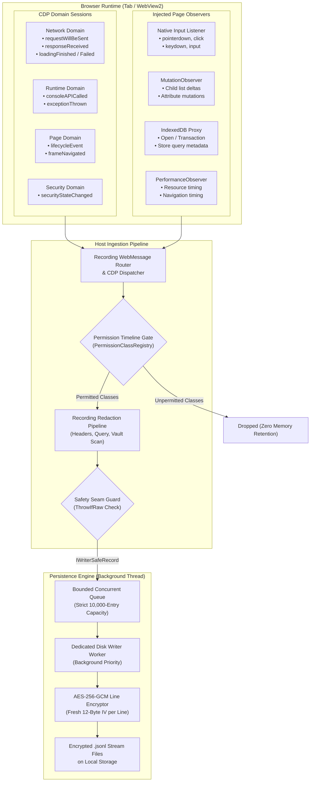

# Ingestion Engine & Bounded Queue Architecture

Nova's Session Recording engine is engineered to capture dense, multi-stream web events without introducing measurable UI thread latency, dropped animation frames, or renderer stalls in the host browser. Capturing live network traffic, high-frequency DOM mutations, console logs, and input interactions requires strict decoupling between the browser rendering engine and disk persistence.

This guide details the internal mechanics of the ingestion pipeline: from DevTools Protocol (CDP) session management and page script observers to the asynchronous message router, the 10,000-entry bounded concurrent queue, worker thread coordination, and in-stream lossiness gap markers.

---

## 1. End-to-End Ingestion Topology

Event collection originates from two distinct collection vectors within the recorded tab: Chrome DevTools Protocol (CDP) domain sessions and injected in-page script observers. Both vectors feed into the host ingestion pipeline:



---

## 2. Chrome DevTools Protocol (CDP) Session Lifecycle

When a recording is started via [`nova.session_record_start`](../../../../mcp-reference/tools/session-recording/nova-session-record-start.md), Nova attaches a DevTools protocol session directly to the target tab's underlying WebView2 environment.

### Hooked Protocol Domains

| CDP Domain | Monitored Events | Capture Rationale |
| :--- | :--- | :--- |
| **`Network`** | `Network.requestWillBeSent`<br/>`Network.responseReceived`<br/>`Network.loadingFinished`<br/>`Network.loadingFailed`<br/>`Network.dataReceived` | Captures full HTTP/HTTPS request and response metadata, headers, redirect chains, MIME types, and timing waterfalls without monkey-patching browser `fetch` or `XMLHttpRequest`. |
| **`Runtime`** | `Runtime.consoleAPICalled`<br/>`Runtime.exceptionThrown` | Collects all standard console output levels (`log`, `warn`, `error`, `info`, `debug`, `dir`) and unhandled JavaScript promise rejections with full stack traces. |
| **`Page`** | `Page.lifecycleEvent`<br/>`Page.frameNavigated`<br/>`Page.domContentEventFired`<br/>`Page.loadEventFired` | Maps the lifecycle milestones of the root frame and child iframes, enabling precise correlation between navigation state and subsequent user actions. |
| **`Security`** | `Security.securityStateChanged`<br/>`Security.visibleSecurityStateChanged` | Logs certificate transitions, Mixed Content blocks, and Content Security Policy (CSP) enforcement events into `security-violations.jsonl`. |

### Non-Invasive Attachment Invariants
* **Zero Script Mutation:** DevTools protocol hooking operates at the browser core level. Target web applications cannot detect CDP hooks via prototype inspection, `Function.toString()` auditing, or global variable queries.
* **Detachment Cleanup:** Upon invoking [`nova.session_record_stop`](../../../../mcp-reference/tools/session-recording/nova-session-record-stop.md) or upon tab closure, all CDP event listeners are detached cleanly. No persistent debugging flags or memory buffers remain in the tab.

---

## 3. Injected Page Script Observers

Certain client-side events cannot be captured passively through standard CDP protocol domains without introducing excessive polling overhead. Nova injects lightweight page scripts at document creation time:

### 1. Native Interaction Observers
* **Event Interception:** Captures `pointerdown`, `click`, `auxclick`, `keydown`, `input`, and `change` events on the window capture phase.
* **Selector Ancestry Generation:** When an interaction occurs, the observer calculates an optimal CSS selector path (e.g., `form#checkout > div.actions > button.btn-primary`) and records element metadata (bounding client rect, visible text snippet).
* **Synthetic vs Real Disambiguation:** Distinguishes between native user inputs and synthetic agent events dispatched via [`nova.click_selector`](../../../../mcp-reference/tools/browser-automation/nova-click-selector.md) or [`nova.type_selector`](../../../../mcp-reference/tools/browser-automation/nova-type-selector.md).

### 2. DOM Mutation Observers (`MutationObserver`)
* **Continuous Delta Tracking:** Evaluates a `MutationObserver` instance recording document tree alterations (child node additions, removals, attribute modifications, text node changes).
* **Format Compatibility:** Serializes mutations into an rrweb-compatible JSON structure for full time-travel DOM reconstruction.
* **Throttle & Debounce:** Batches rapid DOM mutations (e.g., during complex virtual-DOM re-renders) into 50-millisecond windows to minimize postMessage serialization overhead.

### 3. IndexedDB Proxy Traps
* **Non-Destructive Wrapping:** Intercepts `window.indexedDB.open`, `IDBDatabase.transaction`, and `IDBObjectStore` operations.
* **Operation Metadata:** Records database names, object store names, operation modes (`readonly`, `readwrite`), and hashed primary keys. Actual stored records are strictly withheld unless the secret-bearing `indexeddb_values` permission class is explicitly granted.

### 4. PerformanceObserver Stream
* Intercepts `navigation`, `resource`, `paint`, and `largest-contentful-paint` performance timing entries, streaming metrics directly into `performance.jsonl`.

---

## 4. The 10,000-Entry Bounded Concurrent Queue

A catastrophic failure mode in web session recorders is memory exhaustion. If a rogue client script enters an infinite error loop or streams millions of WebSocket packets, buffering events indefinitely in RAM can crash the browser host process.

To eliminate this vulnerability, Nova enforces a strict mathematical bound on the writer queue:

$$\text{Queue Capacity} = 10,000 \quad \text{Entries}$$

```
  Ingestion Burst (CDP + Observers)
                 │
                 ▼
     ┌───────────────────────┐
     │  Safety Seam Check    │
     └───────────┬───────────┘
                 │
                 ▼
        Queue Count < 10,000?
        ┌────────┴────────┐
        ▼                 ▼
     [ YES ]           [ NO ]
        │                 │
        │                 ├──► 1. Drop Oldest Entry (FIFO Eviction)
        │                 └──► 2. Inject Gap Marker (stream_truncated / gap_start)
        ▼                 ▼
 ┌───────────────────────────────┐
 │   Bounded Concurrent Queue    │  ◄── Capacity: 10,000 max
 └──────────────┬────────────────┘
                │
                ▼  (Single Background Worker)
 ┌───────────────────────────────┐
 │   AES-256-GCM Line Writer     │
 └──────────────┬────────────────┘
                │
                ▼
      Encrypted Disk Files
```

### Operational Invariants
1. **$O(1)$ Enqueue Time:** The UI thread or CDP event handler enqueues records in constant time, never performing synchronous file writes or heavy cryptographic operations.
2. **Dedicated Background Writer:** A single worker thread dequeues events, coordinates line-level encryption, and flushes bytes to disk sequentially.
3. **Oldest-Drop Eviction Policy:** When the queue reaches its 10,000-entry capacity under sustained event flooding, the oldest unwritten item is immediately evicted to preserve the freshest forensic evidence.
4. **Gap Marker Accounting:** Whenever an item is evicted, the recorder updates an internal dropped-event counter and writes a typed gap marker into `lifecycle.jsonl`.

---

## 5. In-Stream Lossiness & Gap Markers

When reviewing a session recording post-mortem, determining whether a missing network call was absent from the wire or dropped due to queue pressure is essential for forensic accuracy. Nova writes explicit gap markers into the stream:

| Gap Marker Kind | Trigger Condition | Diagnostic Meaning |
| :--- | :--- | :--- |
| **`gap_start`** | The bounded queue experienced its first packet eviction during a burst. | Signals that events between this timestamp and `gap_end` may be missing or incomplete. |
| **`gap_end`** | Queue count returned below safe operational thresholds for 500 ms. | Marks the resumption of fully verified, gap-free recording. |
| **`stream_truncated`** | Recording was forcefully stopped during queue saturation or disk exhaustion. | Indicates that events after this marker were permanently dropped. |
| **`checkpoint_required`** | DOM mutation queue overflowed, invalidating the continuous delta chain. | Replay engines must pause DOM delta application until a new baseline snapshot is loaded. |
| **`checkpoint_written`** | Fresh DOM baseline snapshot was serialized and committed to disk. | Replay engines can resume DOM reconstruction starting from this snapshot index. |

---

## 6. Concrete Diagnostic Scenarios

### Scenario A: High-Throughput WebSocket Flood
A web application receives a high-frequency WebSocket stream (e.g., real-time financial market ticker emitting 3,000 messages/second):
1. Incoming frames saturate the host ingestion pipeline within 3.5 seconds.
2. The bounded queue fills to 10,000 items.
3. Nova's eviction policy engages: older incoming frames are dropped, and a `gap_start` marker is committed with payload metadata (message count, average frame size, dropped frame tally).
4. The host browser process maintains normal responsiveness, UI framerates remain locked at 60 FPS, and the tab does not freeze.

### Scenario B: Infinite Console Error Loop
A broken script triggers an unhandled promise rejection inside a recursive animation loop:
1. `Runtime.exceptionThrown` fires hundreds of times per second.
2. Nova buffers errors up to the quota threshold.
3. Once the stream quota is reached, subsequent identical error signatures are aggregated into a single `payload_suppressed` entry with recurrence counts, protecting disk storage and context window budgets during agent analysis.

---

## 7. Related Documentation

* [Safety Seams & DOM Snapshots](../safety-seams-and-dom-snapshots/README.md): Compiler safety contracts, `ThrowIfRaw` guard, and DOM snapshot serialization.
* [Capture Pipeline Hub](../README.md): Overview of the ingestion pipeline and queue architecture.
* [Streams & Permission Classes](../../streams-and-permission-classes/README.md): Catalog of the 12 stream files and permission taxonomy.
* [Start Recording Tool Reference](../../../../mcp-reference/tools/session-recording/nova-session-record-start.md) · [Stop Recording Tool Reference](../../../../mcp-reference/tools/session-recording/nova-session-record-stop.md)
