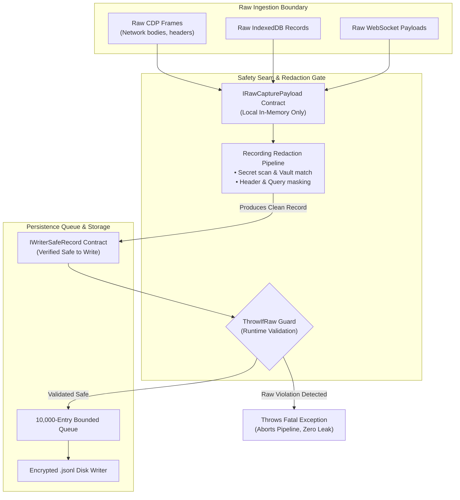
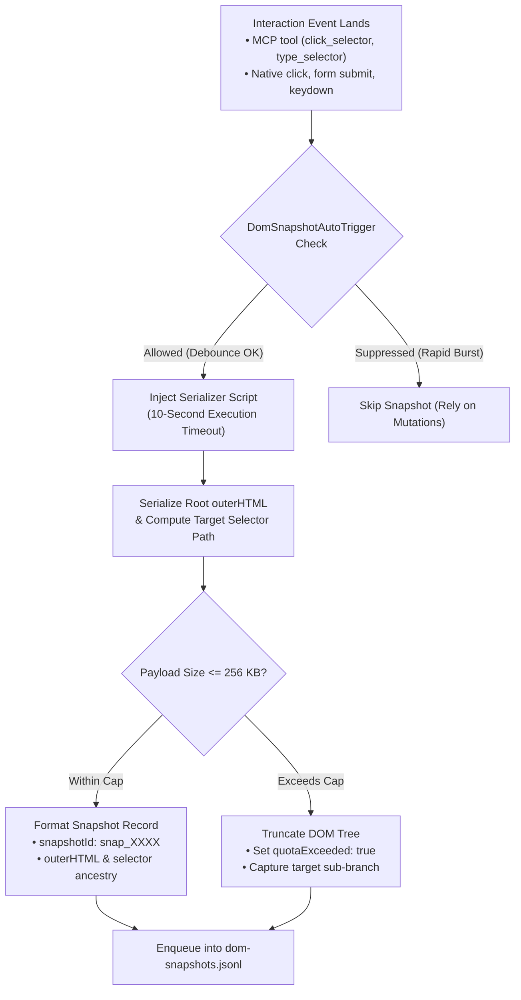

# Safety Seams & DOM Snapshot Architecture

Capturing web sessions requires stringent controls to prevent sensitive credentials from leaking to disk and to avoid freezing web pages during DOM serialization. A single un-redacted bearer token written to disk undermines the entire security boundary; similarly, serializing multi-megabyte DOM trees synchronously can freeze user interfaces and break automated tests.

This guide details Nova's two core defensive barriers: the compiler- and runtime-enforced Safety Seam architecture (partitioning raw payloads from writer-safe records) and the automated, quota-bounded DOM snapshot serialization pipeline.

---

## 1. The Compiler & Runtime Safety Seam

To guarantee that un-redacted credentials and raw secrets never reach persistent disk storage, Nova implements a strict two-tier safety contract between ingestion and disk persistence:



### Type Contracts: `IRawCapturePayload` vs `IWriterSafeRecord`
* **`IRawCapturePayload`:** Marks incoming, pre-redaction data. Objects implementing this interface exist exclusively within redactor-local memory. The writer queue method signatures strictly reject any object carrying this interface.
* **`IWriterSafeRecord`:** Marks verified, post-redaction records. Only objects implementing `IWriterSafeRecord` can be accepted by the background writer queue.

### The `ThrowIfRaw` Runtime Guard
Even if an implementation bug attempts to cast or bypass type checks, the persistence boundary invokes a mandatory runtime assertion before enqueuing any record:

```
WriterQueueSafetyContract.ThrowIfRaw(record);
```

If the payload implements `IRawCapturePayload` or fails compliance verification, the runtime throws an immediate exception, terminating the recording pipeline rather than writing potentially tainted bytes to persistent storage.

---

## 2. The `MetadataOnlyRecord` Primitive

When raw content cannot be safely captured—due to size caps, binary payloads, redaction failures, or stream quota exhaustion—Nova does not introduce ambiguous missing data. Instead, it emits a standardized `IWriterSafeRecord` of kind `MetadataOnlyRecord`:

```json
{
  "ts": "2026-10-18T10:14:22.184Z",
  "kind": "metadata_only",
  "reason": "websocket_payload_skipped_binary",
  "contentType": "application/octet-stream",
  "sizeBytes": 65536,
  "sha256": "4b227777d4dd1fc61c6f884f48641d02b4d121d3fd328cb08b5531fcacdabf8a"
}
```

### Standard Reason Codes

| Reason Code | Trigger Scenario | Forensic Utility |
| :--- | :--- | :--- |
| **`payload_size_exceeded`** | Network body or WebSocket frame exceeded the configured maximum byte cap (e.g., 2 MB). | Proves a response occurred, records its exact size and hash, without exhausting memory. |
| **`binary_content_omitted`** | Inbound or outbound stream contained non-text binary frames (Protobuf, binary ArrayBuffer). | Logs transfer occurrence and size without polluting JSONL streams with base64 blobs. |
| **`redaction_quota_exhausted`** | Entity contained an excessive number of token matches, risking redactor timeouts. | Downgrades payload safely while preserving request timing and URL routing evidence. |
| **`unsupported_mime_type`** | Media streaming responses (video/mp4, audio/webm) bypassing text inspection. | Documents media delivery milestones without saving raw media streams. |

---

## 3. In-Stream Checkpoint and Safety Markers

In addition to queue-level overflow markers, the safety seam injects lifecycle records into `lifecycle.jsonl` whenever state boundaries change:

| Marker Type | Trigger Event | Replay Engine Action |
| :--- | :--- | :--- |
| **`payload_suppressed`** | An individual record's body exceeded size limits or failed quota. | Neighboring stream records are intact; only this body was replaced with metadata. |
| **`redaction_state_lost`** | Incremental text redactor lost synchronization across a chunk boundary. | Stream is downgraded to metadata-only until redactor re-synchronizes. |
| **`permission_revoked`** | A permission class was revoked mid-recording by the user. | Stream permanently stops producing records from this timestamp forward. |
| **`checkpoint_required`** | DOM mutation queue overflowed; delta chain is broken. | Replay engine must wait for a fresh baseline before continuing. |
| **`checkpoint_written`** | Fresh DOM baseline snapshot written to disk. | Replay engine can resume DOM reconstruction from this snapshot. |

---

## 4. Automated DOM Snapshot Triggers (`DomSnapshotAutoTrigger`)

Full DOM tree snapshots provide visual and semantic page context. However, taking continuous full-page snapshots on every minor frame is computationally prohibitive. Nova combines automatic event-driven triggers with strict serialization guardrails:



### Auto-Trigger Scenarios
1. **MCP Tool Execution:** Whenever an agent executes [`nova.click_selector`](../../../../mcp-reference/tools/browser-automation/nova-click-selector.md), [`nova.type_selector`](../../../../mcp-reference/tools/browser-automation/nova-type-selector.md), or [`nova.choose_option`](../../../../mcp-reference/tools/browser-automation/nova-choose-option.md), a post-interaction snapshot is queued automatically.
2. **Native Form Submissions:** Form submit events trigger immediate capture to freeze field values prior to page unload.
3. **Modal Dialog Openings:** DOM alterations resulting in high z-index overlay displays trigger snapshots to record blocker and dialog states.

---

## 5. Page-Side DOM Serialization Guardrails

Serializing the DOM in a complex Single Page Application (SPA) involves walking tens of thousands of nodes. Without strict safeguards, this process can freeze the tab's JavaScript event loop.

### 1. The ~256 KB Size Cap
* The page-side serializing script caps HTML output at approximately 256 KB.
* If a document tree exceeds this limit, the serializer prioritizes the interaction target's immediate DOM hierarchy (parent containers, siblings, and input controls) while truncating distant, non-interactive sub-trees.
* The resulting snapshot record is marked with `"quotaExceeded": true`, ensuring post-mortem tools know the periphery was truncated.

### 2. 10-Second Bridge Execution Timeout
* Serialization scripts are evaluated with an explicit 10-second hard execution timeout.
* If a web page's main thread is locked in an infinite JavaScript calculation or layout thrashing loop, the snapshot attempt aborts without crashing the host recording engine.
* The recorder logs a `dom_snapshot_timeout` event and continues collecting network and console telemetry uninterrupted.

### 3. Target Selector Ancestry Extraction
* For every interaction snapshot, Nova extracts the precise DOM ancestry chain:
  ```json
  {
    "snapshotId": "snap_9f41b8a1",
    "targetSelector": "#app > div.main-view > form.checkout > button[type='submit']",
    "targetTag": "BUTTON",
    "targetAttributes": {
      "id": "submit-btn",
      "class": "btn btn-primary is-disabled",
      "type": "submit"
    },
    "domSizeBytes": 184320,
    "quotaExceeded": false
  }
  ```
* This structure allows agents to inspect target button states (e.g., verifying whether `disabled` or `is-disabled` classes prevented submission) without downloading the entire page HTML.

---

## 6. On-Demand vs Automated DOM Snapshots

In addition to automated interaction snapshots, agents can trigger explicit, on-demand snapshots at any critical workflow juncture:

| Snapshot Mode | Invocation Mechanism | Use Case |
| :--- | :--- | :--- |
| **Automated** | Triggered by user clicks, form submits, or MCP interaction tools. | Zero-effort historical record of all state transitions caused by actions. |
| **On-Demand** | Explicitly called via [`nova.session_record_snapshot_dom`](../../../../mcp-reference/tools/session-recording/nova-session-record-snapshot-dom.md). | Pre-flight baseline capture before risky actions, or capturing transient visual states (animations, tooltips). |

---

## 7. Related Documentation

* [Ingestion Engine & Bounded Queue Architecture](../ingestion-engine-and-queue-management/README.md): CDP hooks, message routing, and the 10,000-entry queue.
* [Capture Pipeline Hub](../README.md): Architecture overview and physical disk layout.
* [Encryption & Redaction Pipeline](../../encryption-and-redaction/README.md): AES-256-GCM envelope encryption and in-memory redaction.
* [Snapshot DOM Tool Reference](../../../../mcp-reference/tools/session-recording/nova-session-record-snapshot-dom.md) · [DOM Snapshot Retrieval Reference](../../../../mcp-reference/tools/session-recording/nova-session-record-dom-snapshot.md)
