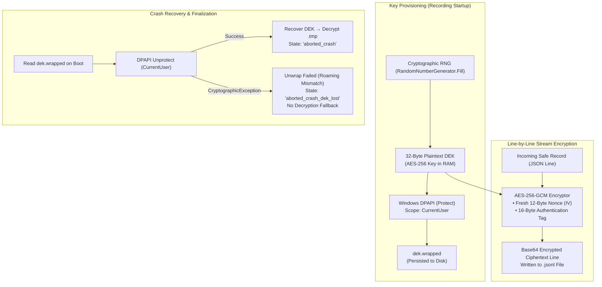

# Encryption & Redaction Pipeline

Session recordings capture high-density forensic data that may inadvertently touch sensitive corporate systems: authentication tokens, proprietary API responses, personally identifiable information (PII), and session cookies. Writing this data to disk in unencrypted plain text would create severe exposure risks.

Nova implements an enterprise-grade cryptographic architecture: every recording is encrypted at rest using an ephemeral **AES-256-GCM Data Encryption Key (DEK)** wrapped via the **Windows Data Protection API (DPAPI)**. When enabled, Nova executes **capture-time secret redaction in volatile memory**—ensuring that passwords, bearer tokens, and secrets registered in Nova's Vault are scrubbed before reaching the disk.

---

## 1. Domain Architecture & Subguides

The Encryption & Redaction Pipeline subsystem is divided into two specialized technical guides:

```
+-----------------------------------------------------------------------------------+
|                     ENCRYPTION & REDACTION PIPELINE DOMAIN                        |
+-----------------------------------------------------------------------------------+
| 1. Cryptographic Storage & Crash Recovery | Ephemeral 256-bit AES DEK, Windows   |
|                                           | DPAPI wrapping, line-by-line AEAD.   |
+-------------------------------------------+---------------------------------------+
| 2. Redaction Pipeline & Retention         | In-memory capture-time secret scrubbing|
|                                           | DPAPI Vault matching, 7-day retention.|
+-----------------------------------------------------------------------------------+
```

| Guide | Focus Area | Core Architectural Concepts |
| :--- | :--- | :--- |
| **[Cryptographic Storage & Crash Recovery](cryptographic-storage-and-recovery/README.md)** | Cryptographic Storage & Integrity | 256-bit AES-GCM DEK generation, Windows DPAPI CurrentUser key wrapping (`dek.wrapped`), line-by-line AEAD framing with fresh 12-byte IVs, crash reconciliation states (`completed`, `aborted_crash`, `aborted_crash_dek_lost`), and tamper detection. |
| **[Redaction Pipeline & Retention](redaction-pipeline-and-retention/README.md)** | In-Memory Privacy & Lifecycle | Synchronous in-memory redaction before persistence, HTTP header masking (`Authorization`, `Cookie`), regex query parameter sanitization, DPAPI Vault constant-time secret matching, the zero-secret `manifest.json`, and the 7-day automated purge lifecycle. |

---

## 2. Cryptographic Storage Architecture Overview

Nova uses an envelope encryption model to guarantee that recording artifacts are physically tied to the active Windows user account:



---

## 3. Core Cryptographic Invariants

1. **Per-Recording Ephemeral DEK:** Each recording generates a fresh 32-byte AES key. The plaintext DEK is never stored unencrypted on disk.
2. **DPAPI User Scope:** The key is wrapped using Windows DPAPI under `DataProtectionScope.CurrentUser`. Copying the recording folder to another machine or another Windows user account renders the files permanently unreadable.
3. **Line-Level AEAD Integrity:** Stream records are individually encrypted with AES-256-GCM and a unique 12-byte IV. Any manual modification or disk corruption causes immediate authentication failure on decrypt.
4. **Pre-Disk In-Memory Redaction:** Secret scrubbing executes synchronously in memory before items enter the writer queue. Un-redacted secrets never exist in temporary disk files.
5. **Decoupled Plaintext Manifest:** `manifest.json` provides fast indexing and status checking while maintaining a strict zero-secret invariant (zero URLs, domain names, or page titles).

---

## 4. Related Architecture Guides

* [Cryptographic Storage & Crash Recovery](cryptographic-storage-and-recovery/README.md): Detailed AEAD framing, DPAPI unwrap, and crash recovery.
* [Redaction Pipeline & Retention](redaction-pipeline-and-retention/README.md): Detailed header/query masking, Vault matching, and purge rules.
* [Session Recording Hub](../README.md): Master hub, operational limits, and complete MCP tool matrix.
* [Architecture & Capture Pipeline](../architecture-and-pipeline/README.md): Ingestion pipeline, bounded queue, and gap markers.
* [Streams & Permission Classes](../streams-and-permission-classes/README.md): Catalog of the 12 stream files and permission taxonomy.
* [Querying & Time-Travel Debugging](../query-and-time-travel/README.md): Interrogating network streams, console logs, and DOM snapshots post-mortem.
* [Purge Tool Reference](../../../mcp-reference/tools/session-recording/nova-session-record-purge.md) · [Export Tool Reference](../../../mcp-reference/tools/session-recording/nova-session-record-export.md)
