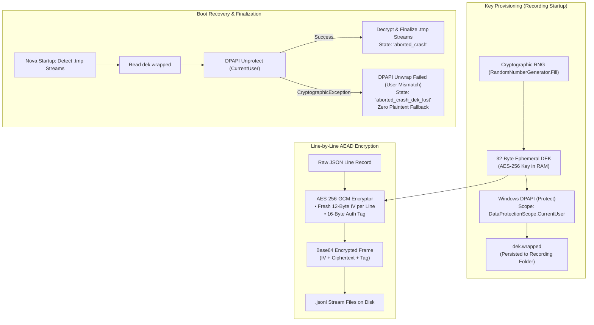
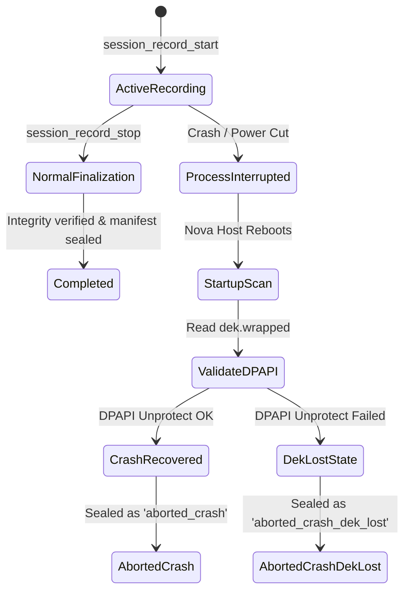

# Cryptographic Storage Architecture & Crash Recovery

Session recordings capture granular forensic evidence from web sessions, potentially including authenticated API responses, sensitive system metadata, and internal business logic. Persisting this data in unencrypted plaintext on local disk presents an unacceptable risk if a developer machine is lost, stolen, or accessed by unauthorized local processes.

To guarantee tamper-resistance, confidentiality, and user-account isolation, Nova implements an enterprise-grade cryptographic architecture: every recording is encrypted at rest using an ephemeral **AES-256-GCM Data Encryption Key (DEK)** wrapped via the **Windows Data Protection API (DPAPI)**.

This guide details the cryptographic storage model, line-by-line AEAD framing, crash recovery finalization states, and tamper detection guarantees.

---

## 1. The Envelope Encryption Architecture

Nova employs a two-tier envelope encryption model to ensure that recording files cannot be accessed outside the active Windows user account session:



### 1. Per-Recording Ephemeral DEK
When a recording starts (`nova.session_record_start`):
* Nova generates a fresh 32-byte (256-bit) cryptographically random Data Encryption Key (DEK) using `RandomNumberGenerator.Fill`.
* The plaintext DEK is retained exclusively in volatile host memory during the active recording session.

### 2. Windows DPAPI Key Wrapping (`dek.wrapped`)
* The DEK is encrypted immediately using the Windows Data Protection API:
  $$\text{WrappedDEK} = \text{DPAPI.Protect}(\text{PlainDEK}, \text{Scope}=\text{CurrentUser})$$
* The wrapped blob is persisted to the recording directory as `dek.wrapped`.
* **Security Invariant:** DPAPI keys are derived from the active Windows user's logon security token and hardware-bound master keys. If the recording directory is copied to another machine, backed up to external media, or accessed by a different Windows user profile, `dek.wrapped` **cannot be unwrapped**.

---

## 2. Line-by-Line AES-256-GCM Framing

Every stream file (`network.cdp.jsonl`, `console.jsonl`, `interactions.jsonl`, etc.) is encrypted on a line-by-line basis using Galois/Counter Mode (AES-256-GCM), providing authenticated encryption with associated data (AEAD):

```
+-----------------------------------------------------------------------------------+
|                           LINE-LEVEL ENCRYPTED FRAME                              |
+-----------------------------------------------------------------------------------+
| [ 12 Bytes: Nonce (IV) ] | [ N Bytes: Ciphertext ] | [ 16 Bytes: Auth Tag (MAC) ] |
+-----------------------------------------------------------------------------------+
                                         │
                                         ▼ (Base64 Encoded)
             "AQIDBAUGBwgJCgsMDQ4PEBESExQVFhcYGRobHB0eHyA..."
```

### Protocol Mechanics
1. **Fresh Nonce (IV) per Line:** A unique 12-byte initialization vector (IV) is cryptographically generated for every single line. Nonces are never reused across records, eliminating GCM catastrophic keystream leakage risks.
2. **16-Byte Authentication Tag:** Every line produces a 16-byte cryptographic MAC tag verifying ciphertext integrity and authenticity.
3. **Stream Append Performance:** Because encryption occurs line-by-line, the persistence worker appends encrypted frames sequentially without decrypting or rewriting earlier file content.
4. **Random-Access Paged Reads:** Post-mortem analysis tools can seek to arbitrary line offsets and decrypt specific entries individually using [`nova.session_record_get_entry`](../../../../mcp-reference/tools/session-recording/nova-session-record-get-entry.md) without reading the entire file into memory.

---

## 3. Crash Recovery & Finalization States

Browser crash events, power outages, or forced process termination can interrupt an active recording before a formal `nova.session_record_stop` call executes. Nova implements an automated crash reconciliation engine during host boot:



### Crash State Definitions

| Recording Status | Description & Post-Mortem Accessibility |
| :--- | :--- |
| **`completed`** | Normal termination. The recording stopped cleanly; all queues were flushed, file streams sealed, and the manifest integrity hashes verified. |
| **`aborted_crash`** | The host process terminated unexpectedly while recording was active. On startup, Nova unwrapped `dek.wrapped` successfully using the local DPAPI context, flushed unsealed `.tmp` stream tails, and closed the recording. Telemetry up to the crash point is intact and fully readable. |
| **`aborted_crash_dek_lost`** | The recording suffered a crash, but `dek.wrapped` could not be decrypted upon reboot (e.g., user profile migration, domain credential reset, or disk transfer). The files remain permanently encrypted; Nova marks the session as unreadable and does not provide an insecure plaintext fallback. |

---

## 4. Tamper Detection & Integrity Verification

Because AES-256-GCM is an authenticated cipher mode, any external tampering with the `.jsonl` files (such as injecting malicious events, modifying timestamps, or altering headers) results in an immediate authentication tag mismatch:

* If a single byte of ciphertext or IV is altered, `AesGcm.Decrypt` throws a `CryptographicException: The authentication tag did not match`.
* When an authentication failure is encountered during post-mortem queries or exports, Nova halts stream processing and flags the specific line as corrupted.
* The decoupled `manifest.json` also stores SHA-256 hashes for all completed stream files, providing whole-file integrity verification at startup.

---

## 5. Related Documentation

* [Redaction Pipeline & Retention](../redaction-pipeline-and-retention/README.md): In-memory capture-time secret scrubbing, Vault matching, and purge policies.
* [Encryption & Redaction Hub](../README.md): High-level cryptographic overview and privacy boundaries.
* [Stream Catalog & Compression](../../streams-and-permission-classes/stream-catalog-and-compression/README.md): Specifications for the 12 stream files and payload limits.
* [Export Tool Reference](../../../../mcp-reference/tools/session-recording/nova-session-record-export.md) · [Purge Tool Reference](../../../../mcp-reference/tools/session-recording/nova-session-record-purge.md)
