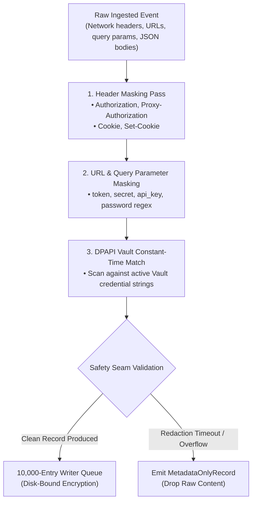
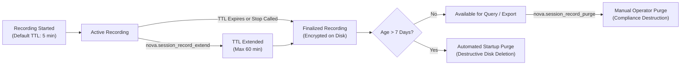

# In-Memory Secret Redaction & Retention Lifecycle

Session recordings preserve deep forensic context, but recording raw HTTP traffic and DOM state risks capturing sensitive credentials: user passwords, bearer authentication tokens, session cookies, and API keys. Post-recording redaction (scanning files after they have been written to disk) is an unacceptable architectural anti-pattern—it leaves traces in file system caches, SSD wear-leveling blocks, and process dumps.

Nova implements **capture-time secret redaction in volatile memory**: all data is scanned and sanitized before it ever enters the persistence queue or touches disk. In parallel, Nova enforces a strict **retention lifecycle** backed by deterministic time-to-live (TTL) bounds and automated startup purging.

---

## 1. Capture-Time In-Memory Redaction Flow

Redaction executes as a synchronous filter inside the host ingestion pipeline before records reach the background persistence queue:



### Architectural Guarantees
1. **Pre-Persistence Execution:** Raw, unmasked strings exist only in short-lived, generational managed memory buffers.
2. **Zero Disk Leakage:** If the host process crashes mid-redaction, the raw bytes were never written to disk, preventing forensic recovery of un-redacted artifacts.
3. **Deterministic Replacement Markers:** Sanitized values are replaced with standardized redaction tokens:
   * `[redacted:header]`
   * `[redacted:query_param]`
   * `[redacted:vault_secret]`

---

## 2. Redaction Rules & Parameter Sanitization

### 1. HTTP Header Masking
Unless the high-privilege `headers_sensitive` permission class is explicitly granted, the following HTTP headers are scrubbed automatically from all request and response metadata in `network.cdp.jsonl`:

| Header Name | Masking Rule | Replacement Value |
| :--- | :--- | :--- |
| **`Authorization`** | Replaces bearer tokens, basic auth credentials, and signatures. | `[redacted:header]` |
| **`Cookie`** | Replaces all request cookie name-value pairs. | `[redacted:cookie]` |
| **`Set-Cookie`** | Replaces all response cookie assignment directives. | `[redacted:cookie]` |
| **`Proxy-Authorization`** | Replaces proxy authentication credentials. | `[redacted:header]` |
| **`X-Api-Key`** | Replaces proprietary API key headers. | `[redacted:header]` |

### 2. URL & Query Parameter Sanitization
Query strings within URLs are scanned against a regex pattern identifying common credential keys (`token`, `access_token`, `auth`, `password`, `pass`, `api_key`, `secret`, `client_secret`):

```
Original:  https://api.internal.corp/v1/auth?client_id=agent_1&token=eyJhbGciOi...
Sanitized: https://api.internal.corp/v1/auth?client_id=agent_1&token=[redacted:query_param]
```

---

## 3. DPAPI Vault Constant-Time Secret Matching

Nova features an integrated DPAPI credential Vault used by autonomous agents to securely log into web applications. When session recording is active, the redaction pipeline cross-references all payload text against stored Vault secrets:

* **In-Memory Fingerprinting:** The redactor evaluates registered Vault credentials using constant-time string comparisons to prevent timing attacks.
* **Exact & Substring Matching:** If any stored credential (such as a multi-character password or session token) appears inside an HTTP POST body, WebSocket text frame, or DOM snapshot attribute, it is replaced with `[redacted:vault_secret]`.
* **Vault Noise Immunity:** If no secrets match, the payload proceeds without structural distortion. If a match occurs, the event metadata flags `"vaultMatched": true` so agents querying network traffic via [`nova.session_record_query`](../../../../mcp-reference/tools/session-recording/nova-session-record-query.md) can specifically audit where credential injections took place.

---

## 4. The Decoupled Plaintext Manifest (`manifest.json`)

To enable fast indexing, listing, and state querying without decrypting full event streams, Nova writes an unencrypted `manifest.json` file inside each recording directory.

### The Zero-Secret Invariant
To prevent metadata leakage, the plaintext manifest enforces a strict **Zero-Secret Invariant**:
* The manifest contains **zero URLs, domain names, page titles, or query parameters**.
* It records exclusively non-sensitive session metadata:

```json
{
  "recordingId": "rec_20261018_101502_b8a9",
  "tabId": "tab_work_3",
  "sandboxId": "sandbox_production",
  "createdAt": "2026-10-18T10:15:02.100Z",
  "expiresAt": "2026-10-18T10:20:02.100Z",
  "status": "completed",
  "finalizedAt": "2026-10-18T10:18:45.320Z",
  "permissionClasses": [
    "metadata",
    "interactions_mcp",
    "network_timing_detail",
    "dom_snapshots"
  ],
  "streamFileHashes": {
    "network.cdp.jsonl": "e3b0c44298fc1c149afbf4c8996fb92427ae41e4649b934ca495991b7852b855",
    "console.jsonl": "ca978112ca1bbdcafac231b39a23dc4da786eff8147c4e72b9807785afee48bb",
    "dom-snapshots.jsonl": "5891b5b522d5df086d0ff0b110fbd9d21bb4fc7163af34d08286a2e846f6be03"
  }
}
```

External monitoring scripts or directory indexers can inspect recording dates, statuses, and file integrity hashes without learning which websites the user or agent visited.

---

## 5. Retention Lifecycle & Automated Purge Policies

Uncontrolled diagnostic recordings can rapidly consume disk storage. Nova enforces strict temporal boundaries across the recording lifecycle:



### Lifecycle Limits

| Limit Dimension | Constrained Value | Operational Rationale |
| :--- | :--- | :--- |
| **Default Active TTL** | 5 minutes (300,000 ms) | Prevents runaway recording sessions from filling disk storage if an agent crashes. |
| **Allowed TTL Window** | 5 seconds to 60 minutes | Flexible window for brief task verification or prolonged audits. |
| **Extension Limit** | Up to 60 minutes per call | Active sessions can be extended via [`nova.session_record_extend`](../../../../mcp-reference/tools/session-recording/nova-session-record-extend.md). |
| **Historical Retention** | 7 days | Completed recordings are automatically purged on Nova startup once older than 7 days. |
| **Manual Purge Tool** | [`nova.session_record_purge`](../../../../mcp-reference/tools/session-recording/nova-session-record-purge.md) | Allows operators to destructively purge sessions older than $N$ days or target specific IDs. |

---

## 6. Related Documentation

* [Cryptographic Storage & Crash Recovery](../cryptographic-storage-and-recovery/README.md): 256-bit AES-GCM, DPAPI key wrapping, and integrity checks.
* [Encryption & Redaction Hub](../README.md): High-level cryptographic overview and privacy boundaries.
* [Privacy & Vault Architecture](../../../privacy/README.md): Structure of the DPAPI credential Vault and SecretRef tokens.
* [Purge Tool Reference](../../../../mcp-reference/tools/session-recording/nova-session-record-purge.md) · [Extend Tool Reference](../../../../mcp-reference/tools/session-recording/nova-session-record-extend.md)
