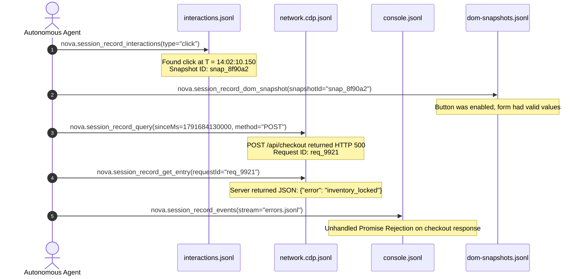

# Querying & Time-Travel Debugging

Time-travel debugging in Nova provides agents and developers with the ability to interrogate preserved session history post-mortem. When an automated workflow breaks, attempting to reproduce the failure on a live web application often alters database records, expires one-time tokens, or encounters transient network variances.

Session Recording transforms debugging into an asynchronous forensic investigation: agents correlate exact input timestamps with network failures, console stack traces, and DOM snapshots without re-executing transactions.

---

## 1. Domain Architecture & Subguides

The Querying & Time-Travel Debugging subsystem is divided into two specialized technical guides:

```
+-----------------------------------------------------------------------------------+
|                     QUERYING & TIME-TRAVEL DEBUGGING DOMAIN                       |
+-----------------------------------------------------------------------------------+
| 1. Query Engine & Event Correlation     | Multi-stream correlation, URL/status    |
|                                         | filtering, DOM snapshot auditing.       |
+-----------------------------------------+-----------------------------------------+
| 2. Session Export & Replay Harness      | Decrypted exports, standard HAR 1.2,    |
|                                         | offline replay testing, sharing safety. |
+-----------------------------------------------------------------------------------+
```

| Guide | Focus Area | Core Architectural Concepts |
| :--- | :--- | :--- |
| **[Query Engine & Event Correlation](query-engine-and-event-correlation/README.md)** | Live Forensic Investigation | High-precision network filtering (`nova.session_record_query`), detailed request lifecycle retrieval (`nova.session_record_get_entry`), paged stream inspection (`nova.session_record_events`), and interaction-to-DOM snapshot correlation. |
| **[Session Export & Replay Harness](session-export-and-replay-harness/README.md)** | Artifact Portability & Verification | Full session decryption to disk (`nova.session_record_export`), standard HTTP Archive (HAR 1.2) synthesis, deterministic mock replay harnesses, continuous DOM mutation playback, and secure artifact sharing. |

---

## 2. The Multi-Stream Correlation Principle

The fundamental strength of Nova's recording engine is chronological multi-stream correlation. Events across all 12 streams share a unified, high-precision millisecond timestamp (`ts`):



---

## 3. Core Tool Capabilities Summary

| Diagnostic Operation | Recommended MCP Tool | Typical Use Case |
| :--- | :--- | :--- |
| **Locate Suspicious Requests** | [`nova.session_record_query`](../../../mcp-reference/tools/session-recording/nova-session-record-query.md) | Search for failed HTTP calls ($400 \le \text{status} \le 599$) or URL regex matches. |
| **Deep Request Inspection** | [`nova.session_record_get_entry`](../../../mcp-reference/tools/session-recording/nova-session-record-get-entry.md) | Inspect full headers, payloads, and timing breakdowns for a specific `requestId`. |
| **Examine Console & Errors** | [`nova.session_record_events`](../../../mcp-reference/tools/session-recording/nova-session-record-events.md) | Read paged JavaScript errors, console warnings, and lifecycle milestones. |
| **Audit User/Agent Actions** | [`nova.session_record_interactions`](../../../mcp-reference/tools/session-recording/nova-session-record-interactions.md) | Trace the exact sequence of clicks, typing, and selector paths executed. |
| **Inspect UI State at Failure** | [`nova.session_record_dom_snapshot`](../../../mcp-reference/tools/session-recording/nova-session-record-dom-snapshot.md) | Inspect element outerHTML, disabled states, and validation classes at action time. |
| **Export Portable HAR / Files** | [`nova.session_record_export`](../../../mcp-reference/tools/session-recording/nova-session-record-export.md) | Decrypt the entire recording into a local directory with standard `network.har`. |

---

## 4. Time-Travel Boundary Contracts

1. **Read-Only Telemetry:** Time-travel debugging inspects captured historical evidence. It **does not rewind live server databases** or reverse submitted financial transactions.
2. **Deterministic Replay Fixtures:** Replay harnesses utilize captured network streams to simulate offline server responses for reproducible CI/CD testing.
3. **Un-Grantable Live Rewind:** Nova does not support hot-rewinding live browser tabs to previous JavaScript execution frames.

---

## 5. Related Architecture Guides

* [Query Engine & Event Correlation](query-engine-and-event-correlation/README.md): Detailed parameter schemas, query recipes, and correlation playbooks.
* [Session Export & Replay Harness](session-export-and-replay-harness/README.md): HAR 1.2 generation, replay test harnesses, and safe sharing guidelines.
* [Session Recording Hub](../README.md): Master hub, operational limits, and complete MCP tool matrix.
* [Architecture & Capture Pipeline](../architecture-and-pipeline/README.md): Ingestion pipeline, bounded queue, and gap markers.
* [Streams & Permission Classes](../streams-and-permission-classes/README.md): Catalog of the 12 stream files and permission taxonomy.
* [Encryption & Redaction Pipeline](../encryption-and-redaction/README.md): Cryptographic storage and capture-time sanitization.
* [Query Tool Reference](../../../mcp-reference/tools/session-recording/nova-session-record-query.md) · [Export Tool Reference](../../../mcp-reference/tools/session-recording/nova-session-record-export.md)
