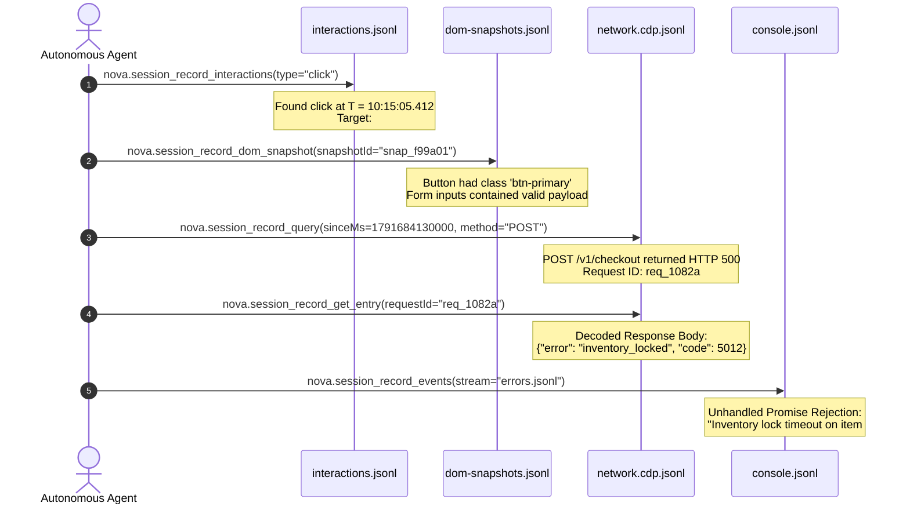

# Query Engine & Multi-Stream Event Correlation

When automated web workflows encounter silent failures, transient network drops, or unhandled exceptions, attempting to reproduce the bug on a live web application often alters database records, invalidates one-time tokens, or triggers anti-bot defenses. 

Nova transforms debugging into an asynchronous forensic investigation: agents and developers interrogate preserved, multi-stream historical recordings using high-precision query filters. By correlating exact interaction timestamps with network requests, console errors, and DOM snapshots, agents identify root causes without re-executing transactions.

This guide provides the complete query engine specification, multi-stream correlation principles, tool invocation recipes, and end-to-end diagnostic playbooks.

---

## 1. The Multi-Stream Correlation Principle

Every event captured across Nova's 12 stream files is stamped with an ISO 8601 millisecond timestamp (`ts`). This shared temporal baseline allows agents to reconstruct the exact sequence of events leading up to a failure:



---

## 2. Network Stream Filtering with `nova.session_record_query`

In a standard web session, `network.cdp.jsonl` contains hundreds or thousands of auxiliary subrequests (static images, stylesheet bundles, analytics beacons). Searching this volume manually causes context saturation.

[`nova.session_record_query`](../../../../mcp-reference/tools/session-recording/nova-session-record-query.md) provides indexed, server-side filtering:

```json
{
  "recordingId": "rec_20261018_101502_b8a9",
  "urlMatch": "/api/v1/orders",
  "method": "POST",
  "statusGte": 400,
  "statusLte": 599,
  "sinceMs": 1791684130000,
  "limit": 10
}
```

### Supported Filter Parameters

| Filter Key | Type | Description |
| :--- | :--- | :--- |
| **`urlMatch`** | string (regex/substring) | Matches against full request URLs. |
| **`method`** | string | Filters by HTTP method (`GET`, `POST`, `PUT`, `DELETE`). |
| **`mimeType`** | string | Filters by response MIME type (e.g., `application/json`). |
| **`statusGte` / `statusLte`** | integer | Constrains HTTP status code ranges (e.g., $400 \le \text{status} \le 599$). |
| **`sinceMs` / `untilMs`** | integer (epoch ms) | Restricts results to an exact temporal window. |
| **`hasBody`** | boolean | Filters for requests that captured non-empty payload bodies. |
| **`vaultMatched`** | boolean | Filters for requests where Vault credentials were redacted. |
| **`limit`** | integer | Caps result array size (default: 50, max: 200). |

### Child Target & Worker Execution Contexts
Modern web applications delegate data synchronization to dedicated Web Workers and embed third-party services in cross-site `iframe` elements. Standard devtools recording often loses visibility into these child sessions.

Nova's session recorder automatically attaches Network instrumentation to all child targets (existing targets at start and new targets attached while paused). When queried via `nova.session_record_query`, each matched row in `entries` reports its exact execution context:
* **`context`:** `"page"` for the main frame, `"worker"` for dedicated Web Workers, or `"iframe"` for cross-site embedded frames.
* **`contextUrl`:** The worker script URL (e.g. `https://example.com/worker.js`) or embedded frame URL.
* **`sessionId`:** Unique CDP child session identifier. Request and response bodies are captured and read directly from the child session in which the HTTP transaction occurred.

---

## 3. Deep Request Lifecycle Inspection with `nova.session_record_get_entry`

Once an agent identifies a suspicious `requestId` via `nova.session_record_query`, it invokes [`nova.session_record_get_entry`](../../../../mcp-reference/tools/session-recording/nova-session-record-get-entry.md) to inspect the complete request and response lifecycle:

```json
{
  "recordingId": "rec_20261018_101502_b8a9",
  "requestId": "req_1082a"
}
```

### Result Payload Structure
The tool decrypts and returns:
1. **Full URL & Route:** `https://api.example.com/v1/checkout`
2. **Request Headers:** Cleaned and sanitized header dictionary.
3. **Request Body:** Parsed JSON object, form parameters, or `MetadataOnlyRecord`.
4. **Response Headers:** Content-Type, cache headers, custom server headers.
5. **Response Body:** Decoded UTF-8 string or parsed JSON object.
6. **Detailed Timing:** DNS lookup, SSL negotiation, connection time, TTFB, and download duration.

---

## 4. Paged Event Stream Inspection with `nova.session_record_events`

For non-network telemetry, agents use [`nova.session_record_events`](../../../../mcp-reference/tools/session-recording/nova-session-record-events.md) to inspect encrypted stream files in sequential pages:

```json
{
  "recordingId": "rec_20261018_101502_b8a9",
  "stream": "errors.jsonl",
  "sinceMs": 1791684130000,
  "limit": 25
}
```

### Targetable Streams
* `console.jsonl`: Standard console output.
* `errors.jsonl`: Unhandled runtime exceptions and script crashes.
* `lifecycle.jsonl`: Navigation events and in-stream gap markers.
* `workers.jsonl`: Web Worker and Service Worker messaging.
* `indexeddb-ops.jsonl`: Transaction queries and object store access.
* `security-violations.jsonl`: CSP violations and Mixed Content warnings.

---

## 5. Interaction & DOM Snapshot Correlation

When UI automation fails silently—for example, clicking a button produces no navigation and no network call—the cause is almost always client-side UI state (e.g., a disabled button or invisible validation blocker).

### Step 1: Query the Interaction Timeline
Invoke [`nova.session_record_interactions`](../../../../mcp-reference/tools/session-recording/nova-session-record-interactions.md):
```json
{
  "recordingId": "rec_20261018_101502_b8a9",
  "action": "click",
  "limit": 10
}
```
Result returns the interaction record, target selector, and linked `snapshotId`:
```json
{
  "ts": "2026-10-18T10:15:05.412Z",
  "action": "click",
  "targetSelector": "#payment-form > button.submit-btn",
  "snapshotId": "snap_f99a01"
}
```

### Step 2: Retrieve the Linked DOM Snapshot
Invoke [`nova.session_record_dom_snapshot`](../../../../mcp-reference/tools/session-recording/nova-session-record-dom-snapshot.md):
```json
{
  "recordingId": "rec_20261018_101502_b8a9",
  "snapshotId": "snap_f99a01"
}
```
The agent inspects the target element's outerHTML and attribute map:
```html
<button class="submit-btn disabled is-locked" disabled="true" data-reason="terms_not_accepted">
  Pay Now
</button>
```
The agent instantly identifies why the click did not trigger a network request: the button had `disabled="true"` because a required "Terms of Service" checkbox was unselected.

---

## 6. End-to-End Diagnostic Playbooks

### Playbook A: Silent Form Validation Failure
1. **Symptom:** Agent submits a form via `nova.click_selector`, but no page transition occurs.
2. **Investigation:**
   * Query `network.cdp.jsonl` with `sinceMs`: 0 requests found.
   * Query `interactions.jsonl`: Click was registered at $T$.
   * Read `snap_XXXX` via `nova.session_record_dom_snapshot`: Inspect input field classes.
3. **Resolution:** Found `<input id="zip" class="form-control is-invalid">` with tooltip `"Invalid postal code format"`. Agent corrects input value and re-submits.

### Playbook B: Authentication Token Refresh Race Condition
1. **Symptom:** User session abruptly terminates during an autonomous workflow.
2. **Investigation:**
   * Query `network.cdp.jsonl` for HTTP 401: Found `GET /api/v1/profile` returned 401.
   * Query `workers.jsonl` around that timestamp: Service worker attempted background token refresh.
   * Read `errors.jsonl`: Refresh token endpoint returned HTTP 400 (`invalid_grant`).
3. **Resolution:** The refresh token had expired or was consumed by a concurrent tab. Agent triggers a full re-login flow via Vault.

---

## 7. Related Documentation

* [Session Export & Replay Harness](../session-export-and-replay-harness/README.md): Exporting recordings to disk, standard HAR generation, and replay validation.
* [Querying & Time-Travel Hub](../README.md): Overview of multi-stream interrogation and tool capabilities.
* [Streams & Permission Classes](../../streams-and-permission-classes/README.md): Catalog of all 12 stream files and payload formats.
* [Query Tool Reference](../../../../mcp-reference/tools/session-recording/nova-session-record-query.md) · [Get Entry Tool Reference](../../../../mcp-reference/tools/session-recording/nova-session-record-get-entry.md)
