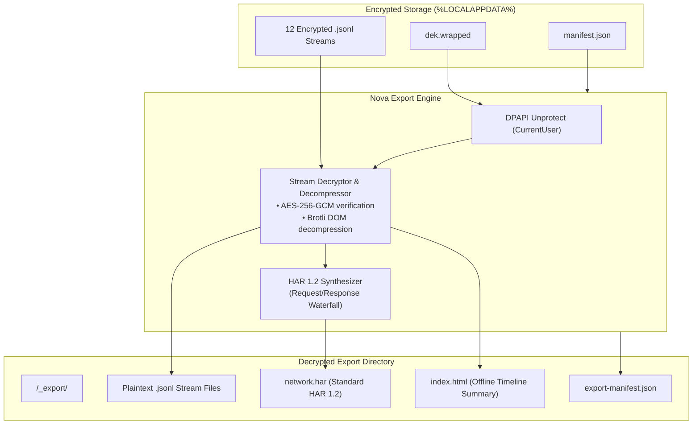
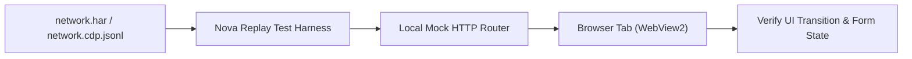

# Session Export, HAR Synthesis & Replay Verification

While live MCP queries allow agents to interrogate recordings programmatically, long-term regression tracking, cross-team bug reporting, and CI/CD replay verification require portable diagnostic artifacts. Encrypted on-disk streams tied to a single Windows DPAPI user cannot be inspected directly by external developer tooling.

Nova bridges this gap through the [`nova.session_record_export`](../../../../mcp-reference/tools/session-recording/nova-session-record-export.md) tool, generating decrypted offline diagnostic bundles, standard HTTP Archive (HAR 1.2) files, and deterministic mock replay datasets.

This guide details the session export pipeline, HAR 1.2 synthesis, offline replay verification harnesses, and safe collaboration practices.

---

## 1. The Decrypted Session Export Pipeline

When an agent or developer invokes `nova.session_record_export`, Nova unwraps the recording's DPAPI DEK in memory, sequentially decrypts each stream file, and writes a standalone post-mortem directory to disk:



### Invocation Schema
```json
{
  "recordingId": "rec_20261018_101502_b8a9",
  "outputDirectory": "C:\\Workspace\\Diagnostics\\Exports",
  "includeHar": true,
  "includePayloads": true,
  "maxBodySizeBytes": 1048576
}
```

---

## 2. Standard HTTP Archive (HAR 1.2) Synthesis

To enable analysis in industry-standard tools (Google Chrome DevTools Network panel, Charles Proxy, Fiddler, Insomnia), Nova converts `network.cdp.jsonl` into a fully compliant **HAR 1.2 archive** (`network.har`):

### HAR Synthesis Features
1. **Timing Waterfalls:** Accurately maps blocked, DNS, connect, SSL, TTFB, and receive durations from CDP timing timestamps.
2. **Header Normalization:** Flattens raw HTTP headers while maintaining sanitized redaction markers (`[redacted:header]`).
3. **Payload Inlining:** Inlines response bodies (JSON, HTML, SVG) up to the specified `maxBodySizeBytes`. Bodies larger than the threshold or binary streams are marked with comment metadata.
4. **Cache State:** Preserves HTTP 304 Not Modified milestones and disk/memory cache indicators.

Agents and engineers can drag and drop `network.har` directly into Chrome DevTools to visually inspect network activity exactly as it occurred during the recorded run.

---

## 3. Replay Verification Harness

A primary utility of exported session recordings is regression testing. Automated test suites can load recorded network streams to replay browser tests deterministically without connecting to live backend servers:



### Replay Testing Advantages
* **Deterministic Fixtures:** Network responses, latency timings, and status codes are fixed, eliminating flakiness from third-party APIs.
* **Offline CI/CD Execution:** Replay harnesses run entirely within local test runners without internet egress.
* **Non-Destructive Bug Reproduction:** Verifies bug fixes against real recorded server failures (such as rare 502 Bad Gateway responses or database deadlock errors) that cannot be trivially mocked.

---

## 4. DOM Mutation Playback & Visual Reconstruction

When the `dom_mutations` permission class is captured, the exported bundle includes decompressed rrweb-compatible mutation logs in `dom-mutations.jsonl`:

* **Continuous DOM Playback:** Plays back DOM alterations sequentially, rendering a fluid visual reproduction of the user or agent interaction.
* **Snapshot Synchronization:** Links continuous mutations with discrete HTML snapshots in `dom-snapshots.jsonl` to ensure DOM tree validity across long sessions.
* **Visual Evidence Correlation:** Pairs interaction coordinates from `interactions.jsonl` with rendered frames, showing exactly where clicks occurred relative to page layout elements.

---

## 5. Time-Travel Boundary Contracts

Understanding the architectural scope and limitations of time-travel debugging is essential for operational safety:

| Dimension | Supported Forensic Capability | Invariant Boundary Limit |
| :--- | :--- | :--- |
| **Telemetry History** | Full inspection of captured network, console, DOM, and interaction events. | Cannot inspect data from streams where permissions were not granted. |
| **Server State** | Inspects exact HTTP responses returned by the server at recording time. | **Does not rewind server databases.** Submitted transactions remain committed on the live server. |
| **Live Replay** | Replays captured responses into an isolated mock test harness. | Cannot "rewind" live web tabs without reloading and re-issuing browser state. |
| **Encryption Boundary** | Decrypts files during export on the machine holding the DPAPI key. | Exported plaintext files are no longer protected by DPAPI. |

---

## 6. Safe Artifact Sharing Guidelines

Because `nova.session_record_export` removes line-level AES-256-GCM encryption and DPAPI envelopes, the resulting files become standard plaintext files on disk.

### Security Best Practices
1. **Pre-Export Redaction Verification:** Confirm that capture-time redaction was active during recording. If `headers_sensitive` or `indexeddb_values` were granted, verify that exported files do not contain confidential customer records.
2. **Export Path Isolation:** Always export into temporary, access-restricted folders rather than shared public network drives.
3. **Disposal Lifecycle:** Once an exported HAR or diagnostic folder has been analyzed or attached to an issue tracker, delete the plaintext folder and rely on the encrypted source recording in `%LOCALAPPDATA%`.

---

## 7. Related Documentation

* [Query Engine & Event Correlation](../query-engine-and-event-correlation/README.md): Live MCP querying, filtering, and interaction correlation.
* [Querying & Time-Travel Hub](../README.md): Architectural overview of forensic capabilities.
* [Encryption & Redaction Pipeline](../../encryption-and-redaction/README.md): Cryptographic storage and capture-time sanitization.
* [Export Tool Reference](../../../../mcp-reference/tools/session-recording/nova-session-record-export.md) · [Purge Tool Reference](../../../../mcp-reference/tools/session-recording/nova-session-record-purge.md)
