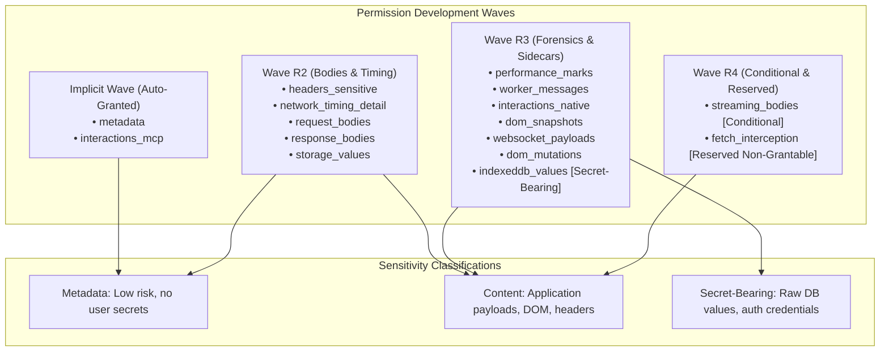

# Streams & Permission Classes

Nova's Session Recording engine enforces fine-grained data segregation by partitioning captured telemetry into **12 distinct stream files**. Recording depth is governed by a formal taxonomy of **15 permission classes**, allowing agents and security policies to balance forensic detail against privacy boundaries.

This guide provides the architectural overview of the stream segregation model, permission taxonomy across Waves R1–R4, and navigational links to the specialized subguides.

---

## 1. Domain Architecture & Subguides

The Streams & Permission Classes subsystem is divided into two specialized technical guides:

```
+-----------------------------------------------------------------------------------+
|                     STREAMS & PERMISSION CLASSES DOMAIN                           |
+-----------------------------------------------------------------------------------+
| 1. Stream Catalog & Mutation Compression | The 12 stream formats, JSONL framing,  |
|                                          | Brotli DOM mutations, sidecar streams. |
+------------------------------------------+----------------------------------------+
| 2. Permission Taxonomy & Revocation      | 15 permission classes across Waves R1-4|
|                                          | sensitivity tiers, dynamic revocation. |
+-----------------------------------------------------------------------------------+
```

| Guide | Focus Area | Core Architectural Concepts |
| :--- | :--- | :--- |
| **[Stream Catalog & Mutation Compression](stream-catalog-and-compression/README.md)** | Stream Files & Payloads | Deep catalog of all 12 stream files (`network.cdp.jsonl`, `console.jsonl`, `interactions.jsonl`, etc.), JSONL data schemas, Level 6 streaming Brotli compression for DOM mutations, payload size caps, and V2 opt-in sidecar semantics. |
| **[Permission Taxonomy & Revocation Mechanics](permission-taxonomy-and-revocation/README.md)** | Granular Access Governance | Complete taxonomy of the 15 permission classes across development Waves R1–R4, sensitivity tiers (Metadata, Content, Secret-Bearing), default safe policies, dynamic `PermissionClassRegistry` evaluation, and mid-stream revocation sequences. |

---

## 2. Overview of the Twelve Stream Files

Each stream file is encrypted independently using AES-256-GCM. Depending on the granted permission classes, an active recording produces a targeted subset of streams:

```
<recording-id>/
├── network.cdp.jsonl          # HTTP requests, responses, headers, and timing
├── console.jsonl              # Standard console log, warn, error, debug entries
├── errors.jsonl               # Unhandled JavaScript exceptions and promise rejections
├── lifecycle.jsonl            # Navigation milestones and in-stream gap markers
├── interactions.jsonl         # Agent and user click/key/input sequences
├── dom-snapshots.jsonl        # Standalone HTML snapshots and selector ancestry
├── security-violations.jsonl  # CSP violations, mixed content, TLS alerts
├── performance.jsonl          # PerformanceObserver timing marks and web vitals
├── workers.jsonl              # Web Worker and Service Worker lifecycle events
├── indexeddb-ops.jsonl        # IndexedDB transaction and query metadata
├── websocket-payloads.jsonl   # Opt-in WebSocket text frames
├── indexeddb-values.jsonl     # Opt-in secret-bearing IDB record values
└── dom-mutations.jsonl        # Opt-in Brotli-compressed rrweb mutation stream
```

---

## 3. Permission Class Taxonomy Summary

Nova organizes permission classes into four development waves and three strict sensitivity tiers:



---

## 4. Key Operational Invariants

1. **Explicit Capability Responses for Sidecars:** If an agent queries a sidecar stream (such as `websocket-payloads.jsonl` or `indexeddb-values.jsonl`) that was not enabled for the recording, Nova returns an explicit capability error stating that the stream was not recorded—never a misleading empty array.
2. **Deterministic Payload Caps:** When a payload exceeds its configured size limit (e.g., 2 MB for HTTP response bodies or 64 KB for WebSocket frames), the recorder emits a typed `MetadataOnlyRecord` containing byte count and SHA-256 hash without storing raw content.
3. **Mid-Stream Revocation Safety:** Revoking a permission class mid-session permanently severs capture for that stream without deleting previously encrypted records.

---

## 5. Related Architecture Guides

* [Stream Catalog & Mutation Compression](stream-catalog-and-compression/README.md): Detailed schemas, JSONL framing, and Brotli compression.
* [Permission Taxonomy & Revocation Mechanics](permission-taxonomy-and-revocation/README.md): Full class taxonomy, waves, and negotiation recipes.
* [Session Recording Hub](../README.md): Master hub, operational limits, and complete MCP tool matrix.
* [Architecture & Capture Pipeline](../architecture-and-pipeline/README.md): Ingestion engine, bounded queue, and safety seam guards.
* [Encryption & Redaction Pipeline](../encryption-and-redaction/README.md): AES-256-GCM envelope encryption, DPAPI keys, and secret sanitization.
* [Querying & Time-Travel Debugging](../query-and-time-travel/README.md): Interrogating network streams, console logs, and DOM snapshots post-mortem.
* [Record Events Tool Reference](../../../mcp-reference/tools/session-recording/nova-session-record-events.md) · [Start Recording Tool Reference](../../../mcp-reference/tools/session-recording/nova-session-record-start.md)
