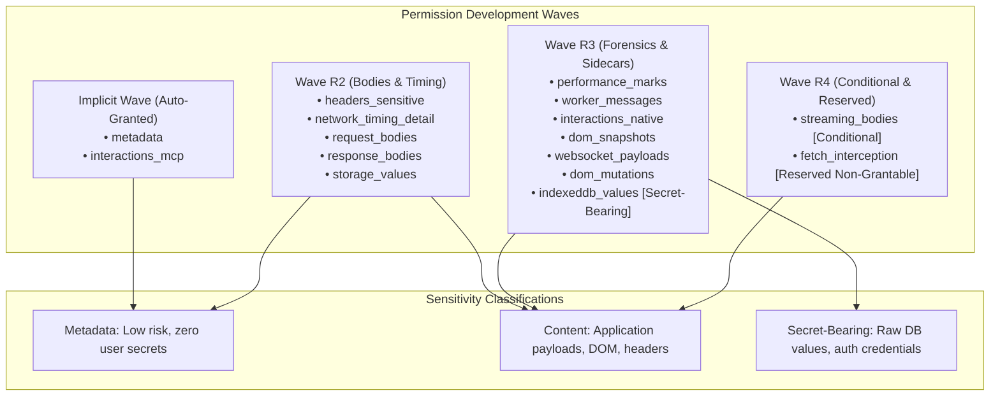
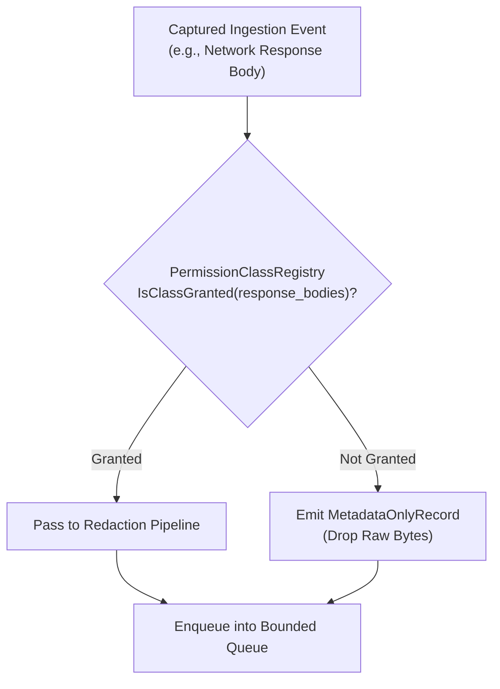

# Permission Taxonomy & Revocation Mechanics

Nova enforces strict principle-of-least-privilege capture through a formal taxonomy of **15 permission classes**. Rather than offering an all-or-nothing recording switch, Nova allows agents, automated workflows, and enterprise compliance engines to grant only the exact data classes required for a specific diagnostic session.

This guide details the complete permission class taxonomy across development Waves R1–R4, sensitivity classifications, runtime permission enforcement, mid-stream revocation mechanics, and pre-flight negotiation strategies.

---

## 1. Development Waves & Permission Taxonomy

Nova organizes permission classes into development waves reflecting architectural maturity and risk boundaries:



---

## 2. Complete Catalog of the 15 Permission Classes

| Permission Class | Development Wave | Sensitivity Tier | Data Captured | Default State |
| :--- | :--- | :--- | :--- | :--- |
| **`metadata`** | Implicit | Metadata | HTTP URLs, methods, status codes, standard console logs, document navigation milestones, IDB query hashes. | Auto-Granted |
| **`interactions_mcp`** | Implicit | Metadata | Synthetic actions dispatched via Nova MCP tools (`nova.click_selector`, `nova.type_selector`). | Auto-Granted |
| **`headers_sensitive`** | Wave R2 | Content | Unmasked HTTP request and response headers (`Authorization`, `Cookie`, `Set-Cookie`). | Disabled |
| **`network_timing_detail`** | Wave R2 | Metadata | Detailed DNS, SSL, connect, TTFB, and download duration breakdowns. | Granted in Full |
| **`request_bodies`** | Wave R2 | Content | Inbound HTTP POST, PUT, and PATCH payloads (scanned by redaction pipeline). | Disabled |
| **`response_bodies`** | Wave R2 | Content | Outbound server HTTP response bodies (JSON, HTML, text). | Disabled |
| **`storage_values`** | Wave R2 | Content | `localStorage` and `sessionStorage` key-value pairs at navigation points. | Disabled |
| **`performance_marks`** | Wave R3 | Metadata | `PerformanceObserver` user timing marks and web vital metrics. | Disabled |
| **`worker_messages`** | Wave R3 | Content | Messages and lifecycle events between the main thread and Web/Service Workers. | Disabled |
| **`interactions_native`** | Wave R3 | Content | Real hardware user inputs (physical mouse clicks, keystrokes, scroll deltas). | Disabled |
| **`dom_snapshots`** | Wave R3 | Content | Periodic and on-demand full HTML tree snapshots and target element ancestry. | Granted in Full |
| **`websocket_payloads`** | Wave R3 | Content | WebSocket inbound and outbound text message frames. | Disabled |
| **`dom_mutations`** | Wave R3 | Content | Full-fidelity, continuous rrweb-compatible DOM tree mutation streams (Brotli). | Disabled |
| **`indexeddb_values`** | Wave R3 | Secret-Bearing | Raw, unmasked records and objects stored inside IndexedDB object stores. | Disabled |
| **`streaming_bodies`** | Wave R4 | Content | Chunk-level capture of Server-Sent Events (SSE) and chunked HTTP responses. | Conditional |
| **`fetch_interception`** | Wave R4 | Reserved | Active interception and modification of live fetch calls during recording. | Non-Grantable |

> [!CAUTION]
> The **`indexeddb_values`** permission class is classified as **Secret-Bearing**. Modern web applications frequently persist authentication tokens, encrypted session keys, and offline customer records in IndexedDB. Enabling this class captures raw database values; it must only be used in isolated test sandboxes or during authorized security audits.

---

## 3. Safe Default Configurations vs Secret-Bearing Opt-Ins

When an agent invokes [`nova.session_record_start`](../../../../mcp-reference/tools/session-recording/nova-session-record-start.md) without passing explicit permission classes, Nova applies the **Default Safe Policy**:

```json
{
  "permissionClasses": [
    "metadata",
    "interactions_mcp",
    "network_timing_detail",
    "dom_snapshots"
  ]
}
```

### Why This Default Policy?
1. **Zero Secret Leakage:** No request or response bodies are recorded, sensitive headers are scrubbed, and raw database values are withheld.
2. **Sufficient Forensic Context:** Provides full URL routing, HTTP response status codes, console error stack traces, and pre-/post-interaction DOM snapshots. Over 90% of autonomous navigation and form submission failures can be diagnosed using this default set alone.
3. **Low Storage Footprint:** Recordings under the default policy rarely exceed 2 MB, even when run across prolonged 5-minute workflows.

---

## 4. Dynamic Runtime Permission Evaluation

Permission checks do not occur only at recording initiation; they are evaluated continuously by the `PermissionClassRegistry` whenever an event reaches the ingestion router:



If a specific class is not granted:
* The event's metadata (timestamp, URL, method, timing) is still preserved under the `metadata` class.
* The body or sensitive value is replaced with a `MetadataOnlyRecord` or suppressed entirely, preventing unauthorized data capture.

---

## 5. Mid-Stream Permission Revocation Mechanics

Security policies or operators may decide to revoke a granted permission class while a recording is in progress (e.g., when an agent transitions from a public catalog page into a sensitive payment gateway).

### The Revocation Sequence
1. **Revocation Invocation:** The host or security monitor revokes the permission class (e.g., `request_bodies`).
2. **Registry State Update:** The `PermissionClassRegistry` atomically flips the class flag to `revoked`.
3. **In-Stream Marker Emission:** A typed `permission_revoked` marker is immediately injected into `lifecycle.jsonl`:
   ```json
   {
     "ts": "2026-10-18T10:16:30.150Z",
     "kind": "permission_revoked",
     "permissionClass": "request_bodies",
     "reason": "operator_policy_boundary"
   }
   ```
4. **Permanent Stream Severance:** From this exact timestamp forward, all incoming records requiring `request_bodies` are suppressed to metadata.
5. **No Retroactive Deletion:** Previously recorded and encrypted records prior to the revocation timestamp remain stored. If the entire recording must be invalidated, the operator must invoke [`nova.session_record_purge`](../../../../mcp-reference/tools/session-recording/nova-session-record-purge.md).

---

## 6. Agent Pre-Flight Negotiation Playbook

Before initiating a recording for a complex workflow, agents should select permission classes matching their diagnostic objective:

```
+-----------------------------------------------------------------------------------+
| DIAGNOSTIC OBJECTIVE    | RECOMMENDED PERMISSION CLASSES                          |
+-----------------------------------------------------------------------------------+
| Form / UI Validation    | metadata, interactions_mcp, dom_snapshots               |
| Failure                 | (Default safe profile; zero sensitive leaks)            |
+-------------------------+---------------------------------------------------------+
| API Integration &       | metadata, interactions_mcp, network_timing_detail,      |
| Backend Status Debugging| request_bodies, response_bodies                         |
+-------------------------+---------------------------------------------------------+
| Single Page App (SPA)   | metadata, interactions_mcp, dom_snapshots,              |
| State & Replay Audit    | dom_mutations, worker_messages                          |
+-------------------------+---------------------------------------------------------+
| Full Forensic           | metadata, interactions_mcp, interactions_native,        |
| Security Inspection     | headers_sensitive, request_bodies, response_bodies,     |
|                         | websocket_payloads, dom_snapshots, indexeddb_values     |
+-----------------------------------------------------------------------------------+
```

---

## 7. Related Documentation

* [Stream Catalog & Mutation Compression](../stream-catalog-and-compression/README.md): Specifications for all 12 stream files and Brotli compression.
* [Streams & Permission Classes Hub](../README.md): High-level taxonomy and sensitivity classifications.
* [Encryption & Redaction Pipeline](../../encryption-and-redaction/README.md): In-memory sanitization and DPAPI envelope protection.
* [Start Recording Tool Reference](../../../../mcp-reference/tools/session-recording/nova-session-record-start.md) · [Purge Tool Reference](../../../../mcp-reference/tools/session-recording/nova-session-record-purge.md)
