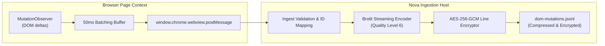

# Stream Catalog & Mutation Compression

Nova partitions captured session data into **12 distinct stream files**, separating high-frequency telemetry, network metadata, DOM deltas, and sensitive database states into dedicated streams. Each stream is framed as an encrypted line-delimited JSON (`.jsonl`) file, ensuring that queries can target specific event types without decrypting or parsing irrelevant telemetry.

This guide provides the complete specification of all 12 stream formats, the Brotli compression pipeline for DOM mutations, payload size caps, and the semantics of opt-in sidecar streams.

---

## 1. The Twelve Encrypted Stream Files

When a recording is active, events are filtered and routed into one or more of the following stream files within the recording folder (`%LOCALAPPDATA%\NovaBrowser\Recordings\<recording-id>\`):

| Stream Filename | Primary Event Types | Sensitivity Tier | Enabling Permission Class |
| :--- | :--- | :--- | :--- |
| **`network.cdp.jsonl`** | HTTP/HTTPS request and response metadata, URLs, methods, headers, status codes, timing waterfalls. | Metadata / Content | `metadata` (bodies require `request_bodies` / `response_bodies`) |
| **`console.jsonl`** | JavaScript console log messages (`console.log`, `warn`, `error`, `info`, `debug`, `dir`). | Metadata | `metadata` |
| **`errors.jsonl`** | Unhandled JavaScript runtime exceptions, unhandled Promise rejections, script compilation errors. | Metadata | `metadata` |
| **`lifecycle.jsonl`** | Document navigation milestones (`DOMContentLoaded`, `load`), tab focus changes, and in-stream gap markers. | Metadata | `metadata` |
| **`interactions.jsonl`** | User input sequences (clicks, typing, keyboard navigation) and MCP synthetic tool invocations. | Metadata / Content | `interactions_mcp`, `interactions_native` |
| **`dom-snapshots.jsonl`** | Standalone HTML document snapshots, target outerHTML, and CSS selector ancestry trees. | Content | `dom_snapshots` |
| **`security-violations.jsonl`** | Content Security Policy (CSP) violations, Mixed Content blocks, certificate status changes. | Metadata | `metadata` |
| **`performance.jsonl`** | PerformanceObserver navigation timing metrics and custom user timing marks. | Metadata | `performance_marks` |
| **`workers.jsonl`** | Web Worker and Service Worker registration, termination, and message passing events. | Content | `worker_messages` |
| **`indexeddb-ops.jsonl`** | Database schema transactions, object store queries, operation modes, and primary key hashes. | Metadata | `metadata` |
| **`websocket-payloads.jsonl`** | Inbound and outbound WebSocket text frames and frame metadata. | Content | `websocket_payloads` |
| **`indexeddb-values.jsonl`** | Unmasked, raw IndexedDB record values (strictly quota-capped and redactor-scanned). | Secret-Bearing | `indexeddb_values` |
| **`dom-mutations.jsonl`** | Continuous, rrweb-compatible DOM tree mutation deltas (Brotli-compressed). | Content | `dom_mutations` |

---

## 2. Stream Data Schemas & JSONL Framing

Each stream consists of line-delimited JSON objects. Every record begins with a unified millisecond timestamp (`ts`) and an event `kind`:

### 1. Network Stream (`network.cdp.jsonl`)
```json
{
  "ts": "2026-10-18T10:15:02.120Z",
  "kind": "response_received",
  "requestId": "req_1082a",
  "url": "https://api.example.com/v1/user/cart",
  "method": "GET",
  "statusCode": 200,
  "statusText": "OK",
  "mimeType": "application/json",
  "headers": {
    "content-type": "application/json; charset=utf-8",
    "cache-control": "no-cache"
  },
  "timing": {
    "dnsMs": 1.2,
    "connectMs": 8.4,
    "sslMs": 14.1,
    "ttfbMs": 42.6,
    "totalMs": 68.3
  }
}
```

### 2. Interaction Stream (`interactions.jsonl`)
```json
{
  "ts": "2026-10-18T10:15:05.412Z",
  "kind": "interaction",
  "source": "mcp_tool",
  "action": "click",
  "toolName": "nova.click_selector",
  "targetSelector": "button#checkout-button",
  "targetTag": "BUTTON",
  "targetText": "Proceed to Checkout",
  "coordinates": { "x": 420, "y": 780 },
  "snapshotId": "snap_f99a01"
}
```

### 3. Console & Error Streams (`console.jsonl`, `errors.jsonl`)
```json
{
  "ts": "2026-10-18T10:15:06.014Z",
  "kind": "console_error",
  "level": "error",
  "text": "Uncaught (in promise) Error: Inventory lock timeout",
  "stackTrace": "Error: Inventory lock timeout\n    at checkout.js:142:19\n    at async handleCheckout (checkout.js:88:5)"
}
```

---

## 3. Brotli Mutation Compression (`dom-mutations.jsonl`)

Capturing full-fidelity DOM mutations via `MutationObserver` generates hundreds of thousands of mutation records during heavy web application interaction. Persisting raw JSON deltas causes extreme disk bloat and I/O bottlenecks.

To resolve this, Nova pipes DOM mutation records through a streaming Brotli compression engine:



### Compression Architecture
1. **Quality Level 6:** Nova configures Brotli compression at Level 6, striking the optimal balance between high compression ratios (~85% reduction on DOM strings) and near-zero CPU overhead.
2. **Sequential Delta Dependency:** Mutation records depend on the previous snapshot state. If the stream encounters a queue overflow, the engine emits a `checkpoint_required` marker and triggers a fresh DOM snapshot baseline into `dom-snapshots.jsonl` to reset the delta chain.
3. **Transparent Decryption & Decompression:** When agents invoke [`nova.session_record_events`](../../../../mcp-reference/tools/session-recording/nova-session-record-events.md) on `dom-mutations.jsonl`, Nova handles decryption and Brotli decompression transparently in memory, streaming standard JSON mutation events back to the client.

---

## 4. Payload Size Thresholds & Quota Suppression

To protect system resources, individual stream entries enforce strict byte-size thresholds:

| Stream / Data Item | Size Limit | Suppression Behavior |
| :--- | :--- | :--- |
| **HTTP Request Body** | 1 MB | Suppressed to `MetadataOnlyRecord` with reason `payload_size_exceeded`. |
| **HTTP Response Body** | 2 MB | Suppressed to `MetadataOnlyRecord`; headers and timing remain intact. |
| **WebSocket Text Frame** | 64 KB | Frames over 64 KB are replaced with metadata (frame count, byte size, hash). |
| **DOM Snapshot Tree** | ~256 KB | Page-side serializer truncates peripheral DOM nodes and sets `quotaExceeded: true`. |
| **IndexedDB Value Entry** | 256 KB | Large BLOBs or large objects are replaced with `MetadataOnlyRecord`. |

When a body exceeds its threshold, the recorder never writes truncated, corrupted JSON. It writes a complete, typed `MetadataOnlyRecord` containing the byte count, SHA-256 digest, and MIME type.

---

## 5. V2 Opt-In Sidecar Stream Semantics

Several streams are classified as **V2 Opt-In Sidecars**:
* `websocket-payloads.jsonl`
* `indexeddb-values.jsonl`
* `dom-mutations.jsonl`

### Behavioral Guarantees
* **Conditional Creation:** If a recording was initiated without granting the corresponding permission class (e.g., `websocket_payloads` or `indexeddb_values`), the physical stream file is **not created on disk**.
* **Explicit Capability Responses:** If an agent queries a sidecar stream that was not enabled for the recording, Nova returns an explicit error or capability response stating that the stream was not recorded. Nova **never returns an empty success array (`[]`)**, preventing agents from falsely concluding that a web page had zero WebSocket traffic or zero database operations.

---

## 6. Related Documentation

* [Permission Taxonomy & Revocation](../permission-taxonomy-and-revocation/README.md): Detailed permission classes, waves, and mid-stream revocation.
* [Streams & Permission Classes Hub](../README.md): Overview of streams and security categories.
* [Safety Seams & DOM Snapshots](../../architecture-and-pipeline/safety-seams-and-dom-snapshots/README.md): Quota enforcement and snapshot serialization.
* [Record Events Tool Reference](../../../../mcp-reference/tools/session-recording/nova-session-record-events.md) · [Query Tool Reference](../../../../mcp-reference/tools/session-recording/nova-session-record-query.md)
