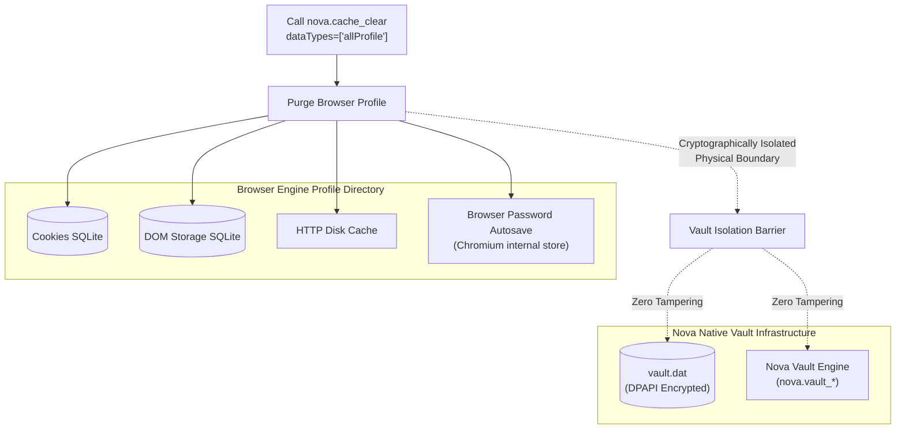
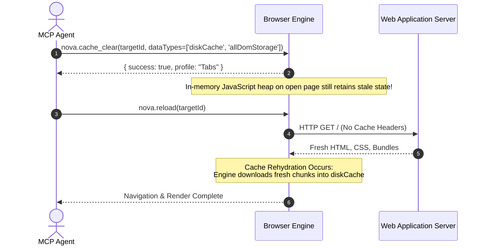

# `allSite` vs. `allProfile` & Vault Isolation

When executing broad cleanup operations, choosing between `allSite` and `allProfile` determines whether browser configuration and auxiliary histories are preserved or reset to a factory baseline. Furthermore, understanding how Nova isolates its native credential manager from browser engine storage guarantees that critical secrets remain protected during complete profile resets.

This guide details the granular boundary between `allSite` and `allProfile`, the architectural isolation of the Nova Encrypted Vault, and multi-profile blast radius dynamics.

---

## 1. Granular Component Invalidation Matrix

The table below delineates the precise behavior of every browser subsystem under composite cleanup categories:

```
+-----------------------------------------------------------------------------------------------+
| BROWSER SUBSYSTEM                     | allSite Invalidation        | allProfile Invalidation |
+-----------------------------------------------------------------------------------------------+
| Cookies (HTTP, DOM, HttpOnly)         | CLEARED (all origins)       | CLEARED (all origins)   |
| localStorage                          | CLEARED (all origins)       | CLEARED (all origins)   |
| sessionStorage                        | CLEARED (all origins)       | CLEARED (all origins)   |
| IndexedDB Databases                   | CLEARED (all origins)       | CLEARED (all origins)   |
| Cache Storage API (window.caches)     | CLEARED (all origins)       | CLEARED (all origins)   |
| Service Worker Registrations          | CLEARED (all origins)       | CLEARED (all origins)   |
| HTTP Disk Cache                       | RETAINED                    | CLEARED                 |
| Navigation History (URL logs)         | RETAINED                    | CLEARED                 |
| Download History Records              | RETAINED                    | CLEARED                 |
| Form Autofill Data                    | RETAINED                    | CLEARED                 |
| Browser Internal Password Autosave    | RETAINED                    | CLEARED                 |
| Browser Profile Settings & Zoom       | RETAINED                    | CLEARED                 |
| Physical Files Downloaded to Disk     | UNTOUCHED (always safe)     | UNTOUCHED (always safe) |
| Nova Encrypted Vault (vault.dat)      | UNTOUCHED (isolated)        | UNTOUCHED (isolated)    |
+-----------------------------------------------------------------------------------------------+
```

### Key Architectural Differences

1. **`allSite` (Website State Invalidation):**
   * Purges all application-layer state (`cookies`, `allDomStorage`, `cacheStorage`, `serviceWorkers`).
   * **Preserves User Chrome:** HTTP disk cache, navigation history, form autofill, and browser preferences remain intact.
   * **Primary Use Case:** Resolving complex authentication corruption or stale client database states across web applications without degrading browser UI customizations.

2. **`allProfile` (Factory Profile Rebuild):**
   * Executes a complete reset of the entire browser engine profile directory.
   * Clears everything purged by `allSite`, plus disk cache, navigation logs, download lists, form autofill, and browser internal settings.
   * **Primary Use Case:** Preparing a clean test environment, tearing down automated testing sandboxes, or wiping all traces of browsing activity prior to decommissioning.

---

## 2. The Nova Vault Isolation Invariant

A fundamental security principle in Nova's architecture is the strict physical and cryptographic separation between the browser engine's internal password store and Nova's native encrypted vault:



### Browser Password Autosave vs. Nova Encrypted Vault
1. **Browser Password Autosave:** The built-in Chromium mechanism that prompts "Save password for this site?". This data is stored within the browser profile directory and is purged when `allProfile` is selected.
2. **Nova Encrypted Vault (`vault.dat`):** Nova's enterprise credential management subsystem. Secrets stored in the vault are encrypted using the Windows Data Protection API (DPAPI) and persisted outside the browser engine profile in `%LOCALAPPDATA%\NovaBrowser\vault.dat`.
3. **The Absolute Invariant:** No cache clearing operation—regardless of whether `allSite`, `allProfile`, or individual categories are specified—can access, modify, or erase secrets in Nova's Vault. Credentials managed through `nova.vault_set` and `nova.vault_get` remain permanently protected.

---

## 3. Multi-Profile & Multi-Tab Isolation Dynamics

The operational blast radius of any cache clear is governed by the target profile's container model:

```
Nova Workspace Container Hierarchy
├── Shared Browser Tabs Profile ("Tabs")
│   ├── Tab 1: https://app.example.com
│   ├── Tab 2: https://github.com
│   └── Tab 3: https://internal.corp
│   └── [Cache Clear on Tab 1 impacts Tab 2 and Tab 3]
│
├── Isolated Sandbox Profile A ("sandbox-finance")
│   ├── Tab 101: https://banking.corp
│   └── [Cache Clear here is confined strictly to sandbox-finance]
│
└── Isolated Sandbox Profile B ("sandbox-staging")
    ├── Tab 201: https://staging.example.com
    └── [Completely insulated from Sandbox A and Shared Tabs]
```

### Isolation Guarantees

* **Standard Browser Tabs:** All standard tabs share a single underlying browser user profile (`all_browser_tabs`). Executing `nova.cache_clear` on any standard tab clears that data category across **every standard tab** in the workspace.
* **Isolated Sandboxes:** Each sandbox operates within its own dedicated profile on disk (`%LOCALAPPDATA%\NovaBrowser\Sandboxes\<SandboxId>\`). A cache clear executed in `sandbox-finance` has zero impact on `sandbox-staging` or standard tabs.
* **Ephemeral Private Tabs:** Private tabs utilize temporary, in-memory profiles (`private-*`). Clearing data in a private tab purges temporary session storage without touching persistent sandboxes or standard tabs.

---

## 4. Post-Clear Verification & Rehydration Patterns

A frequent operational misconception is that a cache store must remain empty immediately following a clear:



### Deterministic Rehydration Rules
1. **Reload After Invalidation:** Always execute `nova.reload` or `nova.navigate` immediately following a cache clearing call. JavaScript variables held in active memory heaps do not automatically clear when disk caches are deleted.
2. **Rehydration Is Expected:** Upon reload, the browser immediately requests fresh bundles from the server and writes them into the disk cache. A non-zero cache directory post-reload indicates that fresh assets were successfully fetched.
3. **Verification via Network Logs:** To verify that caching was invalidated, monitor network requests via [Network Interception](../../../network/network-interception/README.md) and confirm that server responses return HTTP `200 OK` (with byte payloads) rather than HTTP `304 Not Modified`.

---

## 5. Related References

* [Cache & Cleanup Master Guide](../README.md): Core concepts and browsing data category index.
* [Profile Invalidation & Category Matrix](../profile-invalidation-and-category-matrix/README.md): The 9 browsing categories and practical invalidation recipes.
* [Site Data Permissions & Audit](../../permissions-and-audit/README.md): User consent gating and audit trail verification.
* [Cache Clear Reference](../../../../mcp-reference/tools/site-data-and-identity/nova-cache-clear.md): Schema definition and parameter boundaries.

---

[Cache & Cleanup Hub](../README.md) · [Site Data Management](../../README.md)
