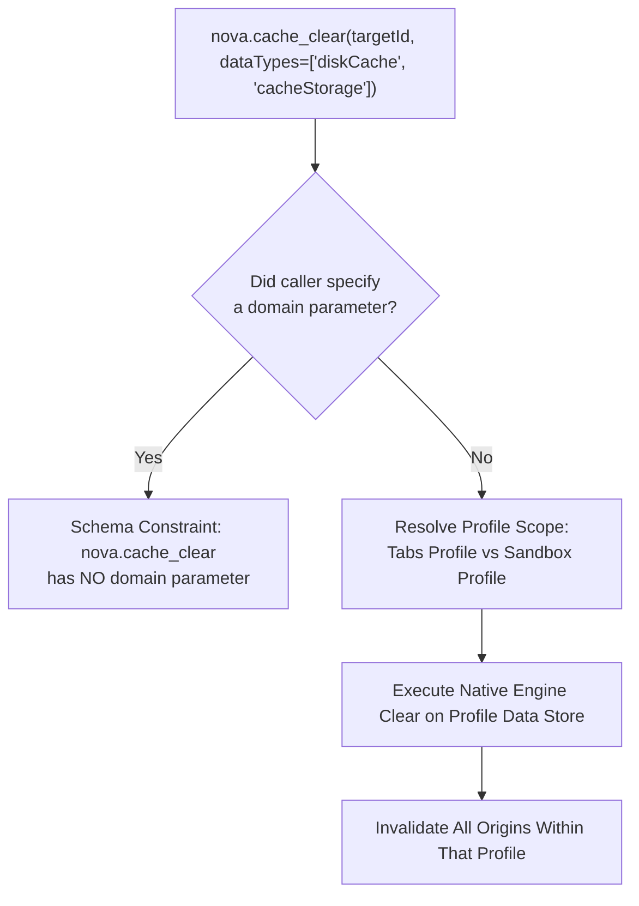

# Profile Invalidation & Category Matrix

Web browsers accumulate immense volumes of transient and cached data: compiled JavaScript bytecodes, rendered layout stylesheets, programmatic cache entries, background worker scripts, and client-side database fragments. When web applications deploy new code releases or face corrupt caching layers, stale assets cause elusive rendering glitches, broken single-page navigation, or endless script errors.

Nova's `nova.cache_clear` tool exposes a granular invalidation engine based on typed data categories. This guide details the 9 browsing-data categories, their internal engine mappings, and surgical invalidation strategies.

---

## 1. The 9 Browsing-Data Categories Matrix

Nova maps high-level category strings directly to native browser engine storage managers:

```
+----------------------------------------------------------------------------------------------------+
| CATEGORY ENUM       | ENGINE SUBSYSTEM INVALIDATION SCOPE            | OPERATIONAL REMEDY          |
+----------------------------------------------------------------------------------------------------+
| diskCache           | Compiled HTTP cache, images, CSS, scripts,     | Invalidate stale frontend   |
|                     | font files, and media chunks stored on disk.   | deployment assets.          |
| cacheStorage        | Programmatic Cache Storage API records         | Purge outdated PWA shells   |
|                     | (`window.caches`) maintained by service workers.| and cached API responses.  |
| serviceWorkers      | Active service worker script registrations,    | Terminate stuck worker      |
|                     | background sync, and push notification workers.| scripts intercepting fetch. |
| cookies             | All HTTP, DOM, and HttpOnly cookies across all | Complete session reset      |
|                     | domains within the target profile.             | across the profile.         |
| allDomStorage       | Combined localStorage, sessionStorage, and     | Purge corrupted client-side |
|                     | IndexedDB databases across all domains.        | schemas and app state.      |
| localStorage        | Compatibility alias for allDomStorage. Clears  | Historical compatibility    |
|                     | localStorage, sessionStorage, and IndexedDB.   | for legacy scripts.         |
| history             | Browsing navigation history and download       | Clear URL breadcrumbs       |
|                     | metadata records (downloaded files untouched). | without losing site state.  |
| allSite             | Composite site data: allDomStorage + cookies   | Wipe all site state while   |
|                     | + cacheStorage + file-system API data.         | preserving browser prefs.   |
| allProfile          | Factory reset: allSite + diskCache + history   | Complete profile rebuild    |
|                     | + autofill + browser profile configurations.   | to fresh default state.     |
+----------------------------------------------------------------------------------------------------+
```

---

## 2. Invariant: Absence of Domain Filtering in Cache Clearing

A fundamental architectural constraint of browser engine caching is the absence of per-domain granularity:



### Why Domain Filtering Is Not Supported
1. **Shared Block Allocations:** Browser disk caches and memory caches store HTTP responses in shared, memory-mapped block files indexed by content hashes, not in isolated per-domain folders.
2. **Atomic Engine APIs:** Underlying engine clearing APIs operate strictly at the profile storage partition level.
3. **Operational Rule:** When invoking `nova.cache_clear`, the selected categories are cleared **across the entire profile** of the target tab:
   * In standard browser tabs, all tabs share the common `"Tabs"` profile.
   * In sandbox tabs, the clear is contained strictly within that isolated sandbox profile.
   * If an agent requires surgical domain-level cleanup, it must use domain-scoped tools: `nova.cookie_clear` with `domain: "example.com"` or `nova.storage_delete` within the target origin.

---

## 3. Surgical Invalidation Strategies

Rather than resorting to blunt profile resets, autonomous agents and developers can combine specific categories to resolve common operational failures:

### Recipe 1: Fixing Stale Webpack / Vite Bundle Chunk Errors
When a web app updates but client tabs throw `Loading chunk [id] failed`:
```json
{
  "targetId": "tab-101",
  "dataTypes": [
    "diskCache",
    "cacheStorage"
  ],
  "_meta": {
    "intent": "Invalidate stale HTTP bundle chunks and PWA cache after frontend release"
  }
}
```
* **Outcome:** Clears cached `.js` and `.css` files without destroying user authentication cookies or local settings.

### Recipe 2: Terminating Stuck Background Service Workers
When an outdated service worker intercepts network fetches and serves stale offline mock data:
```json
{
  "targetId": "tab-101",
  "dataTypes": [
    "serviceWorkers",
    "cacheStorage"
  ],
  "_meta": {
    "intent": "Unregister malfunctioning service worker and purge offline cache"
  }
}
```
* **Outcome:** Unregisters all service workers in the profile and purges `window.caches`, allowing the fresh server version to register upon page reload.

### Recipe 3: Total Client State Invalidation Without Losing Bookmarks
When application schemas are corrupted in `localStorage` or `IndexedDB`:
```json
{
  "targetId": "tab-101",
  "dataTypes": [
    "allDomStorage",
    "cookies"
  ],
  "_meta": {
    "intent": "Reset corrupted client-side database state and refresh authentication"
  }
}
```
* **Outcome:** Resets all client databases and authentication tokens, returning the application to a pristine first-visit state.

---

## 4. Permission Gating & Audit Transparency

Because profile-wide cache clearing affects all open tabs within the target profile, `nova.cache_clear` is classified as a **high-impact operation**:

1. **Mandatory Intent:** The `_meta.intent` property must be supplied. It is logged in the operational audit trail and shown in the confirmation prompt.
2. **User Confirmation Prompt:** Unless an explicit active session grant exists for the target profile, Nova displays an interactive confirmation dialog detailing:
   * The specific data categories being cleared.
   * The blast radius (whether only an isolated sandbox is affected, or all standard browser tabs).
   * The agent's stated intent.
3. **Audit Log Recording:** Successful clearing operations emit an immutable record to the Site Data audit log, capturing the timestamp, requesting agent ID, target profile, and category list.

---

## 5. Related References

* [Cache & Cleanup Master Guide](../README.md): High-level overview of cache management in Nova.
* [`allSite` vs. `allProfile` & Vault Isolation](../all-site-vs-all-profile-and-vault-isolation/README.md): Deep dive into composite cleanup categories and credential store boundaries.
* [Site Data Troubleshooting](../../troubleshooting/README.md): Resolving persistent login loops and cache rehydration issues.
* [Cache Clear Tool Reference](../../../../mcp-reference/tools/site-data-and-identity/nova-cache-clear.md): Schema definition and parameter boundaries.

---

[Cache & Cleanup Hub](../README.md) · [Site Data Management](../../README.md)
