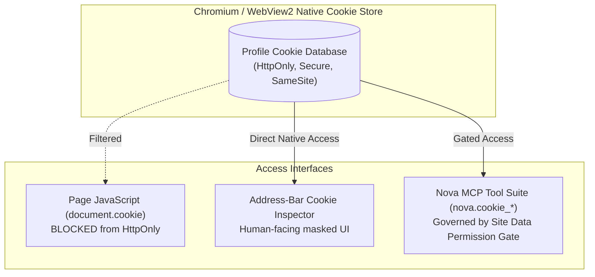
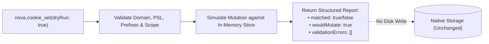
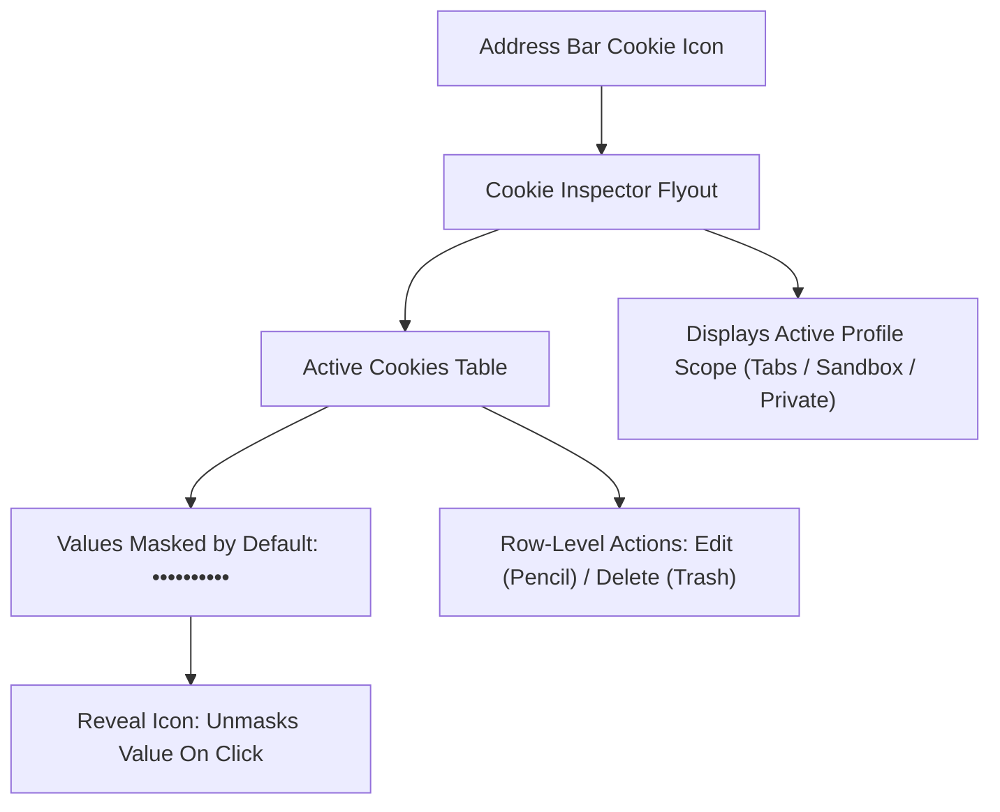

# HttpOnly Visibility, Secret Gating & Cookie Mutation Engine

This sub-guide details Nova AI Workspace's native cookie mutation engine, explaining how it accesses `HttpOnly` security cookies beyond the reach of standard JavaScript, the Site Data Permission Gate governing secret disclosure, simulation using `dryRun`, and integration with the address-bar Cookie Inspector.

---

## 1. Native Engine Architecture vs. `document.cookie`

In standard browser environments, web pages and injected user scripts are strictly isolated from sensitive credentials by the `HttpOnly` flag. When a cookie has `HttpOnly` enabled, standard JavaScript running inside the page receives an empty or partial string when querying `document.cookie`:

```javascript
// Webpage JavaScript execution (Blind to HttpOnly)
console.log(document.cookie); 
// Outputs: "theme=dark; consent=true" (Missing session_token and auth_jwt!)
```

Nova interacts directly with the underlying browser profile's native cookie storage engine:



### Key Differences:
1. **Complete Visibility:** Nova reads and mutates both standard DOM cookies and sensitive `HttpOnly` tokens, enabling autonomous AI agents to diagnose complex single sign-on (SSO) issues, session expiry bugs, and token mismatches.
2. **Metadata Transparency:** Provides full access to expiration timestamps, creation dates, `SameSite` policies (`Strict`, `Lax`, `None`), and `Secure` transport requirements.
3. **Defense-in-Depth:** Because accessing `HttpOnly` credentials represents a potential security exposure, Nova gates raw value reads behind strict permission controls.

---

## 2. Safe Metadata Reads vs. High-Impact Secret Disclosure

Nova enforces an architectural boundary between **cookie metadata** and **raw cookie values**:

```mermaid
flowchart TD
    Call["nova.cookie_list(includeValues: boolean)"] --> Check{"includeValues == true?"}

    Check -->|No (Default: false)| Safe["Safe Read (Auto-Allowed)<br/>• Returns name, domain, path, expires, flags<br/>• Values are redacted/omitted<br/>• Zero credential leak risk"]
    Check -->|Yes| Gate["High-Impact Secret Read<br/>• Requires explicit domainFilter<br/>• Gated by SiteDataPermissionGate<br/>• Prompts user for approval"]

    Gate --> Decision{"User Decision"}
    Decision -->|Allow| OutputWithValues["Return full cookie payload including plaintext values"]
    Decision -->|Deny| Reject["Abort: User denied credential disclosure"]
```

### The `domainFilter` Prerequisite
When an agent requests `includeValues: true`, Nova requires an explicit `domainFilter` (e.g. `domainFilter: "example.com"`). An agent is never permitted to perform an unconstrained, profile-wide dump of plaintext secrets across all domains simultaneously.

---

## 3. Surgical Cookie Mutation Tools

The `site_data_management` capability bundle provides three surgical mutation tools:

### 3.1. Setting Cookies (`nova.cookie_set`)
Creates or updates a cookie within the target profile:

```json
{
  "name": "nova.cookie_set",
  "arguments": {
    "targetId": "tab-1",
    "name": "session_pref",
    "value": "high_contrast",
    "domain": "example.com",
    "path": "/",
    "expires": 1792019200,
    "httpOnly": false,
    "secure": true,
    "sameSite": "Lax",
    "dryRun": false
  }
}
```

* **`dryRun: true`:** Validates the triple identity, Public Suffix List rules, and prefix constraints without committing changes to disk.
* **`expires`:** Accepts a Unix timestamp in seconds. Omitting `expires` creates an in-memory session cookie that is destroyed when the browser closes.

### 3.2. Deleting Cookies (`nova.cookie_delete`)
Removes an exact cookie entry from the target profile:

```json
{
  "name": "nova.cookie_delete",
  "arguments": {
    "targetId": "tab-1",
    "cookieId": "8b7e2a4f01c9d8a35e412b90",
    "dryRun": false
  }
}
```

* Agents can target the cookie by its deterministic 24-character `cookieId` (recommended) or provide the explicit triple `{name, domain, path}`.

### 3.3. Domain-Scoped Bulk Clearing (`nova.cookie_clear`)
Clears all cookies belonging to a specified domain and its subdomains without resetting other sites:

```json
{
  "name": "nova.cookie_clear",
  "arguments": {
    "targetId": "tab-1",
    "domain": "example.com"
  }
}
```

---

## 4. Simulation & Pre-Verification via `dryRun`

Before committing mutations to critical authentication cookies, agents can specify `dryRun: true` on [`nova.cookie_set`](../../../../mcp-reference/tools/site-data-and-identity/nova-cookie-set.md) and [`nova.cookie_delete`](../../../../mcp-reference/tools/site-data-and-identity/nova-cookie-delete.md):



* Confirms whether the target cookie exists prior to attempting deletion.
* Verifies whether domain and prefix constraints pass validation without risking session invalidation.

---

## 5. Address-Bar Cookie Inspector UI Integration

Nova pairs its programmatic MCP tool suite with an interactive, human-facing Cookie Inspector directly in the browser address bar:



* **Sensitive Value Masking:** Values are masked by default (`••••••••••`) to prevent visual leaks during screen sharing or pair programming.
* **Scope Indicators:** Clearly informs the user whether mutations will affect the shared `Tabs` profile, an isolated sandbox, or an ephemeral private tab.

---

## 6. Related Documentation

* **[Cookies Domain Hub](../README.md)** — Core cookie engine overview.
* **[Triple Identity & Normalization Sub-Guide](../triple-identity-and-normalization/README.md)** — Hash algorithms, path case-sensitivity, and PSL rules.
* **[Cookie Inspector UI Surface](../../cookie-inspector/README.md)** — User guide for the address-bar inspector.
* **[Site Data Permissions & Audit](../../permissions-and-audit/README.md)** — Action groups and permission gates.
* **[`nova.cookie_set` Tool Reference](../../../../mcp-reference/tools/site-data-and-identity/nova-cookie-set.md)** — MCP parameter specification.
