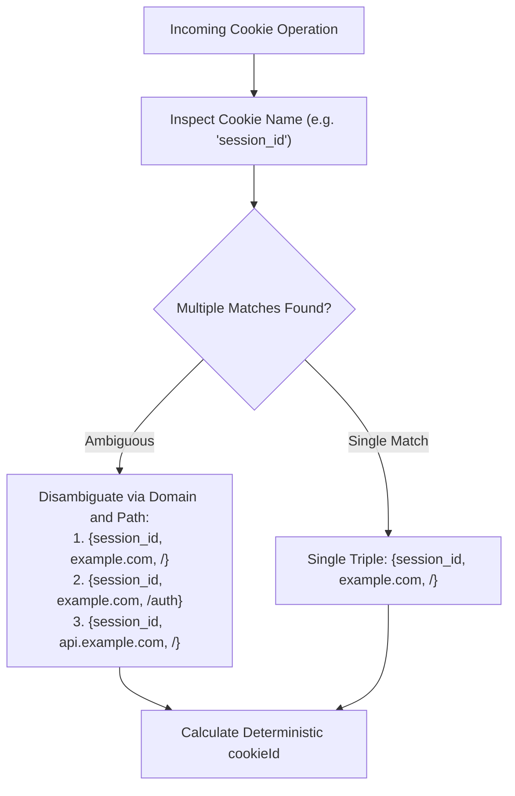
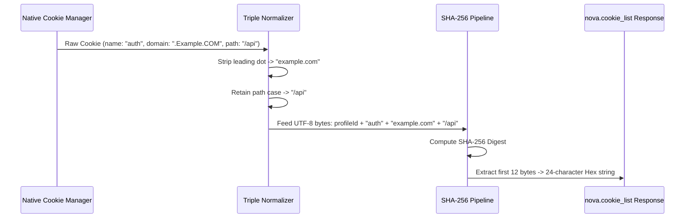
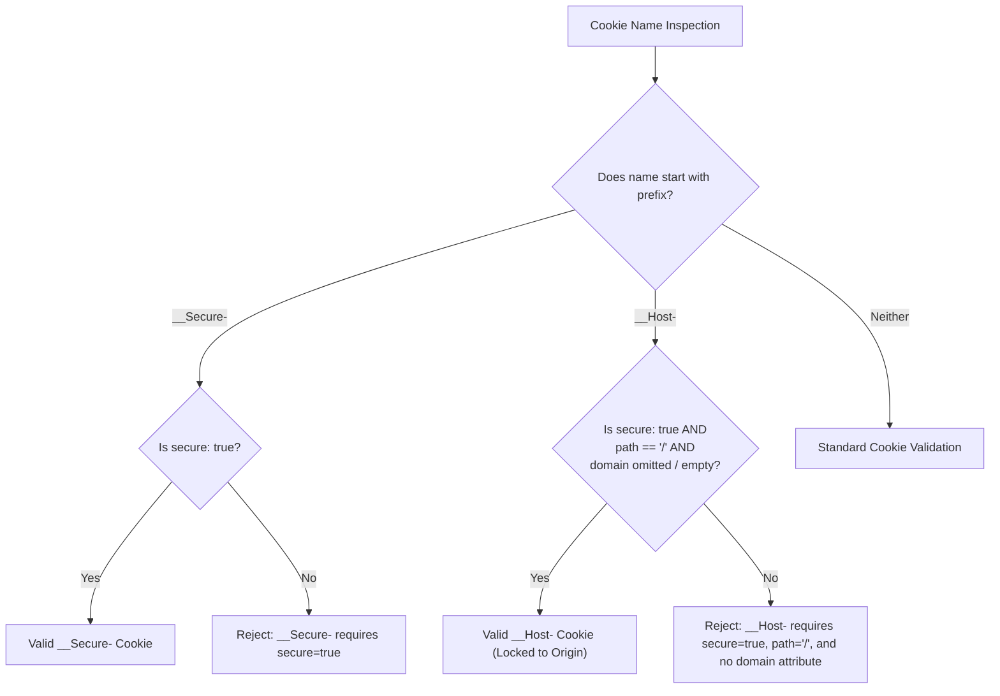

# Cookie Triple Identity, Deterministic Hashing & Normalization

This sub-guide details the identity model of HTTP and DOM cookies in Nova AI Workspace, explaining why cookie names alone cannot uniquely identify a token, how deterministic 24-character hexadecimal `cookieId` hashes are derived, normalization invariants, Public Suffix List (PSL) validation, and RFC 6265bis prefix security guardrails.

---

## 1. The Triple Identity Model (RFC 6265bis)

In web development, cookies are commonly referred to by name alone (e.g., `session_id` or `token`). However, under the authoritative web standard (RFC 6265bis §5.4), a cookie's unique identity is defined strictly by the three-tuple:

$$\text{Cookie Identity} = \{\text{Name}, \text{Domain}, \text{Path}\}$$

A website can legitimately maintain multiple distinct cookies sharing the exact same name within the same browser profile, provided they differ in domain or path:

```
Profile Cookie Store
├── example.com
│   ├── /
│   │   └── session_id = "token-alpha"  [cookieId: a8f410c92be1...]
│   └── /auth
│       └── session_id = "token-beta"   [cookieId: 7c19b042ea09...]
└── api.example.com
    └── /
        └── session_id = "token-gamma"  [cookieId: 3e9d81fa0218...]
```



### The Mutation Ambiguity Trap
Attempting to update or delete a cookie by name alone creates dangerous ambiguity:
* Deleting `session_id` without specifying domain and path might wipe the top-level session while leaving a corrupted sub-path token intact.
* Sending two conflicting cookies with the same name can cause the web server to fail authentication loops.
* Nova eliminates this ambiguity by calculating a deterministic, stable 24-character hexadecimal `cookieId` for every cookie in the store.

---

## 2. Deterministic `cookieId` Hash Derivation

Whenever [`nova.cookie_list`](../../../../mcp-reference/tools/site-data-and-identity/nova-cookie-list.md) enumerates cookies, it assigns a stable identifier to each entry:

$$\text{cookieId} = \text{HexEncode}\Big(\text{SHA-256}\big(\text{profileId} \parallel \text{name} \parallel \text{NormalizeDomain}(\text{domain}) \parallel \text{NormalizePath}(\text{path})\big)\Big)[0..12]$$



### Deterministic ID Properties:
1. **Asynchronous Reference Stability:** An agent can inspect cookies, make reasoning decisions, and subsequently delete or update a specific cookie by its `cookieId` without risking race conditions or deleting the wrong token.
2. **Profile Scoped:** The `profileId` is incorporated directly into the hash preimage, ensuring that an identical cookie triple existing in `Sandbox A` produces a completely different `cookieId` than in `Sandbox B` or the shared `Tabs` profile.

---

## 3. Normalization Invariants & Case-Sensitivity

To guarantee identity consistency across differing input styles, Nova applies strict normalization rules:

### 3.1. Domain Normalization (`NormalizeDomain`)
* **Leading Dot Stripping:** Modern browsers treat `.example.com` and `example.com` as identical domain scopes. Nova strips leading and trailing dots (`.example.com` $\to$ `example.com`).
* **Case-Insensitive Lowercasing:** Domain names are converted to lowercase ASCII.
* **IDN Punycode Conversion:** Internationalized Domain Names containing non-ASCII characters are normalized using standard Punycode (RFC 3490). For example, `münchen.de` normalizes to `xn--mnchen-3ya.de`.

### 3.2. Path Normalization (`NormalizePath`) & The Case-Sensitivity Invariant
* **Leading Slash Guarantee:** Empty or relative paths are normalized to begin with `/` (e.g. `auth` $\to$ `/auth`; empty string $\to$ `/`).
* **Strict Case-Sensitivity (RFC 6265 §5.1.4):** Cookie paths are strictly **case-sensitive**.
  * `/Api` and `/api` are distinct paths representing two completely different cookies.
  * Collapsing or lowercasing paths would violate RFC 6265 and cause cookie deletions to misfire on servers with case-sensitive routing.

---

## 4. Public Suffix List (PSL) & Supercookie Protection

A malicious or misconfigured website must not set cookies on top-level domains (TLDs) or public suffixes (e.g., `com`, `co.uk`, `github.io`). Doing so would allow cross-origin session hijacking of all neighboring sites hosted under that suffix.

```mermaid
flowchart TD
    Req["nova.cookie_set(domain: '.co.uk')"] --> CheckPSL{"Check against Mozilla Public Suffix List"}
    CheckPSL -->|Domain is a Public Suffix| Reject["Reject: Setting cookie on public suffix is forbidden (-32602)"]
    CheckPSL -->|Valid Private Domain (example.co.uk)| Allow["Proceed with Prefix & Security Checks"]
```

When setting a cookie via [`nova.cookie_set`](../../../../mcp-reference/tools/site-data-and-identity/nova-cookie-set.md), Nova validates the requested `domain` against the active Public Suffix List:
* Setting a cookie for `example.com` or `sub.example.com` is permitted.
* Setting a cookie for `com`, `org`, `co.uk`, or `github.io` is rejected immediately.

---

## 5. RFC 6265bis Cookie Prefixes (`__Secure-` and `__Host-`)

Modern security standards introduce special cookie prefixes that browsers enforce to prevent cookie injection and session fixation attacks:



### Prefix Rules:
1. **`__Secure-` Prefix:**
   * The cookie must be set with `secure: true`.
   * It must be transmitted exclusively over HTTPS.
2. **`__Host-` Prefix (Maximum Security):**
   * Must have `secure: true`.
   * Must be set from a secure (HTTPS) origin.
   * Must have `path: "/"`.
   * Must **not** include a `domain` attribute (locking the cookie exclusively to the host origin, preventing subdomain inheritance).

Nova validates these constraints before passing the mutation to the browser engine, preventing malformed cookies from triggering browser-level rejection.

---

## 6. Related Documentation

* **[Cookies Domain Hub](../README.md)** — Core cookie engine architecture and overview.
* **[HttpOnly & Secure Mutation Engine](../httponly-and-secure-mutation-engine/README.md)** — Native engine visibility, secret-read gating, and dryRun mutations.
* **[Site Data Permissions & Audit](../../permissions-and-audit/README.md)** — Security policies and audit logging without secret leaks.
* **[Site Data Troubleshooting](../../troubleshooting/README.md)** — Diagnostic playbooks for login loops and conflicting cookie triples.
* **[`nova.cookie_list` Tool Reference](../../../../mcp-reference/tools/site-data-and-identity/nova-cookie-list.md)** — MCP parameter reference.
