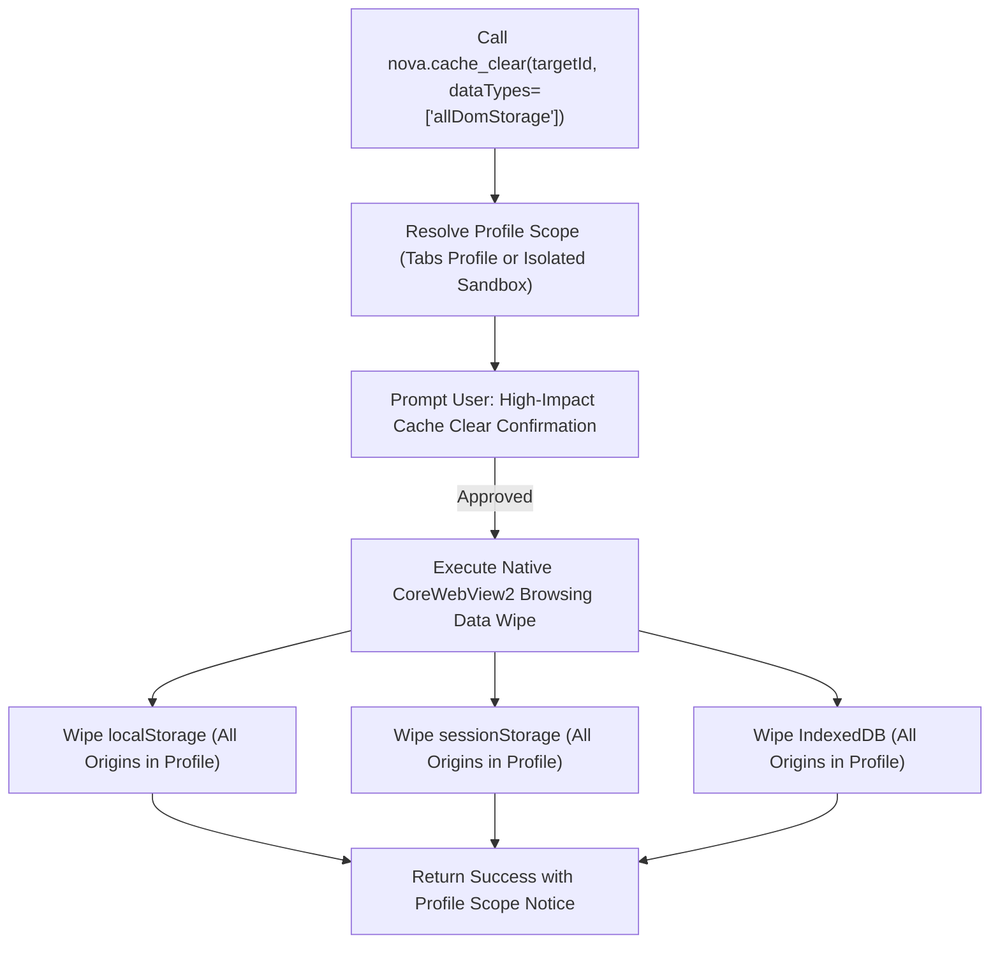

# IndexedDB & Storage Mutations

Web applications rely on two distinct tiers of client-side data persistence: simple key-value stores (`localStorage` and `sessionStorage`) for configuration and session tokens, and structured transactional databases (`IndexedDB` and the `CacheStorage` API) for offline databases, service worker assets, and large object caches. 

Nova provides surgical manipulation tools for key-value storage while maintaining strict protective boundaries around structured databases. This guide details the architectural boundary between simple storage and IndexedDB, the mechanics of safe storage mutations, and non-destructive diagnostic observation.

---

## 1. Structured Storage vs. Key-Value Architecture

The architectural contrast between Web Storage and IndexedDB determines the operational boundary of Nova's tooling:

```
+-----------------------------------------------------------------------------------------------+
| ARCHITECTURAL TRAIT      | Web Storage (localStorage / sessionStorage) | IndexedDB (Structured Databases)             |
+-----------------------------------------------------------------------------------------------+
| Data Model               | Flat, synchronous string key-value pairs.   | Object-oriented, asynchronous transactional. |
| Schema & Typing          | Strictly strings; no schemas or secondary   | Multi-version schemas, object stores,        |
|                          | indexes.                                    | auto-increment keys, secondary indexes.      |
| Storage Limit            | Typically 5 MB to 10 MB per origin.         | Quota-managed; up to 60% of available disk.  |
| Nova Tooling Scope       | Direct surgical access:                     | Diagnostic observation via Session Recording |
|                          | `storage_inspect`, `storage_set`, `delete`. | & atomic wipe via `cache_clear`.             |
+-----------------------------------------------------------------------------------------------+
```

### Why Ad-Hoc IndexedDB Mutation Tools Are Omitted
Direct, ad-hoc editing of arbitrary IndexedDB object stores through high-level agent tools is deliberately withheld in Nova:
1. **Schema and Version Integrity:** Modern web applications enforce rigid TypeScript interfaces and schema version numbers within IndexedDB. Injecting raw JSON records bypassing application migration scripts frequently causes application boot crashes and unrecoverable index corruption.
2. **Transactional State Machine:** IndexedDB operates through explicit `IDBTransaction` scopes (`readonly`, `readwrite`, `versionchange`). External tampering while an application transaction is open creates unhandled race conditions and lock timeouts.
3. **Surgical Key-Value Focus:** 99% of agent automation workflows requiring client-side mutation involve authentication bearer tokens, feature flags, or theme settings—all of which reside in `localStorage` or `sessionStorage`.

---

## 2. Storage Mutation Mechanics: `storage_set` and `storage_delete`

Nova provides targeted tools to create, update, or remove key-value records within the active document origin.

### 1. `nova.storage_set`
Writes or overwrites a single key-value entry:

```json
{
  "targetId": "tab-101",
  "storageType": "local",
  "key": "feature_flags",
  "value": "{\"beta_navigation\": true, \"debug_mode\": false}"
}
```

#### String Constraint & JSON Serialization
Under HTML5 Web Storage specifications, both keys and values are strictly strings:
* Attempting to store objects, arrays, or numbers requires explicit JSON serialization before issuing `nova.storage_set`.
* If a raw object is improperly set via DOM scripts, JavaScript coerces it to `"[object Object]"`, destroying the data structure. Nova expects the `value` parameter to already be string-formatted.

#### Memory Cache Desynchronization Invariant
A frequent pitfall in web automation is updating Web Storage and expecting immediate visual changes in the active page:
* **The In-Memory Gap:** Most SPA frameworks (such as React state, Redux stores, Vuex, or Pinia) read `localStorage` only once during application bootstrap. While `storage_set` updates the underlying DOM storage immediately, the running application's in-memory state variables remain unchanged.
* **Operational Rule:** After modifying critical application configuration or authentication tokens via `nova.storage_set`, agents should execute a page reload (`nova.reload`) to ensure the web application initializes from the newly written storage state.

### 2. `nova.storage_delete`
Surgically removes a single named key:

```json
{
  "targetId": "tab-101",
  "storageType": "session",
  "key": "stale_registration_token"
}
```

* Removes only the target key without affecting other keys in the same store.
* Executed synchronously in the top-level document context.
* Returns confirmation indicating whether the key was present prior to deletion.

---

## 3. Profile-Level DOM Storage Destruction

When testing clean application states, resetting corrupted databases, or clearing persistent sessions, agents utilize `nova.cache_clear`:



### The Invariant: Atomic DOM Storage Destruction
Under the browser engine architecture:
* Specifying `dataTypes: ["allDomStorage"]` (or its accepted compatibility alias `["localStorage"]`) purges **all three storage systems simultaneously**: `localStorage`, `sessionStorage`, and `IndexedDB`.
* **Profile-Wide Scope:** Due to browser engine limitations, cache clearing operates across the **entire profile**. There is no browser engine mechanism to clear IndexedDB exclusively for a single domain without wiping all other origins in that profile.
* For targeted, domain-specific cleanup, use `nova.cookie_clear` (which supports an explicit `domain` parameter) or surgical `nova.storage_delete` for known keys.

---

## 4. Non-Destructive Diagnostic Observation: Session Recording

To inspect and debug IndexedDB activity without modifying client data or risking database corruption, Nova integrates IndexedDB monitoring into its [Session Recording](../../../session-recording/README.md) subsystem:

```
Session Recording Archive (session-rec-20261019-120000/)
├── interactions.jsonl
├── dom-snapshots.jsonl
├── network-events.jsonl
└── indexeddb-ops.jsonl  <-- Dedicated IndexedDB Event Stream
```

### The `indexeddb-ops.jsonl` Event Stream
When session recording is active, Nova intercepts the browser's IndexedDB event dispatchers and records structured operational events:

```json
{
  "timestamp": 1729339200150,
  "database": "AppOfflineDB",
  "version": 3,
  "objectStore": "SyncQueue",
  "operation": "put",
  "keyHash": "7b8e1a02f9c4",
  "valueRedacted": true,
  "transactionMode": "readwrite"
}
```

### Security & Privacy Controls
* **Default Redaction:** By default, `valueRedacted` is `true`. The stream logs operations, database names, object store targets, and transaction modes without logging the underlying payload bytes.
* **Key Hashing:** Object store keys are hashed (SHA-256 truncated to 12 hex characters) to protect primary keys that may contain email addresses or user identifiers.
* **The `indexeddb_values` Permission Class:** In specialized debugging environments, capturing raw database values requires explicitly enabling the `indexeddb_values` permission class in session recording configuration, prompting for user approval.

---

## 5. Related References

* [Web Storage Master Guide](../README.md): Primary reference for `localStorage` and `sessionStorage` paradigms.
* [Origin Storage & Context Bounds](../origin-storage-and-context-bounds/README.md): In-depth examination of RFC 6454 origin partitioning and truncation guards.
* [Cache & Cleanup Master Guide](../../cache-and-cleanup/README.md): Detailed breakdown of all 9 browsing data categories.
* [Session Recording Architecture](../../../session-recording/README.md): Recording lifecycles, event streams, and replay verification.

---

[Web Storage Hub](../README.md) · [Site Data Management](../../README.md)
