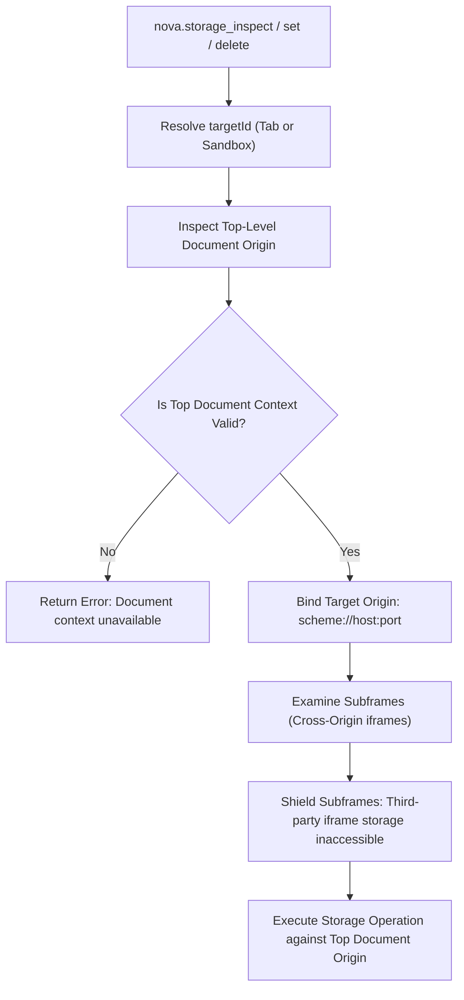
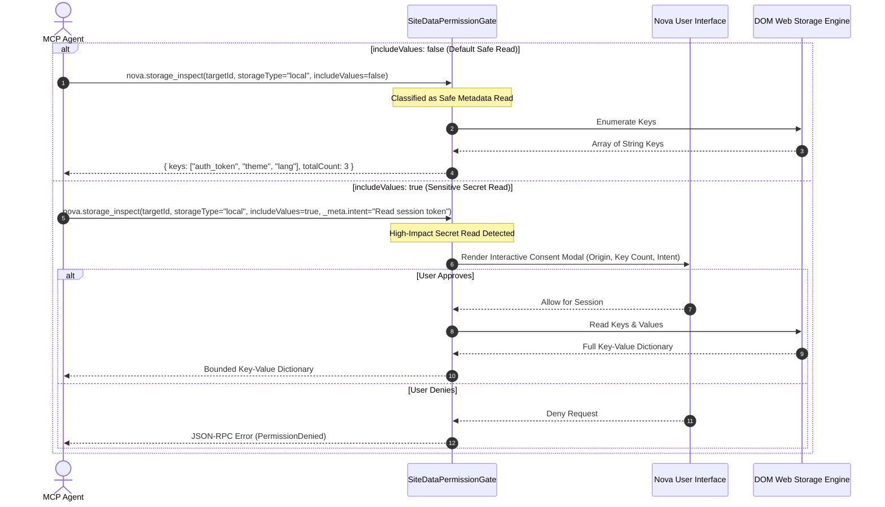

# Origin Storage & Context Bounds

Web Storage (`localStorage` and `sessionStorage`) provides persistent and ephemeral key-value stores scoped strictly by the HTML5 Web Origin definition. Modern Single-Page Applications (SPAs) leverage these stores for JSON Web Tokens (JWTs), user preference trees, client-side route caches, and telemetry queues. Because storage payloads can easily exceed several megabytes, uncontrolled tool access risks both context window exhaustion and credential leakage.

Nova enforces deterministic origin isolation, strict top-level document scoping, and algorithmic context bounds on every storage query.

---

## 1. The Web Origin Tuple and Isolation Boundaries

Per RFC 6454, Web Storage is partitioned strictly by the origin tuple:

$$\text{Origin} = (\text{Scheme}, \text{Host}, \text{Port})$$

Any variation in scheme (`http` vs `https`), host (`app.example.com` vs `auth.example.com`), or port (`:443` vs `:8443`) establishes an entirely disjoint storage partition:

```
Browser Profile Storage Hierarchy
├── https://app.example.com:443
│   ├── localStorage (Shared across all tabs for this origin)
│   │   ├── auth_token = "eyJhbGciOi..."
│   │   └── user_theme = "dark"
│   └── sessionStorage (Isolated to Tab 101)
│       └── checkout_draft = "{\"step\": 2}"
├── https://auth.example.com:443
│   └── localStorage (Disjoint from app.example.com)
│       └── sso_refresh = "rfr_98f41..."
└── http://app.example.com:80 (Disjoint due to insecure scheme)
    └── localStorage (Empty)
```

### `localStorage` vs. `sessionStorage` Lifecycle Dynamics

| Storage Dimension | `localStorage` (`storageType: "local"`) | `sessionStorage` (`storageType: "session"`) |
| :--- | :--- | :--- |
| **Persistence Horizon** | Persisted to disk in profile database; survives browser restarts. | Ephemeral in-memory store; destroyed when tab or browsing context closes. |
| **Cross-Tab Sharing** | Shared synchronously across all tabs and frames within the same profile and origin. | Isolated strictly to the individual tab session; never shared with neighboring tabs. |
| **Window Duplication** | New tabs access the same persistent keys. | Duplicating a tab creates an isolated snapshot of sessionStorage; subsequent writes diverge. |
| **Typical Payload** | Long-lived bearer tokens, UI layout preferences, language settings. | Transient multi-step wizard state, form inputs, route restore vectors. |

---

## 2. The Top-Level Document Context Invariant

A central security design principle of Nova's storage tooling is the **Top-Level Document Context Invariant**:



### Why Cross-Origin Iframe Storage Is Inaccessible
In modern enterprise web applications, pages embed third-party iframes for payment gateways (e.g. Stripe, Adyen), single-sign-on authenticators, or tracking analytics. 

Standard browser DOM APIs expose `window.localStorage` solely for the immediate browsing context. If an agent calls `nova.storage_inspect` on a tab loaded at `https://shop.example.com`, Nova executes exclusively within that top-level document origin:
1. **No Ambient Cross-Origin Bleed:** The agent cannot inadvertently read payment authorization tokens stored in an embedded `https://pay.gateway.com` iframe.
2. **Deterministic Context Binding:** If the page navigates or redirects to an authentication subdomain (e.g. `https://id.example.com`), Nova binds immediately to the new active origin. Operations in flight across a navigation boundary are rejected if the document origin changes before execution completes.

---

## 3. Algorithmic Context Bounding Guards

Web Storage keys can store arbitrary string data up to browser quota limits (typically 5MB to 10MB per origin). If an agent attempts to inspect a page storing a 3MB serialized cache vector or extensive diagnostic log buffer, injecting that raw string into the agent context would exhaust LLM token limits and crash agent workflows.

Nova incorporates two strict bounding mechanisms in `nova.storage_inspect`:

```
Raw Storage Value on Page:
"eyJhbGciOiJIUzI1NiIsInR5cCI6IkpXVCJ9.eyJzdWIiOiIxMjM0NTY3ODkwIiwibmFtZSI6IkpvaG4gRG9lIiwiaWF0IjoxNTE2MjM5MDIyfQ..." (4,800 chars)

Applying valueMaxChars (default 120):
"eyJhbGciOiJIUzI1NiIsInR5cCI6IkpXVCJ9.eyJzdWIiOiIxMjM0NTY3ODkwIiwibmFtZSI6IkpvaG4gRG9lIiwiaWF0IjoxNTE2MjM5MDIyfQ... [truncated: 4680 chars omitted]"
```

### Context Boundary Parameters

| Parameter | Type | Default | Bounds | Security & Stability Function |
| :--- | :--- | :--- | :--- | :--- |
| `maxEntries` | integer | `100` | `1` to `1000` | Limits the maximum number of key records returned in a single inspection payload, preventing token buffer overflow on origins with thousands of telemetry keys. |
| `valueMaxChars` | integer | `120` | `1` to `10000` | Truncates individual value strings to a safe length. Prevents serialized bundles or cache blobs from flooding model context transcripts while preserving recognizable token headers. |
| `keyFilter` | string | `null` | Substring match | Enables targeted surgical queries (e.g. `keyFilter: "token"` or `keyFilter: "user_"`), bypassing irrelevant application cache keys. |

---

## 4. Permission Gating & Intent Requirements

Reading storage keys is structurally separated into **safe metadata reads** and **sensitive secret reads**:



### Intent Requirements (`_meta.intent`)
When requesting `includeValues: true`, agent clients are expected to provide an explicit justification via `_meta.intent`. The justification is displayed prominently in the user consent modal, explaining why access to client-side application secrets is necessary for the ongoing workflow.

---

## 5. Related References

* [Web Storage Master Guide](../README.md): Topologies, MCP storage commands, and architectural boundaries.
* [IndexedDB & Storage Mutations](../indexeddb-and-storage-mutations/README.md): Structural limitations, non-destructive diagnostic capture, and profile-wide cleanup scopes.
* [Site Data Permissions & Audit](../../permissions-and-audit/README.md): Security classifications and audit trail guarantees.
* [Storage Inspect Reference](../../../../mcp-reference/tools/site-data-and-identity/nova-storage-inspect.md): Formal JSON schema definition and parameter options.

---

[Web Storage Hub](../README.md) · [Site Data Management](../../README.md)
