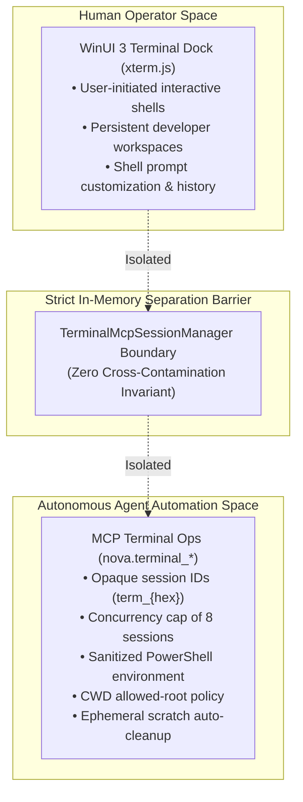

# Agent Headless Sessions & Security Hub

Autonomous AI agents automating development workflows require programmatic shell access to run unit tests, install dependencies, compile assets, and inspect git histories. However, allowing an agent to execute arbitrary CLI commands in an unconstrained environment introduces severe risks: agents can pollute the human operator's interactive shell history, lock up terminal UI tabs, launch processes in sensitive system directories, or exhaust host resources by spawning unbounded concurrent shells.

Nova AI Workspace enforces a strict security and isolation boundary between interactive human dock terminals and headless agent automation.

---

## Architectural Subsystems

Explore the dedicated architecture guides within this domain:

### 1. [Registry Isolation & Concurrency Governance](registry-isolation-and-concurrency/README.md)
* **Physical Registry Separation:** Why agent-owned headless sessions are registered in an isolated in-memory registry (`TerminalMcpSessionManager`) and hidden from the human dock tabs.
* **Opaque Session Handles:** Mapping external integer runner IDs to cryptographic handles (`term_{hex}`) to prevent cross-agent session tampering.
* **Concurrency Quotas & Eviction:** Enforcing a hard ceiling of **8 concurrent agent sessions** per profile, combined with automated eviction of exited sessions.

### 2. [Shell Hygiene & CWD Path Governance](shell-hygiene-and-cwd-policies/README.md)
* **PowerShell Sanitization:** Mandatory unloading of `PSReadLine` (`Remove-Module PSReadLine`) to eliminate multiline escape noise and cursor rewriting artifacts.
* **CWD Allowed-Root Policy:** Restricting initial working directories to registered project workspaces or ephemeral scratch directories, rejecting UNC and sensitive system paths.
* **Hygiene Boundary vs. OS Sandbox:** Understanding that the CWD check is an operational guard, not an OS privilege sandbox (shells run with the operator's user account).
* **Ephemeral Directory Reclamation:** Automatic cleanup of temporary scratch workspaces upon session termination.

---

## Related Documentation

* [Terminal Workspaces Master Hub](../README.md)
* [ConPTY & External Runner Host](../conpty-and-runner/README.md)
* [IPC Named Pipe Wire Protocol](../ipc-wire-protocol/README.md)
* [Command Execution & Sentinels](../command-execution-and-sentinels/README.md)
* [Workspaces, UI Dock & Appearance](../workspaces-and-ui-dock/README.md)
