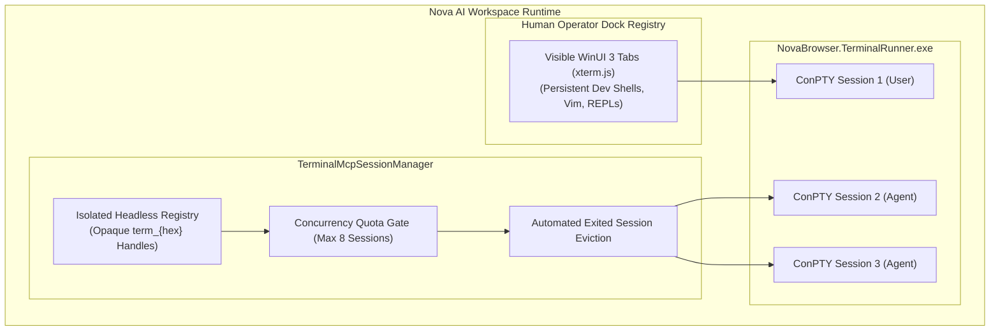
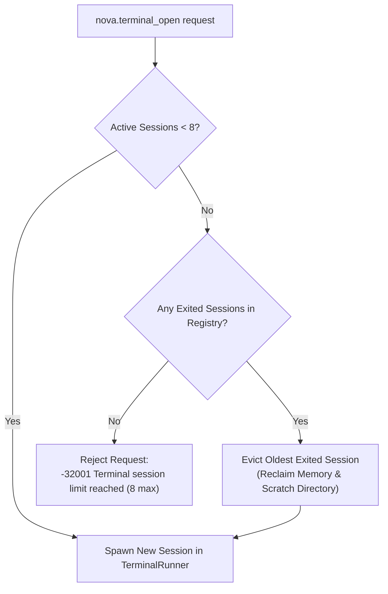

# Terminal Registry Isolation & Concurrency Governance

In an agentic developer workspace, human operators and autonomous AI agents share the same operating system and developer toolchains. However, sharing terminal surfaces directly creates severe operational hazards: an agent might inadvertently inject keystrokes into an operator's active shell, inspect confidential credentials displayed in a user tab, or spawn dozens of background compiler jobs that exhaust host memory.

Nova AI Workspace prevents these conflicts by implementing complete **Registry Isolation**, **Opaque Session Handles**, and **Strict Concurrency Quotas**.



---

## 1. Physical In-Memory Registry Separation

Nova enforces a complete, unbridgeable barrier between human dock terminals and agent automation:

| Dimension | Human Terminal Dock | Headless Agent Sessions |
| :--- | :--- | :--- |
| **Managing Component** | WinUI 3 `TerminalDockService` | `TerminalMcpSessionManager` |
| **Visual Presentation** | Rendered via xterm.js in interactive WebView2 tabs | **Zero visual UI presence** (pure background PTYs) |
| **Session Lifetime** | Persistent across browser sessions; saved in workspaces | Ephemeral; tied to discrete automation task workflows |
| **Agent Visibility** | **Hidden from agents:** MCP tools cannot list, read, or write to dock tabs | Managed programmatically via `nova.terminal_*` tools |
| **Shell Environment** | Interactive profile; `PSReadLine` enabled; custom prompts | Sanitized automation profile; raw byte streams; strict sentinels |

### Security Invariant
An autonomous agent calling [`nova.terminal_list`](../../../../mcp-reference/tools/terminal-ops/nova-terminal-list.md) can *only* observe sessions created through the MCP API. Under no circumstances can an agent inspect, read, or send keystrokes to an interactive shell opened by the human operator.

---

## 2. Opaque Public Session Handles (`term_{hex}`)

Under the hood, `TerminalRunner` identifies sessions using sequential Win32 integer identifiers (`sessionId: 1`, `sessionId: 2`).

If raw integers were exposed over MCP, an agent could guess identifiers, accidentally reference an old session after an index wrap, or collide with concurrent agents:

```csharp
// Internal mapping in TerminalMcpSessionManager
string publicId = $"term_{Guid.NewGuid().ToString("N")[..8]}";
_agentSessions[publicId] = new AgentSessionEntry
{
    PublicId = publicId,
    RunnerSessionId = runnerSessionId,
    CreatedAtUtc = DateTimeOffset.UtcNow,
    WorkingDirectory = resolvedCwd
};
```

* **Cryptographic Opaque Handles:** Agents receive handles formatted as `term_{8-hex}` (e.g., `term_7f3b89a2`).
* **Session Integrity:** All subsequent tool calls ([`nova.terminal_run_command`](../../../../mcp-reference/tools/terminal-ops/nova-terminal-run-command.md), [`nova.terminal_write`](../../../../mcp-reference/tools/terminal-ops/nova-terminal-write.md), [`nova.terminal_close`](../../../../mcp-reference/tools/terminal-ops/nova-terminal-close.md)) require this exact handle. Invalid or expired handles fail immediately with error `-32004 Session Not Found`.

---

## 3. Concurrency Quotas & Automated Eviction

To protect the host machine from resource exhaustion caused by runaway agent loops:

$$\text{ActiveAgentSessions} \le 8$$



1. **Strict Concurrency Ceiling:** Nova caps active agent sessions at **8 concurrent instances**.
2. **Automated Exited Eviction:** When a session exits naturally (e.g., the child shell executed `exit`), its record remains temporarily available so the agent can inspect final exit codes via [`nova.terminal_get_state`](../../../../mcp-reference/tools/terminal-ops/nova-terminal-get-state.md).
3. **Smart Recycling:** If the 8-session limit is reached and a new session is requested, Nova automatically prunes the oldest exited session before evaluating the rejection gate. If all 8 sessions are actively running, the request is rejected with clear remediation guidance.

---

## 4. Related Documentation

* [Agent Headless Sessions Overview](../README.md)
* [Shell Hygiene & CWD Path Governance](../shell-hygiene-and-cwd-policies/README.md)
* [Terminal Open Tool Reference](../../../../mcp-reference/tools/terminal-ops/nova-terminal-open.md)
* [Terminal List Tool Reference](../../../../mcp-reference/tools/terminal-ops/nova-terminal-list.md)
