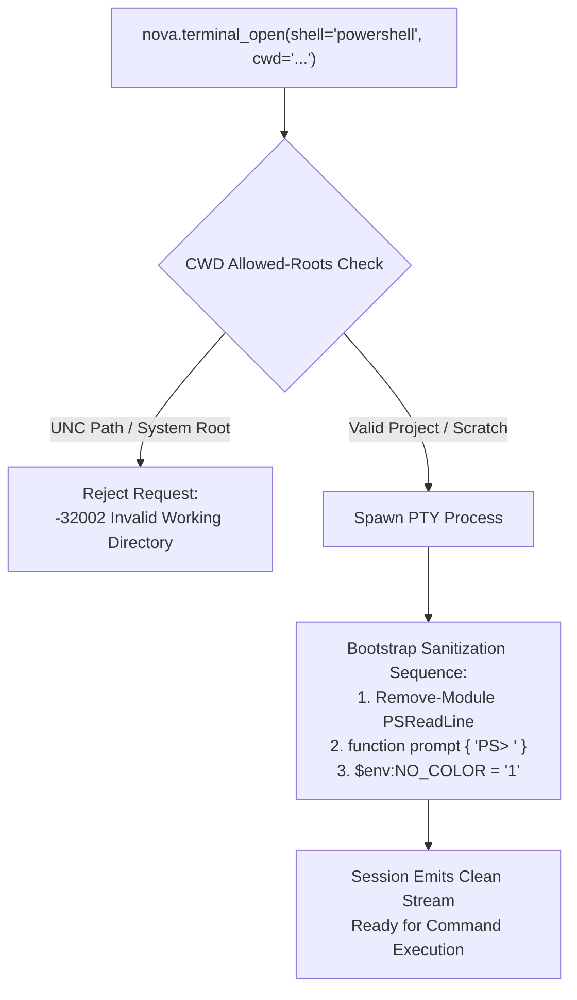
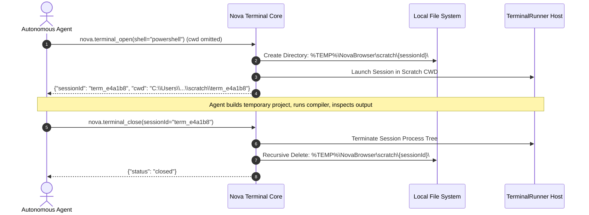

# Shell Hygiene, CWD Path Policies & Ephemeral Reclamation

PowerShell is the default shell for Windows-based terminal automation. While PowerShell provides powerful scripting capabilities, interactive shells include user-friendly modules (such as syntax highlighting, multiline editing, and auto-suggestions) that generate dense streams of ANSI cursor movement sequences. When consumed by AI agents or parsed by automated tools, these sequences cause severe prompt corruption and parsing failures.

Nova AI Workspace enforces **PowerShell Environment Sanitization**, **Working Directory (CWD) Path Governance**, and **Automated Scratch Workspace Reclamation**.



---

## 1. PowerShell Environment Sanitization

Interactive PowerShell sessions automatically load `PSReadLine`, an advanced command-line editing module.

### The Escape Sequence Corruption Problem
When `PSReadLine` is active, every keystroke, suggestion, and completion generates complex ANSI/VT escape sequences:
* `\x1b[?25l` (hide cursor)
* `\x1b[12;34H` (reposition cursor to previous line)
* `\x1b[38;2;...m` (24-bit TrueColor syntax highlighting)
* `\x1b[K` (clear line tail)

While a human eye watching an xterm.js terminal sees smooth formatting, an AI model reading raw output receives an unreadable jumble of overlapping escape bytes, frequently hallucinating command failures.

### Nova's Sanitization Bootstrap
Immediately upon creating an agent-owned PowerShell session, Nova injects an automated sanitization sequence before returning the session handle to the caller:

```powershell
Remove-Module -Name PSReadLine -ErrorAction SilentlyContinue;
function prompt { "PS> " };
$env:NO_COLOR = "1";
Clear-Host;
```

1. **`Remove-Module PSReadLine`:** Reverts PowerShell to standard raw stream input/output, completely eliminating cursor repositioning and phantom formatting characters.
2. **Deterministic Prompt (`PS> `):** Replaces verbose, multi-line, or custom Git-status prompts with a minimal, single-line prompt.
3. **`NO_COLOR=1` Injection:** Advises standard CLI tools (such as `ripgrep`, `cargo`, and `npm`) to omit ANSI color codes, saving hundreds of context tokens.

---

## 2. Working Directory (CWD) Allowed-Root Policy

To prevent agents from executing commands in sensitive operating system directories, Nova validates requested initial directories against an allowed-roots policy:

| Path Category | Policy Verdict | Rationale & Behavioral Enforcement |
| :--- | :---: | :--- |
| **Registered Project Workspaces** | **Allowed** | Paths listed in `terminal-workspaces.json`. |
| **User Profile Directory** | **Allowed** | Paths under `%USERPROFILE%` (e.g., `C:\Users\Username\Projects`). |
| **Nova Ephemeral Scratch** | **Allowed** | Temporary run folders in `%TEMP%\NovaBrowser\scratch\`. |
| **UNC Network Paths (`\\server\share`)** | **Strictly Rejected** | Blocked to prevent NTLM reflection and network relay attacks. |
| **Windows System Roots** | **Strictly Rejected** | `C:\Windows`, `C:\Windows\System32`, and root drives (`C:\`) are rejected. |

### Operational Hygiene vs. OS Security Sandbox
> [!IMPORTANT]
> The CWD path check is an **operational hygiene boundary**, not an impenetrable OS privilege sandbox. The child shell executes with the standard Windows security token of the logged-in user. The policy exists to prevent accidental mistakes (such as running `git clean -fdx` or `npm install` inside system directories), not to restrict malicious human adversaries.

---

## 3. Ephemeral Scratch Workspace Reclamation

When an agent needs to execute a quick diagnostic script, compile a temporary snippet, or inspect a downloaded archive without binding to an existing project:



* **Zero Disk Bloat:** Scratch directories are marked for automatic deletion. When the session is closed via [`nova.terminal_close`](../../../../mcp-reference/tools/terminal-ops/nova-terminal-close.md), Nova recursively purges the temporary workspace from disk.

---

## 4. Related Documentation

* [Agent Headless Sessions Overview](../README.md)
* [Registry Isolation & Concurrency Governance](../registry-isolation-and-concurrency/README.md)
* [Command Execution & Sentinels](../../command-execution-and-sentinels/README.md)
* [Terminal Close Tool Reference](../../../../mcp-reference/tools/terminal-ops/nova-terminal-close.md)
