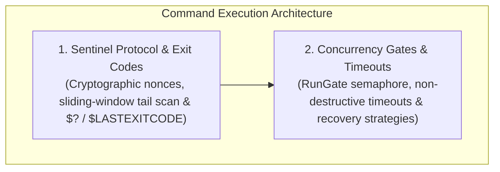

# Command Execution & Sentinel Protocol Hub

Executing commands inside a continuous, interactive Pseudo Console (ConPTY) presents a fundamental protocol challenge: in a persistent terminal session, the process does not terminate when a single command finishes. Instead, the shell prints its prompt and waits for the next keystroke.

Without an explicit signaling mechanism, an automated caller cannot know:
1. When the command completed.
2. What the numeric exit code was.
3. Where the command's stdout ends and the next shell prompt begins.

Nova AI Workspace solves this with a robust **Cryptographic Nonce Sentinel Protocol**, **High-Efficiency Sliding-Window Tail Scanning**, and the **`RunGate` Concurrency Semaphore**.

---

## Architectural Subsystems

Explore the dedicated architecture guides within this domain:

### 1. [Sentinel Detection & Exit Code Resolution](sentinel-detection-and-exit-codes/README.md)
* **The Nonce Sentinel Pattern:** Appending a unique, random sentinel marker (`NOVAEXIT_{nonce}_{code}`) to each command line.
* **Sliding-Window Tail Scanning:** Scanning incoming byte chunks with a 256-byte overlap margin to guarantee that sentinel strings spanning across TCP/pipe packet boundaries are never missed.
* **PowerShell Exit Code Disambiguation:** Harmonizing native Windows executable exit codes (`$LASTEXITCODE`) and PowerShell cmdlet success booleans (`$?`) into a clean integer exit code.

### 2. [Concurrency Gates & Non-Destructive Timeouts](concurrency-gate-and-timeouts/README.md)
* **The `RunGate` Semaphore:** Restricting sessions to exactly one in-flight command at a time to prevent interleaved stdout and race conditions.
* **Non-Destructive Timeouts:** Guaranteeing that when an execution timeout expires, Nova halts waiting and returns partial output *without killing the underlying PTY session*.
* **Interactive Recovery:** Sending control signals (`Ctrl+C`, `Enter`) or inspecting live state via [`nova.terminal_read`](../../../mcp-reference/tools/terminal-ops/nova-terminal-read.md) after a timeout occurs.

---

## Related Documentation

* [Terminal Workspaces Master Hub](../README.md)
* [ConPTY & External Runner Host](../conpty-and-runner/README.md)
* [IPC Named Pipe Wire Protocol](../ipc-wire-protocol/README.md)
* [Agent Headless Sessions & Security](../agent-sessions-and-security/README.md)
* [Terminal Run Command Tool Reference](../../../mcp-reference/tools/terminal-ops/nova-terminal-run-command.md)
