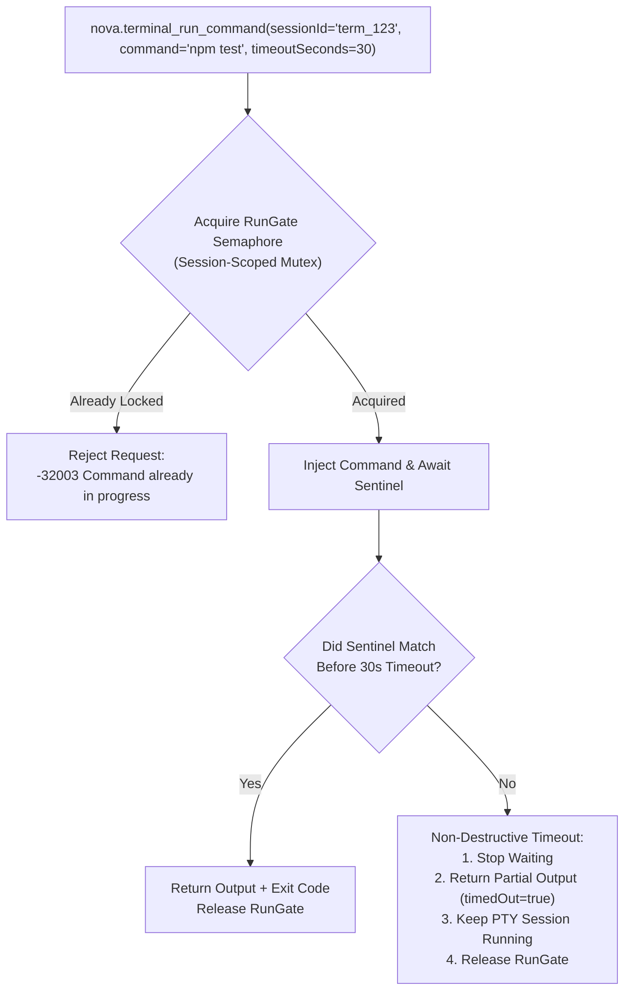
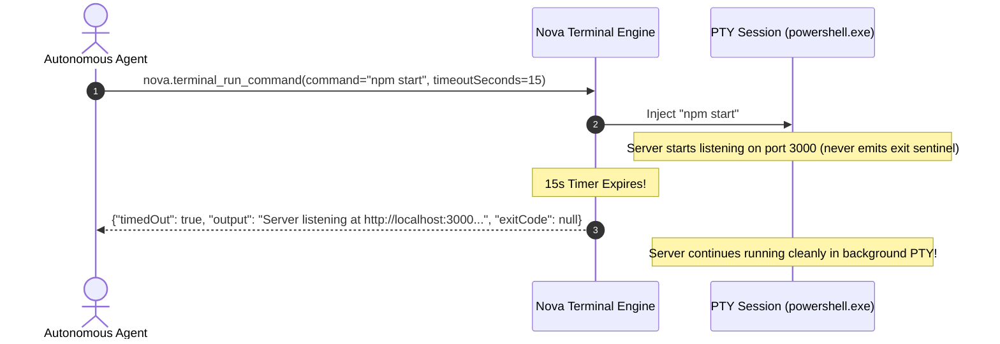

# Terminal Concurrency Gates & Non-Destructive Timeouts

Executing commands in interactive pseudo consoles requires strict serialization. If two threads or agents attempt to run commands in the same session simultaneously, keystrokes and output streams become hopelessly interleaved. Furthermore, when long-running build processes exceed timeouts, blindly killing the session discards active shell environments and uncommitted state.

Nova AI Workspace prevents concurrency collisions via the **`RunGate` Semaphore** and protects active sessions using **Non-Destructive Timeouts**.



---

## 1. The `RunGate` Concurrency Semaphore

Every terminal session entry in `TerminalMcpSessionManager` contains a dedicated asynchronous lock:

```csharp
private readonly SemaphoreSlim _runGate = new SemaphoreSlim(1, 1);
```

### Serialization Invariant
* **Single Command per Session:** An interactive PTY shell cannot execute two commands in parallel. Attempting to issue a second `nova.terminal_run_command` while an earlier command is in flight fails immediately.
* **Non-Blocking Rejection:** Rather than blocking the caller indefinitely in an unbounded queue, Nova returns an immediate protocol error: `-32003 Command In Progress`.
* **Parallel Workflows:** If an agent needs to execute commands in parallel, it should call [`nova.terminal_open`](../../../../mcp-reference/tools/terminal-ops/nova-terminal-open.md) to provision a second independent terminal session.

---

## 2. Non-Destructive Timeouts

When a command takes longer than the configured timeout window (`timeoutSeconds`, default 60s):



### The Architectural Invariant
> [!IMPORTANT]
> **A command timeout never closes or kills the session.**
> Nova terminates its internal wait loop and returns whatever output was collected up to the timeout timestamp, setting `timedOut: true`. The underlying shell and any background processes continue executing undisturbed.

### Why Non-Destructive Timeouts Matter
1. **Background Service Launches:** Development servers (such as `npm run dev`, `vite`, or `flask run`) do not terminate; they run continuously. Non-destructive timeouts allow an agent to verify that the server started successfully and then continue its workflow while leaving the server alive.
2. **Interactive Prompts:** If a command pauses waiting for user input (`Do you want to continue? [Y/n]`), a destructive timeout would kill the setup. A non-destructive timeout allows the agent to observe the prompt in the partial output and send the answering keystroke via [`nova.terminal_write`](../../../../mcp-reference/tools/terminal-ops/nova-terminal-write.md).

---

## 3. Post-Timeout Interactive Recovery

When an agent receives `timedOut: true`, it can choose between three recovery strategies:

1. **Cancel the Stuck Command:**
   Send a `Ctrl+C` interrupt signal using [`nova.terminal_send_key`](../../../../mcp-reference/tools/terminal-ops/nova-terminal-send-key.md):
   ```json
   {
     "name": "nova.terminal_send_key",
     "arguments": { "sessionId": "term_123", "key": "Ctrl+C" }
   }
   ```
2. **Answer an Interactive Prompt:**
   Inject text without appending a newline using [`nova.terminal_write`](../../../../mcp-reference/tools/terminal-ops/nova-terminal-write.md):
   ```json
   {
     "name": "nova.terminal_write",
     "arguments": { "sessionId": "term_123", "data": "yes\n" }
   }
   ```
3. **Inspect Streaming Progress:**
   Read new output bytes asynchronously using [`nova.terminal_read`](../../../../mcp-reference/tools/terminal-ops/nova-terminal-read.md).

---

## 4. Related Documentation

* [Command Execution Overview](../README.md)
* [Nonce Sentinel Detection & Exit Codes](../sentinel-detection-and-exit-codes/README.md)
* [Terminal Write Tool Reference](../../../../mcp-reference/tools/terminal-ops/nova-terminal-write.md)
* [Terminal Send Key Tool Reference](../../../../mcp-reference/tools/terminal-ops/nova-terminal-send-key.md)
