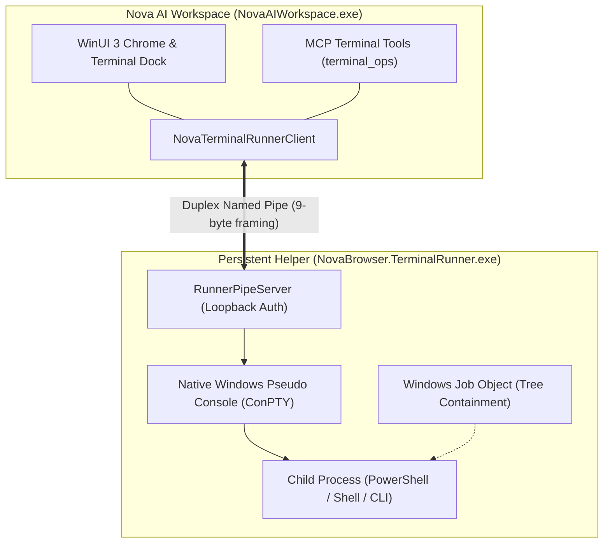

# ConPTY & External Runner Host Hub

Windows command-line execution in modern AI agent environments requires full terminal emulation, VT/ANSI escape sequence fidelity, and process crash resilience. Flat subprocess spawning (`Process.Start` or `child_process.exec`) cannot handle interactive prompts, progress indicators, or curses-like interfaces, and drops all child processes if the host browser reloads or crashes.

Nova AI Workspace decouples terminal execution from the browser process by hosting console sessions inside an external, persistent helper process: **`NovaBrowser.TerminalRunner.exe`**, powered by the native Windows Pseudo Console (**ConPTY**).

---

## Architectural Subsystems

Explore the dedicated architecture guides within this domain:

### 1. [Process Lifecycle & Job Object Containment](process-lifecycle-and-job-objects/README.md)
* **ConPTY Setup & Win32 API Lifecycles:** Creation of pseudo console handles via `CreatePseudoConsole`, handle inheritance invariants, and the TTY console handle requirement (`AllocConsole` / `AttachConsole`).
* **Windows Job Object Containment:** Guaranteeing that child shells, sub-processes, and compiler workers are grouped within a native Job Object with `JOB_OBJECT_LIMIT_KILL_ON_JOB_CLOSE`.
* **Zero Orphan Invariant:** Ensuring that when a terminal session is explicitly closed, its entire process tree is terminated without leaving orphaned background workers.

### 2. [Identity Hashing, Lifecycle & Acceptance Testing](identity-hashing-and-reconciliation/README.md)
* **Deterministic Profile Identity:** Hashing the browser base directory, user logon SID, and integrity level to compute unique, profile-scoped pipe names (`novabrowser-terminal-runner-{profileId}`).
* **Loopback Security:** Enforcing OS-level security via `PipeOptions.CurrentUserOnly` and a 256-bit cryptographically random capability token.
* **Runner Lifecycle Modes:** The 10-second idle shutdown timer, 24-hour orphan session safety timer, and browser lifetime synchronization.
* **Dual-Stage Acceptance Gate:** Automated validation via `NovaBrowser.TerminalRunner.exe --self-test` before client connections are permitted.

---

## Related Documentation

* [Terminal Workspaces Master Hub](../README.md)
* [IPC Named Pipe Wire Protocol](../ipc-wire-protocol/README.md)
* [Agent Headless Sessions & Security](../agent-sessions-and-security/README.md)
* [Command Execution & Sentinels](../command-execution-and-sentinels/README.md)
* [Workspaces, UI Dock & Appearance](../workspaces-and-ui-dock/README.md)
