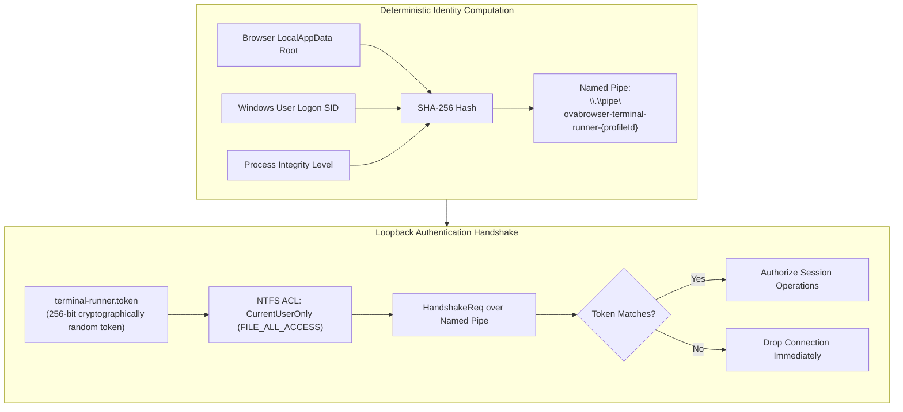
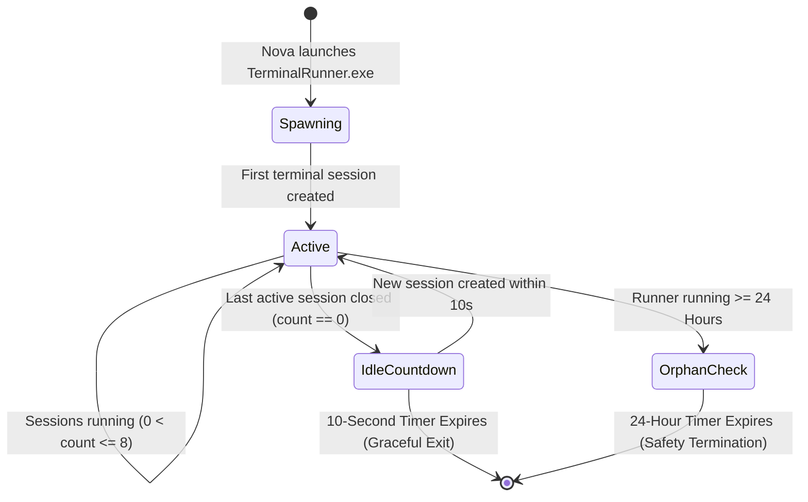

# Identity Hashing, Runner Lifecycles & Acceptance Testing

When decoupling terminal execution into an external helper process (`NovaBrowser.TerminalRunner.exe`), the system must guarantee strict cross-user isolation, deterministic pipe binding, and robust lifecycle management. The runner must not run indefinitely when unused, nor should it terminate prematurely while long-running background tasks (like compilation or local test servers) are executing.

Nova AI Workspace enforces deterministic profile hashing, cryptographic loopback tokens, three-tiered lifecycle timers, and automated self-test verification.



---

## 1. Deterministic Profile Identity & Named Pipe Naming

To allow multiple browser profiles or parallel test instances to run without pipe collisions, `TerminalRunner` computes a deterministic 16-character hexadecimal profile hash:

$$\text{ProfileId} = \text{Truncate}_{16}\Big(\text{SHA256}\big(\text{NormalizedBaseDir} + \text{LogonSID} + \text{IntegrityLevel}\big)\Big)$$

* **Pipe Naming:** The pipe is registered under `\\.\pipe\novabrowser-terminal-runner-{profileId}`.
* **Operating System Enforcement (`CurrentUserOnly`):**
  The pipe server is created using `PipeOptions.CurrentUserOnly`. Windows kernel security checks prevent any process running under a different user account or logon session from opening or writing to the pipe, blocking cross-user local privilege escalation attacks.

---

## 2. 256-Bit Loopback Capability Token

In addition to OS-level pipe ACLs, Nova requires a cryptographic capability token before any session command is processed:

```json
{
  "channel": 1,
  "type": "HandshakeReq",
  "clientPid": 14280,
  "token": "4f8a1c9e2b7d3a5e8f0a2c4e6b8d0a2c4e6b8d0a2c4e6b8d0a2c4e6b8d0a2c4e"
}
```

1. **Token Generation:** When `TerminalRunner` launches, it generates 32 bytes of cryptographically secure random data (`RandomNumberGenerator.GetBytes(32)`).
2. **Restricted Storage:** The token is written to `%LOCALAPPDATA%\NovaBrowser\terminal-runner.token` (or the isolated test profile root) with an explicit Windows security descriptor granting access *only* to the current user's security identifier.
3. **Handshake Verification:** Upon connecting, `NovaAIWorkspace.exe` reads the token from disk and submits it in the initial `HandshakeReq`. If the token is invalid or missing, the runner disconnects the pipe immediately.

---

## 3. The Three Runner Lifecycle Timers

`TerminalRunner` operates as an on-demand process, balancing responsiveness with system memory conservation:



1. **Active Execution Mode:**
   While one or more terminal sessions are open, the runner remains active indefinitely. Background build processes and servers run without interruption.
2. **10-Second Idle Shutdown:**
   When the last session closes, the runner arms a **10-second countdown**. If a new session is requested within 10 seconds (e.g., during rapid tool execution), the runner remains warm. If no session is opened before the countdown expires, the process shuts down cleanly to release host memory.
3. **24-Hour Orphan Safety Timer:**
   If the parent browser process crashes or is forcefully terminated, active sessions continue running. However, to prevent forgotten background scripts from consuming system resources permanently, `TerminalRunner` enforces a hard **24-hour maximum lifetime**. After 24 continuous hours, all remaining sessions are gracefully shut down and the process exits.

---

## 4. Dual-Stage Acceptance Gate (`--self-test`)

Before Nova attempts to dispatch commands or open terminal docks, it verifies runner functionality using its built-in automated self-test:

```powershell
dist\NovaBrowser.TerminalRunner.exe --self-test
```

### Self-Test Validation Steps
* **Phase 1: Win32 Handle Check:** Verifies that a valid console handle can be acquired or allocated via `AllocConsole()`.
* **Phase 2: ConPTY Initialization:** Creates a temporary 80x24 pseudo console and asserts that `CreatePseudoConsole` returns `S_OK`.
* **Phase 3: Stream Roundtrip:** Writes an echo sequence to the PTY input stream and verifies byte reception on the output pipe.
* **Phase 4: Clean Teardown:** Closes the pseudo console and asserts that handles are released without memory leaks or access violations.

If the self-test fails, Nova falls back to diagnostic error reporting on the Tool Observation Bus (TOB), preventing broken terminal sessions from crashing agent workflows.

---

## 5. Related Documentation

* [ConPTY & External Runner Host Overview](../README.md)
* [Process Lifecycle & Job Object Containment](../process-lifecycle-and-job-objects/README.md)
* [IPC Named Pipe Wire Protocol](../../ipc-wire-protocol/README.md)
* [TerminalRunner Component Reference](../../../../components/terminal-runner.md)
