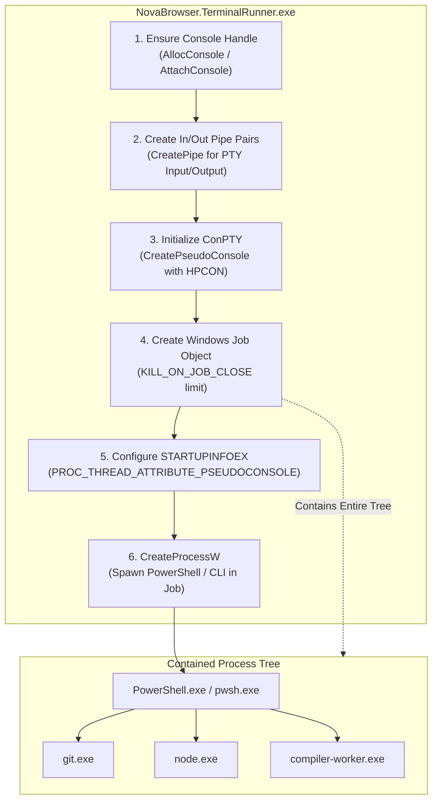
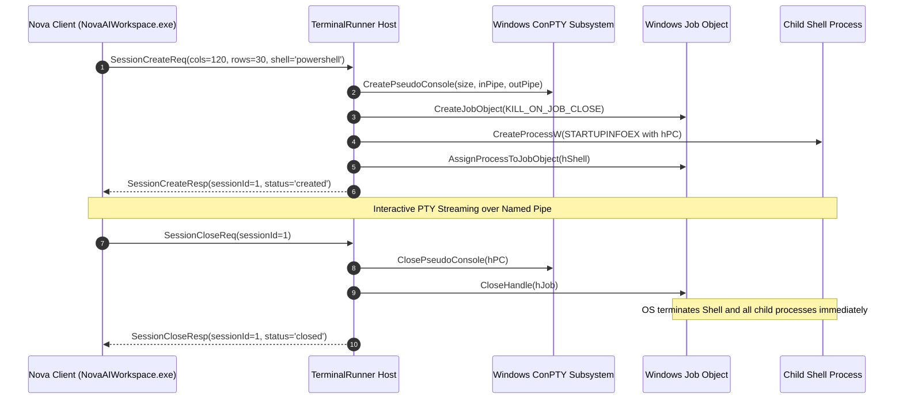

# ConPTY Setup, Win32 Lifecycle & Job Object Containment

Executing terminal commands in modern AI environments requires the full interactive capabilities of a real terminal: color escape sequences, cursor addressing, dynamic progress bars, and prompt interaction. Naive process spawning (`Process.Start`) cannot satisfy these requirements because Windows console applications behave differently when disconnected from a valid Windows Pseudo Console (**ConPTY**).

Nova AI Workspace's external runner process (`NovaBrowser.TerminalRunner.exe`) initializes native ConPTY instances and groups every spawned shell inside a Windows Job Object.



---

## 1. ConPTY Setup & Win32 API Lifecycles

To provide complete virtual terminal fidelity, `TerminalRunner` invokes Windows pseudo console APIs:

```csharp
// 1. Create pipes for PTY input and output
CreatePipe(out IntPtr hPipeInRead, out IntPtr hPipeInWrite, IntPtr.Zero, 0);
CreatePipe(out IntPtr hPipeOutRead, out IntPtr hPipeOutWrite, IntPtr.Zero, 0);

// 2. Initialize the pseudo console with the requested window dimensions
COORD size = new COORD { X = (short)cols, Y = (short)rows };
int hr = CreatePseudoConsole(size, hPipeInRead, hPipeOutWrite, 0, out IntPtr hPC);
```

### The TTY Console Handle Requirement
A subtle, critical invariant of the Windows ConPTY subsystem:
* **The Invariant:** The calling process *must possess an active Win32 console handle* before calling `CreatePseudoConsole`. If a purely GUI or detached background process invokes `CreatePseudoConsole` without a console attached, the API fails with `ERROR_INVALID_HANDLE` (`0x6`).
* **Nova's Architecture:** `TerminalRunner` checks its console status on boot. If no console handle is present, it explicitly attaches via `AttachConsole(ATTACH_PARENT_PROCESS)` or allocates an invisible console buffer via `AllocConsole()`. This ensures consistent PTY creation whether launched from an interactive terminal, WinUI 3, or a background Windows service.

### Handle Inheritance and `STARTUPINFOEX`
When launching child processes, handle inheritance must be strictly limited:
* The shell process must inherit *only* the pseudo console reference, not arbitrary host pipe handles.
* Nova uses `InitializeProcThreadAttributeList` with `PROC_THREAD_ATTRIBUTE_PSEUDOCONSOLE`, passing `hPC`.
* The child process is created via `CreateProcessW` with `EXTENDED_STARTUPINFO_PRESENT`, attaching its standard input, output, and error streams directly to the ConPTY buffer.

---

## 2. Windows Job Object Tree Containment

In development automation, shells spawn complex trees of child processes: a PowerShell script runs `npm install`, which spawns `node.exe`, which spawns native C++ compiler tools (`cl.exe`).

If a terminal session is closed or times out, terminating only the top-level shell process (`powershell.exe`) leaves all child processes running as orphaned background zombies. These orphan processes consume memory, hold locks on files, and prevent clean test runs.

### The Job Object Shield
Nova encloses every runner session inside an isolated Windows Job Object:

```csharp
IntPtr hJob = CreateJobObject(IntPtr.Zero, null);
JOBOBJECT_EXTENDED_LIMIT_INFORMATION info = new JOBOBJECT_EXTENDED_LIMIT_INFORMATION
{
    BasicLimitInformation = new JOBOBJECT_BASIC_LIMIT_INFORMATION
    {
        LimitFlags = JOB_OBJECT_LIMIT_KILL_ON_JOB_CLOSE | JOB_OBJECT_LIMIT_SILENT_BREAKAWAY_OK
    }
};
SetInformationJobObject(hJob, JobObjectExtendedLimitInformation, ref info, Marshal.SizeOf(info));
AssignProcessToJobObject(hJob, processHandle);
```

### Safety Invariants
1. **`JOB_OBJECT_LIMIT_KILL_ON_JOB_CLOSE`:**
   When the terminal session closes (or when `TerminalRunner` terminates), Windows automatically and unconditionally terminates every process assigned to the Job Object. No orphaned compiler, node, or python processes can survive.
2. **`JOB_OBJECT_LIMIT_SILENT_BREAKAWAY_OK`:**
   Allows designated processes (such as detached background daemons explicitly launched by the user) to break away if configured, while keeping ordinary build tools contained.

---

## 3. Sequence: Session Creation to Termination



---

## 4. Related Documentation

* [ConPTY & External Runner Host Overview](../README.md)
* [Identity Hashing, Lifecycle & Acceptance Testing](../identity-hashing-and-reconciliation/README.md)
* [IPC Named Pipe Wire Protocol](../../ipc-wire-protocol/README.md)
* [Agent Headless Sessions & Security](../../agent-sessions-and-security/README.md)
