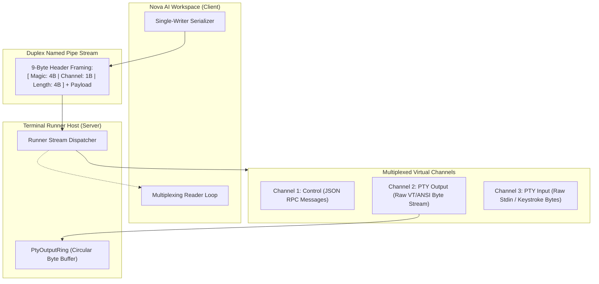

# IPC Named Pipe Wire Protocol Hub

Communication between Nova AI Workspace (`NovaAIWorkspace.exe`) and the console host (`NovaBrowser.TerminalRunner.exe`) operates over high-performance local Windows named pipes. Because terminal sessions stream raw VT/ANSI escape bytes, binary keystrokes, and structured JSON control messages simultaneously, the IPC transport must prevent stream tearing, message interleaving, and thread deadlocks.

Nova's **Named Pipe Wire Protocol** defines a strict, 9-byte framed binary multiplexing protocol combined with an atomic single-writer architecture and circular memory buffers.

---

## Architectural Subsystems

Explore the dedicated architecture guides within this domain:

### 1. [Framing, Channel Multiplexing & Ring Buffers](framing-and-channel-multiplexing/README.md)
* **The 9-Byte Binary Header:** Structure of the magic header (`0x4E 0x54 0x50 0x59` = "NTPY"), channel identifier byte (`1` = Control, `2` = PtyOutput, `3` = PtyInput), and 32-bit little-endian payload length.
* **Atomic Pre-Composed Writes:** Buffer pooling and single-call `WriteFile` / `Stream.Write` guarantees preventing partial-frame interleaving across concurrent threads.
* **Dual-Channel Single-Writer Architecture:** Dedicated serialization mutexes ensuring that output streams from multiple active terminal sessions do not corrupt the pipe.
* **`PtyOutputRing` Circular Memory Buffer:** Zero-allocation ring buffer storing recent terminal scrollback bytes, enabling fast historical tail reads and snapshotting without high GC pressure.

### 2. [Control Frames & Handshake Protocol](control-frames-and-handshake/README.md)
* **JSON Control Channel Schemas:** Type definitions for all Channel 1 frames: `HandshakeReq`, `HandshakeResp`, `SessionCreateReq`, `SessionCreateResp`, `SessionCloseReq`, `SessionCloseResp`, `SessionResizeReq`, and `SessionExitedEvent`.
* **Synchronous Sink Registration:** The mandatory lifecycle invariant requiring the client to register its output listener before launching child processes, eliminating race conditions where initial startup logs are lost.
* **Exit Code Propagation:** Capturing native Windows process termination codes and broadcasting `SessionExitedEvent` frames to subscribed listeners.

---

## Related Documentation

* [Terminal Workspaces Master Hub](../README.md)
* [ConPTY & External Runner Host](../conpty-and-runner/README.md)
* [Agent Headless Sessions & Security](../agent-sessions-and-security/README.md)
* [Command Execution & Sentinels](../command-execution-and-sentinels/README.md)
* [Workspaces, UI Dock & Appearance](../workspaces-and-ui-dock/README.md)
